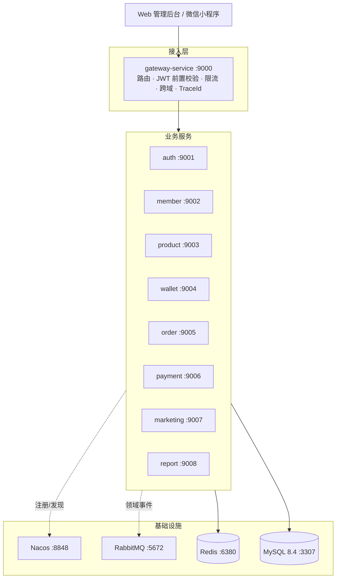

# TeaClub · 连锁奶茶店会员与储值营销管理系统


> 一个品牌 · 多家门店 · 统一会员身份
> Web 管理后台 + 微信小程序 · 前后端分离 · Spring Cloud 微服务

TeaClub 是一套面向连锁奶茶品牌的会员与储值营销管理系统，覆盖 **总部统一管理 → 门店经营 → 会员消费** 三层业务闭环。项目从单体架构完整迁移到微服务架构，包含会员储值、订单交易、支付退款、营销体系、经营分析等核心模块，配套完整的端到端测试与设计文档。

---

## ✨ 功能特性

| 能力域 | 内容 |
| --- | --- |
| 多门店组织 | 总部/门店两级组织，员工门店授权，数据权限后端强制校验 |
| 会员储值 | 实付余额与赠送余额**分列记账**，每次变动生成不可篡改的资金流水 |
| 赠送金过期 | 按充值方案配置的有效期，定时任务自动核销到期赠送金 |
| 订单交易 | 小程序下单 + 收银台下单，金额服务端重算，订单状态机约束 |
| 支付与退款 | 微信支付 API v3 适配器 + Mock 适配器；退款按原资金构成原路回冲 |
| 营销体系 | 优惠券、积分、会员等级折扣、充值赠送、签到、8 类营销活动 |
| 经营分析 | 全部指标由真实业务数据聚合，无任何硬编码或随机数 |
| 资金安全 | BIGINT 存分、行锁 + 唯一索引 + 幂等键三重防护、本地消息表 + Outbox 保证最终一致性 |

---

## 🏗️ 系统架构



服务按业务边界拆分，各自拥有独立数据库（逻辑隔离），通过 OpenFeign 同步调用、RabbitMQ 异步解耦。网关只做路由与认证，各服务仍自行完成功能权限与数据权限校验。

| 服务 | 端口 | 数据库 | 职责 |
| --- | :---: | --- | --- |
| gateway-service | 9000 | — | 统一网关 |
| auth-service | 9001 | iam_db | 用户/角色/权限/品牌/门店 |
| member-service | 9002 | member_db | 会员档案与等级 |
| product-service | 9003 | product_db | 商品与门店定价 |
| wallet-service | 9004 | wallet_db | 钱包双余额/充值/流水/退款 |
| order-service | 9005 | order_db | 订单与状态机 |
| payment-service | 9006 | payment_db | 支付单/通知/退款 |
| marketing-service | 9007 | marketing_db | 券/积分/活动 |
| report-service | 9008 | report_db | 经营报表（跨库只读） |

---

## 🛠️ 技术栈

**后端**：Java 17 / Spring Boot 3.5.16 / Spring Cloud 2025.0.3 / Spring Cloud Alibaba 2025.0.0.0 / MyBatis-Plus 3.5.18 / MySQL 8.4 / Flyway 11.20.3 / Redis / RabbitMQ / Nacos / JWT (jjwt 0.13.0) / OpenFeign / SpringDoc OpenAPI 2.10.0

**Web 前端**：Vue 3.5 / TypeScript 5.6 / Vite 5.4 / Element Plus 2.8 / Pinia 2.2 / Vue Router 4.4 / ECharts 6.1 / Axios

**小程序**：uni-app (Vue 3 + TypeScript) / Pinia

**部署**：Docker / Docker Compose / Nginx

---

## 📁 项目结构

```
TeaClub/
├── backend/
│   ├── teaclub-cloud/          # 微服务后端（10 个模块）
│   │   ├── common/             # 公共组件（core/web/security/messaging/redis/feign）
│   │   ├── gateway-service/    # 网关
│   │   └── *-service/          # 9 个业务服务
│   └── infrastructure/         # Docker 编排 + 39 个端到端测试脚本
├── frontend/
│   ├── teaclub-admin/          # Vue 3 管理后台
│   └── teaclub-miniprogram/    # uni-app 微信小程序
├── deploy/                     # Nginx 配置与幂等权限 SQL
├── docs/                       # 58 份设计/验收/迁移文档
└── scripts/                    # 早期单体的历史测试脚本
```

---

## 🚀 快速开始

### 环境要求

- JDK 17、Maven 3.9+
- Node.js 20+
- Docker Desktop（含 Compose v2，需启用 WSL2）

### 方式一：Docker Compose 一键启动

```bash
cd backend/infrastructure/docker
cp .env.example .env.docker        # 按需修改其中的密码与密钥
docker compose -f docker-compose.yml -f docker-compose.web.yml \
  --env-file .env.docker up -d --build
```

等待约 60–90 秒后访问：

| 入口 | 地址 | 账号 |
| --- | --- | --- |
| 管理后台 | http://localhost:8080 | `admin` / `TeaClub@123` |
| 网关 API | http://localhost:9000 | Bearer Token |
| Nacos 控制台 | http://localhost:8848/nacos | 默认关闭认证 |
| RabbitMQ 管理台 | http://localhost:15672 | 见 `.env.docker` |

### 方式二：本地开发模式

开发时推荐用 Docker 只跑基础设施，后端在 IDEA、前端在 VS Code 运行：

```bash
# 只启动 MySQL / Redis / Nacos / RabbitMQ
cd backend/infrastructure/docker
docker compose -f docker-compose.yml --env-file .env.docker up -d mysql redis nacos rabbitmq
```

- **后端**：IDEA 打开 `backend/teaclub-cloud/pom.xml`，按 auth → 业务服务 → gateway 顺序启动
- **前端**：`cd frontend/teaclub-admin && npm install && npm run dev`，访问 `http://localhost:5173`
- **小程序**：微信开发者工具导入 `frontend/teaclub-miniprogram`，AppID 选测试号

> 各服务运行所需的环境变量可参考 `backend/infrastructure/docker/.env.example`。数据库迁移由 Flyway 在服务启动时自动执行。

---

## 🧪 测试

```bash
cd backend/infrastructure/test
node run-regression.mjs
```

一条命令运行 19 个端到端脚本、255 项断言，覆盖资金闭环、并发扣款、退款冲正、消息可靠性、营销活动、报表与权限隔离。

---

## 📚 文档

设计、架构、数据库、接口、测试与迁移文档全部位于 [`docs/`](docs/)，包括：

- 系统架构设计、数据库设计（含完整 DDL 与统计口径）
- 核心业务规则与资金安全设计
- 接口规范、错误码与安全设计
- 角色权限矩阵、测试报告、部署手册
- 单体到微服务的分步迁移记录

---

## ⚠️ 已知限制（如实声明）

1. **支付为 Mock 实现**：项目不包含真实微信商户资质与证书，支付流程通过 Mock 适配器验证；`WechatPayV3Provider` 保留骨架但未联调。
2. **小程序未真机验证**：无正式 AppID，以编译通过为准。
3. **OSS 为公共读配置**：商品图片使用阿里云 OSS 公共读地址；生产环境应改用私有读 + 签名或 CDN。
4. **本地环境依赖 Docker**：MySQL/Redis/Nacos/RabbitMQ 均以容器方式提供；本机直跑需自行准备这些中间件。

以上限制不会以"已完成/已通过"的方式表述。

---

## 📄 许可

本项目为**课程设计与软件工程展示用途**开源，可自由学习、参考与二次开发。如需用于商业场景，请自行评估支付、资金安全与合规要求。
