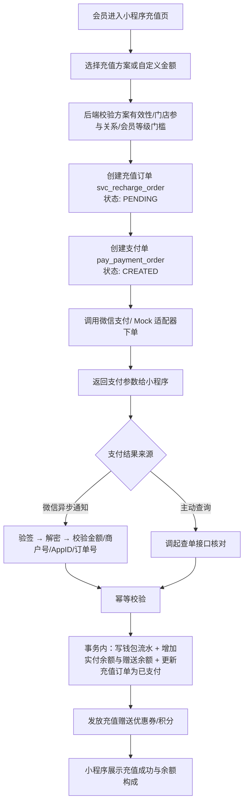
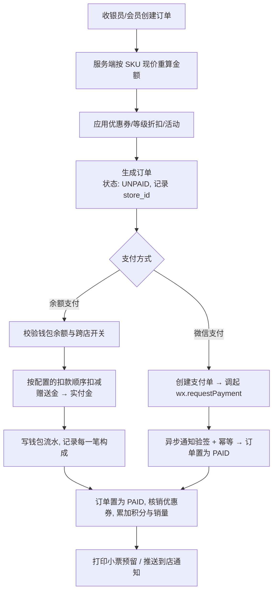
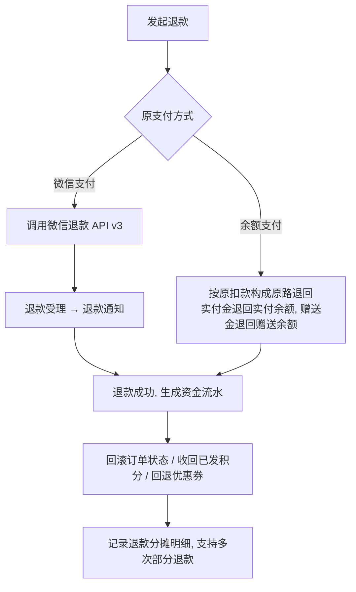

# TeaClub 需求分析与功能清单

| 项目 | 内容 |
| --- | --- |
| 项目名称 | TeaClub 连锁奶茶店会员与储值营销管理系统 |
| 文档编号 | TC-DOC-01 |
| 文档版本 | v1.0 |
| 编制日期 | 2026-11-19 |
| 阶段 | 第一阶段：需求与架构 |
| 编写角色 | 产品经理（主）/ 系统架构师（审阅） |
| 状态 | 待评审 |

---

## 1. 项目概述

### 1.1 背景

连锁奶茶品牌在经营中普遍存在 "总部看不清、门店管不住、会员留不下" 三类问题：

1. **总部看不清**：多门店营业数据分散，缺乏统一口径的营业额、充值额、退款额、会员增长统计。
2. **门店管不住**：店长与收银员权限边界模糊，存在越权查看其他门店数据、越权修改价格的风险。
3. **会员留不下**：会员储值、优惠券、积分、等级折扣缺乏闭环，储值金与赠送金混记导致财务对不平账。

TeaClub 以 **"一个品牌 + 多家门店 + 统一会员身份"** 为业务底座，构建会员储值、消费支付、营销触达与经营分析的一体化系统。

### 1.2 项目定位

- **用途**：课程设计 / 软件工程项目展示，同时按真实商业系统工程标准实现。
- **形态**：Web 管理后台（总部 + 门店）+ 微信小程序（会员端）。
- **架构**：前后端分离，模块化单体（Modular Monolith），预留微服务拆分能力。
- **品牌模型**：第一期单品牌多门店；数据模型预留 `brand_id`，为未来多品牌 SaaS 化留出扩展点。

### 1.3 核心价值主张

| 角色 | 核心诉求 | 系统给出的答案 |
| --- | --- | --- |
| 总部管理者 | 全局经营可视、统一策略下发 | 总部看板、门店排行、全品牌营销活动配置 |
| 门店店长 | 管好本店的货、人、单 | 门店工作台、本店报表、本店员工与订单 |
| 收银员 | 开单快、结账准、扣款清 | 收银工作台、钱包支付、余额构成明细 |
| 会员 | 充值划算、消费方便、权益清楚 | 小程序点单、在线充值、优惠券与积分 |
| 财务 | 账实相符、可追溯 | 储值双余额分账、资金流水不可篡改、对账 |

---

## 2. 利益相关者与角色定义

### 2.1 后台角色（RBAC）

| 角色编码 | 角色名称 | 数据范围 | 核心能力 |
| --- | --- | --- | --- |
| `SUPER_ADMIN` | 超级管理员 | 全品牌 | 全部功能，含角色权限配置 |
| `HQ_ADMIN` | 总部管理员 | 全品牌 | 门店管理、员工管理、商品与营销配置、全局报表 |
| `HQ_FINANCE` | 总部财务 | 全品牌（只读财务） | 充值/退款/对账查询、异常储值处理，不可改商品与营销 |
| `HQ_MARKETING` | 总部运营 | 全品牌（营销域） | 优惠券、活动、积分规则配置 |
| `STORE_MANAGER` | 店长 | 授权门店（可多店） | 本店员工、订单、商品上下架、本店报表、退款审批 |
| `CASHIER` | 收银员 | 授权门店（单店为主） | 收银工作台、开单、收款、查询本店订单；不可改配置、不可看财务汇总 |
| `STORE_VIEWER` | 门店只读 | 授权门店 | 只读查看看板与订单（用于督导巡店场景） |

> 说明：角色是模板，**门店数据范围由 `sys_user_store` 关联表决定**，与角色解耦。一个店长可被授权多家门店，一个收银员通常只授权单店。权限判定 = 功能权限（角色→权限点） ∩ 数据权限（用户→门店集合）。

### 2.2 会员端角色

| 角色 | 说明 |
| --- | --- |
| 游客 | 可浏览门店与商品，不可下单、不可充值 |
| 注册会员 | 手机号注册，拥有品牌级唯一会员身份 |
| 微信绑定会员 | 绑定微信 openid，可使用小程序支付与消息触达 |

### 2.3 会员身份的关键约束

- 会员属于 **品牌**，不属于任何门店。会员在 A 店充值，可在 B 店消费（是否允许跨店消费由品牌配置 `wallet_cross_store_enabled` 控制）。
- 会员钱包属于 **品牌**，`brand_id + member_id` 唯一。
- 每笔订单、每笔充值、每笔退款 **必须** 记录发生门店 `store_id`，用于门店结算与报表归属。

---

## 3. 业务流程全景

### 3.1 会员储值流程

### 3.2 门店消费流程

### 3.3 退款流程

---

## 4. 功能清单

**优先级说明**：P0 = 第一期必须交付（验收必备）；P1 = 第一期应交付（体现完整性）；P2 = 预留扩展（本期只做设计与占位）。

### 4.1 A. 总部管理后台

| 编号 | 功能 | 端 | 优先级 | 说明 |
| --- | --- | --- | --- | --- |
| A-01 | 管理员登录 | Web | P0 | 账号密码 + JWT；登录失败锁定；登录日志 |
| A-02 | 品牌基础信息 | Web | P0 | 品牌名称、Logo、客服电话、储值规则开关 |
| A-03 | 多门店管理 | Web | P0 | 门店 CRUD、启停用、营业时间、地址经纬度 |
| A-04 | 员工管理 | Web | P0 | 后台账号 CRUD、重置密码、启用禁用、门店授权 |
| A-05 | 角色管理 | Web | P0 | 角色 CRUD、角色与权限点绑定 |
| A-06 | 权限管理 | Web | P0 | 权限点（菜单/按钮/接口）维护、树形展示 |
| A-07 | 门店数据权限 | Web | P0 | 用户-门店授权关系维护；后端强制校验 |
| A-08 | 总部经营看板 | Web | P0 | 今日营业额、订单量、充值额、退款额、新增会员 |
| A-09 | 全门店营业额统计 | Web | P0 | 按日期区间 + 门店维度汇总，支持导出 |
| A-10 | 门店销售排行榜 | Web | P1 | 按营业额/订单量/客单价排序 |
| A-11 | 全品牌会员查询 | Web | P0 | 手机号/等级/标签/状态多条件检索 |
| A-12 | 操作日志审计 | Web | P1 | 记录关键写操作的操作人、IP、耗时、结果 |

### 4.2 B. 门店管理

| 编号 | 功能 | 端 | 优先级 | 说明 |
| --- | --- | --- | --- | --- |
| B-01 | 门店基础信息 | Web | P0 | 店长可维护本店基础信息（受限字段） |
| B-02 | 门店商品管理 | Web | P0 | 从总部商品库选品上架到本店 |
| B-03 | 门店商品价格 | Web | P0 | 门店差异化定价（覆盖总部建议价） |
| B-04 | 门店员工管理 | Web | P0 | 店长管理本店员工，不可跨店 |
| B-05 | 门店订单管理 | Web | P0 | 本店订单列表、详情、取消、退款 |
| B-06 | 门店会员消费查询 | Web | P0 | 查询在本店消费过的会员及其订单 |
| B-07 | 门店充值记录 | Web | P0 | 本店发生的充值订单与流水 |
| B-08 | 门店退款管理 | Web | P0 | 退款申请、审批、执行、结果查询 |
| B-09 | 收银工作台 | Web | P0 | 选品、改数量、选会员、用券、余额/微信收款、小票预览 |
| B-10 | 门店经营报表 | Web | P0 | 本店日/周/月营业额、订单量、客单价、商品销量 |
| B-11 | 库存查看与调整 | Web | P1 | 门店 SKU 库存、盘点调整（生成库存流水） |

### 4.3 C. 会员管理

| 编号 | 功能 | 端 | 优先级 | 说明 |
| --- | --- | --- | --- | --- |
| C-01 | 会员注册 | 小程序 | P0 | 手机号 + 验证码注册（演示环境使用 Mock 短信） |
| C-02 | 会员登录 | 小程序 | P0 | 手机号密码 / 验证码登录，签发会员 JWT |
| C-03 | 会员资料管理 | 小程序 + Web | P0 | 昵称、头像、生日、性别 |
| C-04 | 会员手机号查询 | Web | P0 | 后台按手机号精确/模糊查询 |
| C-05 | 微信身份绑定 | 小程序 | P1 | wx.login → code2session → 绑定 openid/unionid |
| C-06 | 会员等级 | Web + 小程序 | P0 | 等级规则（累计消费/累计充值）、等级折扣 |
| C-07 | 会员消费记录 | Web + 小程序 | P0 | 订单列表与明细 |
| C-08 | 会员充值记录 | Web + 小程序 | P0 | 充值订单与钱包流水 |
| C-09 | 会员积分记录 | Web + 小程序 | P0 | 积分获得/消耗/过期流水 |
| C-10 | 会员标签 | Web | P1 | 标签库 + 会员打标（沉睡、高频、高价值） |
| C-11 | 会员状态管理 | Web | P0 | 正常/冻结，冻结后不可消费 |

### 4.4 D. 储值管理

| 编号 | 功能 | 端 | 优先级 | 说明 |
| --- | --- | --- | --- | --- |
| D-01 | 会员钱包 | 全端 | P0 | 品牌级钱包，实付余额 + 赠送余额分离 |
| D-02 | 充值套餐 | Web + 小程序 | P0 | 面额、赠送额、赠送券、参与门店、有效期 |
| D-03 | 自定义充值金额 | 小程序 | P1 | 在规则区间内自由输入金额 |
| D-04 | 充值赠送金额 | 全端 | P0 | 按方案计算，单独计入赠送余额 |
| D-05 | 储值流水 | 全端 | P0 | 每笔变动一条流水，含变动前后余额 |
| D-06 | 储值消费 | 全端 | P0 | 收银台余额支付，按扣款顺序分摊 |
| D-07 | 储值退款 | Web | P0 | 原路退回，按资金来源分别回冲 |
| D-08 | 赠送余额管理 | Web | P0 | 赠送金有效期、使用范围、过期核销 |
| D-09 | 储值账户查询 | Web + 小程序 | P0 | 余额构成、累计充值、累计消费 |
| D-10 | 储值异常记录 | Web | P1 | 余额与流水不一致、重复通知、超时未决单 |

### 4.5 E. 商品管理

| 编号 | 功能 | 端 | 优先级 | 说明 |
| --- | --- | --- | --- | --- |
| E-01 | 商品分类 | Web | P0 | 树形分类，排序、启停 |
| E-02 | 商品管理 | Web | P0 | SPU 基础信息、描述、状态 |
| E-03 | 商品图片 | Web | P1 | 主图 + 多图，本地/对象存储预留 |
| E-04 | 商品规格 | Web | P0 | SKU（大杯/中杯、冷/热、加料），独立价格 |
| E-05 | 商品价格 | Web | P0 | 总部建议价，SKU 维度 |
| E-06 | 商品库存 | Web | P1 | 门店 SKU 库存与库存流水 |
| E-07 | 门店上下架 | Web | P0 | 门店可选品上下架 |
| E-08 | 门店差异化定价 | Web | P0 | 覆盖门店售价，低于成本价需校验 |
| E-09 | 商品销量统计 | Web | P1 | 按 SKU / 商品 / 门店维度 |

### 4.6 F. 订单管理

| 编号 | 功能 | 端 | 优先级 | 说明 |
| --- | --- | --- | --- | --- |
| F-01 | 小程序下单 | 小程序 | P0 | 选门店 → 选品 → 提交 → 支付 |
| F-02 | 门店收银下单 | Web | P0 | 收银员代客下单 |
| F-03 | 订单查询 | Web + 小程序 | P0 | 多条件分页，受门店数据权限约束 |
| F-04 | 订单详情 | Web + 小程序 | P0 | 明细、优惠分摊、支付与退款记录 |
| F-05 | 订单取消 | Web + 小程序 | P0 | 未支付可取消；已支付走退款 |
| F-06 | 订单支付 | 全端 | P0 | 余额支付 / 微信支付 |
| F-07 | 订单退款 | Web | P0 | 全额/部分退款，多退可累计 |
| F-08 | 订单状态流转 | 后端 | P0 | 状态机约束，禁止非法跳转 |
| F-09 | 订单打印预留 | 后端 | P2 | 打印机适配接口（本期给出接口与 Mock 实现） |
| F-10 | 订单统计 | Web | P1 | 订单量、客单价、时段分布 |

### 4.7 G. 微信支付

| 编号 | 功能 | 端 | 优先级 | 说明 |
| --- | --- | --- | --- | --- |
| G-01 | 小程序支付（JSAPI） | 后端 | P0 | 下单签名 → 返回 `timeStamp/nonceStr/package/signType/paySign` |
| G-02 | Native 扫码支付 | Web | P1 | 收银台展示二维码 |
| G-03 | 充值微信支付 | 后端 | P0 | 复用支付下单能力，业务类型区分 |
| G-04 | 支付结果查询 | 后端 | P0 | 主动查单兜底 |
| G-05 | 支付通知 | 后端 | P0 | 验签 → 解密 → 校验 → 幂等 → 业务处理 |
| G-06 | 退款申请 | 后端 | P0 | 退款单 + 微信退款 API v3 |
| G-07 | 退款通知 | 后端 | P0 | 退款结果异步通知处理 |
| G-08 | 支付流水 | Web | P0 | 支付单全生命周期查询 |
| G-09 | 对账数据 | Web | P1 | 日对账视图（本期为内部流水核对 + 预留账单下载） |
| G-10 | 异常订单处理 | Web | P1 | 支付中/通知失败/金额不符的人工干预入口 |

> **支付适配器要求**：必须实现 `PaymentGateway` 接口的两个实现——`WechatPayV3Gateway`（真实，需要商户号/证书/APIv3 密钥，从环境变量注入）与 `MockPaymentGateway`（无真实资质时使用）。二者通过配置 `teaclub.payment.provider=wechat-v3|mock` 切换。**Mock 适配器产生的支付结果必须在数据中明确标记 `provider=MOCK`，不得伪装为真实微信支付成功。**

### 4.8 H. 营销管理

| 编号 | 功能 | 端 | 优先级 | 说明 |
| --- | --- | --- | --- | --- |
| H-01 | 充值优惠活动 | Web | P0 | 充值满额赠送金额/赠送券，绑定门店与等级 |
| H-02 | 满减优惠券 | Web | P0 | 门槛金额、减免金额 |
| H-03 | 折扣优惠券 | Web | P1 | 折扣率、最高优惠上限 |
| H-04 | 新人优惠券 | Web | P1 | 注册自动发放 |
| H-05 | 生日优惠券 | Web | P1 | 生日月自动发放（定时任务） |
| H-06 | 会员积分 | 全端 | P0 | 消费赠积分、积分流水、规则可配 |
| H-07 | 积分兑换 | 小程序 + Web | P1 | 积分换券/换商品 |
| H-08 | 签到活动 | 小程序 | P1 | 日签到得积分，连续签到加成 |
| H-09 | 会员等级折扣 | 全端 | P0 | 按等级享受订单折扣 |
| H-10 | 沉睡会员召回 | Web | P2 | 按未消费天数圈选人群 + 发券（本期仅圈选与发券） |

**营销活动通用配置项**：活动名称、类型、开始时间、结束时间、参与门店（全部/指定）、参与会员等级、活动状态（草稿/进行中/已暂停/已结束）、每人领取上限、每人使用上限、使用规则（最低消费、适用商品、有效期）。

### 4.9 I. 数据统计

| 编号 | 指标 | 优先级 | 数据来源 |
| --- | --- | --- | --- |
| I-01 | 今日营业额 | P0 | `oms_order` 中 status=PAID/COMPLETED 的实付金额合计（按支付时间） |
| I-02 | 今日订单量 | P0 | 同上口径的订单数 |
| I-03 | 充值金额 | P0 | `svc_recharge_order` 已支付单的实付金额合计 |
| I-04 | 退款金额 | P0 | `pay_refund_order` 成功退款金额合计 |
| I-05 | 会员新增数量 | P0 | `mem_member` 按创建时间计数（可按门店来源统计） |
| I-06 | 会员消费排行 | P1 | 按会员累计消费金额排序 |
| I-07 | 商品销量排行 | P1 | `oms_order_item` 汇总 |
| I-08 | 门店营业额排行 | P0 | 按 `store_id` 分组汇总 |
| I-09 | 每日销售趋势 | P0 | 按日分组的时间序列 |
| I-10 | 会员增长趋势 | P1 | 按日新增会员数 |

> **强约束**：所有统计必须由真实业务表聚合计算，禁止任何硬编码或随机数。统计口径在《数据库设计》与《核心业务规则》中固化为 SQL 视图/聚合查询。

---

## 5. 关键业务规则（BR）

| 编号 | 规则 | 强制层级 |
| --- | --- | --- |
| BR-01 | 一个品牌包含多个门店，门店通过 `sys_store.brand_id` 归属品牌 | 数据库 |
| BR-02 | 会员身份属于品牌，`mem_member` 不设 `store_id` 作为归属字段（仅记录注册来源门店） | 数据库 + 服务层 |
| BR-03 | 每笔订单必须记录 `store_id`，且门店必须属于当前品牌且处于启用状态 | 服务层 + 数据库 |
| BR-04 | 每笔充值必须记录发生门店 `store_id`（小程序充值时取会员所结算门店或默认门店） | 服务层 |
| BR-05 | 门店员工的数据访问范围由 `sys_user_store` 决定，后端在查询层强制注入门店过滤条件 | 服务层 + 拦截器 |
| BR-06 | 门店商品价格可独立配置，未配置时回退总部建议价；门店价不得低于总部设定的最低保护价 | 服务层 |
| BR-07 | 会员储值是否支持跨店消费由品牌配置 `wallet_cross_store_enabled` 控制 | 配置 + 服务层 |
| BR-08 | 会员钱包默认属于品牌，一笔充值只增加该品牌钱包余额 | 数据库 |
| BR-09 | 实付余额与赠送余额必须分列记账，任何操作不得混记 | 数据库 + 服务层 |
| BR-10 | 每一次余额变化必须产生一条独立流水，流水包含变动前余额、变动金额、变动后余额（实付/赠送各一组） | 数据库 + 服务层 |
| BR-11 | 禁止任何直接 UPDATE 余额字段的操作，余额变更只能通过钱包服务的事务方法完成 | 代码规范 + 代码评审 |
| BR-12 | 扣款顺序（先赠送金还是先实付金）由品牌配置 `wallet_deduct_order` 决定，默认为 `GIFT_FIRST` | 配置 + 服务层 |
| BR-13 | 退款必须按原支付方式与资金构成回冲，不得直接用订单金额覆盖余额 | 服务层 |
| BR-14 | 所有金额以服务端计算结果为准，客户端传入的商品总价、优惠金额、余额一律不采信 | 服务层 |
| BR-15 | 充值/支付/退款的业务单号全局唯一，并作为幂等键 | 数据库唯一索引 |
| BR-16 | 支付成功必须以服务端收到并验签通过的异步通知（或主动查单结果）为准，不得以前端回调为准 | 服务层 |
| BR-17 | 订单状态流转必须符合状态机定义，非法流转直接拒绝 | 服务层 |
| BR-18 | 优惠券核销与积分发放必须与订单支付在同一事务或可靠的补偿机制内完成 | 服务层 |

---

## 6. 非功能需求（NFR）

| 编号 | 类别 | 指标 |
| --- | --- | --- |
| NFR-01 | 性能 | 常规列表接口 P95 < 500ms；看板聚合接口 P95 < 1.5s（数据量 10 万订单级） |
| NFR-02 | 并发 | 同一钱包并发扣款不产生超扣；重复支付通知不产生重复入账 |
| NFR-03 | 安全 | 密码 BCrypt 存储；JWT 有效期 ≤ 2h；刷新令牌可撤销 |
| NFR-04 | 安全 | 所有写接口做参数校验与权限校验；管理端接口禁止匿名访问 |
| NFR-05 | 安全 | 密钥、商户证书、APIv3 密钥仅通过环境变量注入，仓库内不得出现真实凭据 |
| NFR-06 | 一致性 | 资金相关操作使用数据库事务；跨服务/跨库场景使用本地消息表或补偿任务 |
| NFR-07 | 可追溯 | 资金流水与操作日志保留期 ≥ 3 年；流水表禁止物理删除 |
| NFR-08 | 可用性 | 数据库/Redis 不可用时服务快速失败并给出明确错误码，不产生脏数据 |
| NFR-09 | 可维护性 | 分层清晰（Controller / Service / Mapper），单文件不超过 500 行 |
| NFR-10 | 可测试性 | 核心资金逻辑单元测试覆盖率 ≥ 70%；提供接口自动化测试脚本 |
| NFR-11 | 兼容性 | 管理后台支持 Chrome/Edge 最新两个大版本；小程序支持 iOS 14+ / Android 10+ |
| NFR-12 | 可部署 | 提供 Docker Compose 一键启动（MySQL + Redis + Backend + Nginx + Web） |

---

## 7. 范围边界

### 7.1 本期包含

- 单品牌多门店组织与权限体系
- 会员注册登录、等级、标签、钱包、积分
- 商品与 SKU、门店定价与上下架、基础库存
- 订单全流程（下单、支付、取消、退款）
- 储值充值与消费（含赠送金）
- 微信支付 API v3 接口封装 + Mock 适配器
- 优惠券、营销活动、签到、积分兑换
- 经营统计与报表
- Docker Compose 部署与完整文档

### 7.2 本期不包含（明确排除）

| 项目 | 原因 | 后续规划 |
| --- | --- | --- |
| 多品牌 SaaS 隔离 | 一期聚焦单品牌 | 数据模型已预留 `brand_id`，二期加租户上下文 |
| 真实短信/微信消息推送 | 需资质与费用 | 一期使用 Mock 短信与日志推送 |
| 外卖配送、第三方平台对接 | 属独立业务线 | 三期 |
| 完整财务会计科目与总账 | 超出课程设计范围 | 仅做对账视图 |
| 微服务拆分 | 过早拆分增加复杂度 | 模块化单体 + 领域边界清晰，具备拆分条件 |
| 真实商户证书联调 | 缺少商户资质 | 提供 Mock 适配器 + 真实适配器骨架与文档 |

---

## 8. 术语表

| 术语 | 定义 |
| --- | --- |
| 品牌（Brand） | 顶层业务主体，包含多个门店，拥有统一会员体系 |
| 门店（Store） | 线下经营单元，订单与充值的归属主体 |
| 实付余额（Principal Balance） | 会员真实支付的储值金额 |
| 赠送余额（Gift Balance） | 活动赠送的金额，使用范围与有效期可受限 |
| 钱包流水（Wallet Transaction） | 一次余额变动的完整记账凭证 |
| 幂等键（Idempotency Key） | 用于识别重复请求的唯一业务标识 |
| 扣款顺序（Deduct Order） | 余额支付时先扣实付金还是赠送金的规则 |
| SPU / SKU | 商品标准单元 / 库存量单元（规格） |
| 原路退回 | 按资金原始来源与支付方式退回 |

---

## 9. 需求追溯矩阵（验收标准 → 功能编号）

| 验收项（来自需求文档第十三节） | 对应功能编号 |
| --- | --- |
| 1. Spring Boot 后端正常启动 | 阶段二/七交付，NFR-12 |
| 2. Vue 管理后台正常访问 | A-01 ~ A-12、阶段六 |
| 3. 小程序可编译运行 | C-01 ~ C-05、F-01、阶段六 |
| 4. 前后端接口正常通信 | 05 接口规范、阶段二 |
| 5. 管理员登录 | A-01 |
| 6. 不同角色权限不同 | A-05、A-06、2.1 角色定义 |
| 7. 总部管理多家门店 | A-03、A-07 |
| 8. 门店员工仅访问授权门店 | A-07、BR-05 |
| 9. 会员注册与余额查询 | C-01、D-01、D-09 |
| 10. 会员充值流程 | D-02、D-03、G-01、G-03 |
| 11. 会员余额消费 | D-06、F-06 |
| 12. 创建与管理订单 | F-01 ~ F-05、B-09 |
| 13. 支付与退款状态正确 | G-05、G-06、F-07、BR-17 |
| 14. 优惠券发放与核销 | H-02 ~ H-05、BR-18 |
| 15. 积分增减 | H-06、C-09 |
| 16. 门店经营数据统计 | I-01 ~ I-10、B-10、A-08 |
| 17. 核心资金业务通过测试 | 第四阶段测试、NFR-10 |
| 18. 完整部署与使用说明 | 第八阶段文档、NFR-12 |

---

## 10. 下一步

本文件确认后进入《02-系统架构设计》，而后依次产出数据库设计、核心业务规则、接口规范、目录规划与开发计划。
