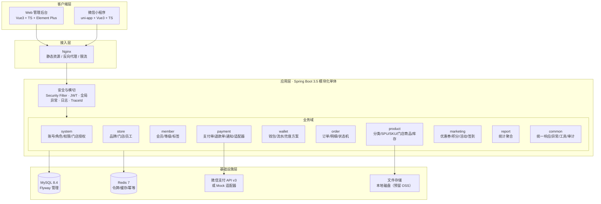
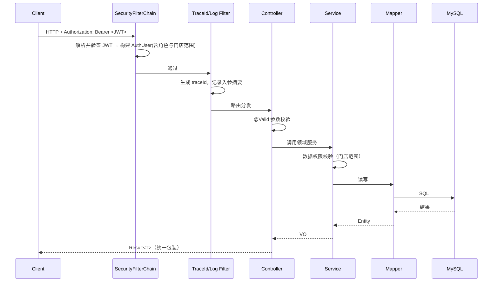
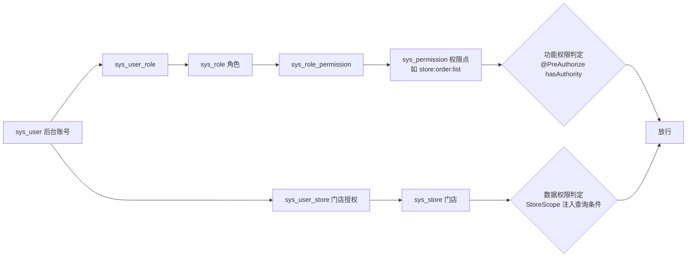
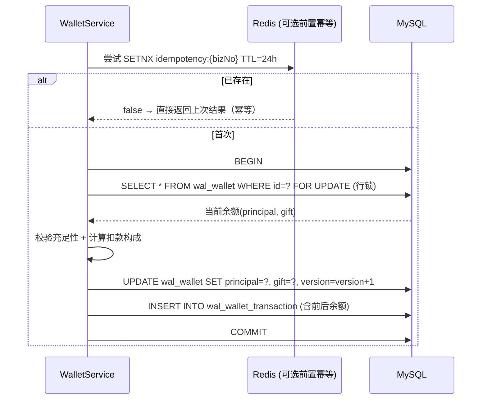
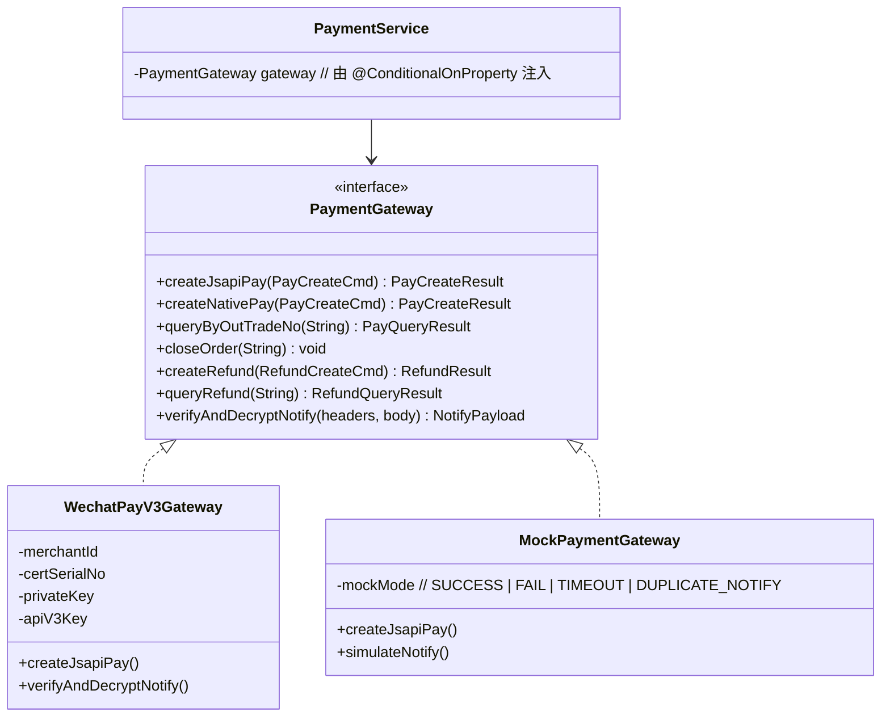
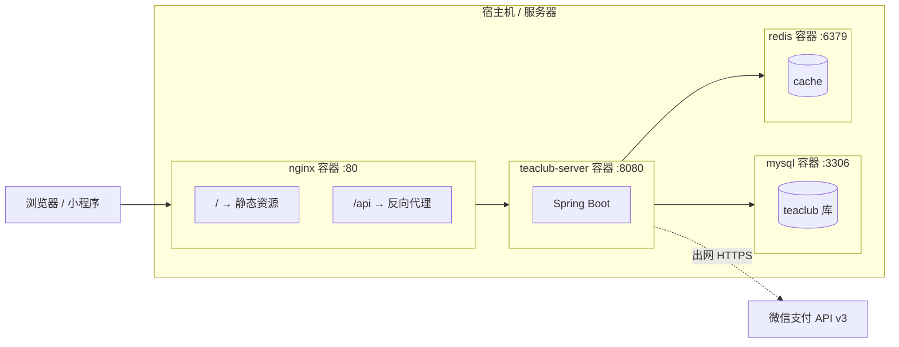

# TeaClub 系统架构设计

| 项目 | 内容 |
| --- | --- |
| 文档编号 | TC-DOC-02 |
| 版本 | v1.0 |
| 编制日期 | 2026-11-19 |
| 编写角色 | 系统架构师 |
| 状态 | 待评审 |

---

## 1. 架构风格与选型理由

### 1.1 结论

采用 **前后端分离 + 模块化单体（Modular Monolith）**：

```
Web 管理后台 (Vue3 SPA)  ─┐
                          ├──►  API 网关层 (Nginx) ──► Spring Boot 应用 ──► MySQL / Redis
微信小程序 (uni-app)      ─┘                                  │
                                                              └──► 微信支付 API v3 (可 Mock)
```

### 1.2 为什么不做微服务

| 维度 | 模块化单体 | 微服务 |
| --- | --- | --- |
| 本期团队规模 | 1 支小团队，合适 | 需要独立运维与治理能力 |
| 资金一致性 | 本地事务即可强一致 | 需分布式事务/Saga，复杂度陡增 |
| 交付周期 | 短，可快速验收 | 长 |
| 拆分能力 | 按领域包划分边界，后续可拆 | — |

**边界划分原则**：后端按业务域分包（`member`、`wallet`、`order`、`payment`、`marketing`、`store`、`system`），跨域只允许通过 **Service 接口** 调用，禁止跨域直接访问 Mapper。这条约束是未来能平滑拆分成微服务的前提。

---

## 2. 技术栈与版本基线

所有版本均在设计阶段通过仓库元数据核实，未凭记忆填写。

### 2.1 后端

| 组件 | 选定版本 | 选定依据 |
| --- | --- | --- |
| JDK | **17**（Temurin 17.0.19 LTS） | 需求指定 Java 17；本机已安装 |
| Spring Boot | **3.5.16** | 需求指定 3.x。Maven Central 上 3.x 最新补丁为 3.5.16（4.x 已发布但**不采用**，需求明确要求 3.x） |
| Spring Security | 随 Boot 3.5.16 管理（6.5.x） | 由 BOM 管理，避免版本冲突 |
| JWT | **jjwt 0.13.0**（api / impl / jackson） | Maven Central 最新稳定版 |
| MyBatis-Plus | **3.5.18**（`mybatis-plus-spring-boot3-starter`） | 需 boot3 专用 starter；最新稳定版 |
| MySQL | **8.4**（本机已安装运行） | 需求指定 MySQL 8 |
| JDBC 驱动 | 由 Boot BOM 管理的 `com.mysql:mysql-connector-j`（9.x） | 9.x 完整支持 MySQL 8.4；不自选版本避免与 BOM 冲突 |
| Redis 客户端 | `spring-boot-starter-data-redis`（Lettuce，随 BOM） | 标准方案 |
| Flyway | **11.20.3**（`flyway-core` + `flyway-mysql`） | 支持 MySQL 8.4，Boot 3.5 兼容 |
| SpringDoc OpenAPI | **2.10.0**（`springdoc-openapi-starter-webmvc-ui`） | **2.x 才兼容 Spring Boot 3.x**；3.x 面向 Boot 4，不可用 |
| 参数校验 | `spring-boot-starter-validation`（Jakarta Validation） | 标准方案 |
| 构建 | Maven 3.9.6（本机 `C:\Users\Admin\apache-maven-3.9.6`） | 已安装 |
| 测试 | JUnit 5 + Mockito + AssertJ（`spring-boot-starter-test`）、Testcontainers（可选） | 需求指定 |

> ⚠ **版本风险已登记**：本机 `mvn` 命令指向一个 Node 包装器（`node_modules/mvn`）且运行报错，实际可用的是 `C:\Users\Admin\apache-maven-3.9.6\bin\mvn.cmd`。第二阶段构建脚本统一使用该绝对路径或使用 Maven Wrapper。详见《08-环境预研与部署规划》。

### 2.2 Web 前端

| 组件 | 选定版本 | 说明 |
| --- | --- | --- |
| Vue | **3.5.45** | — |
| TypeScript | **5.9.3** | 刻意选择 5.x：registry 上的 7.0.2 为极新大版本，工具链兼容性未验证 |
| Vite | **7.3.8** | 选择 7.x：registry latest 为 8.x，生态插件（`@vitejs/plugin-vue` 6.x）在 7.x 上最稳妥 |
| @vitejs/plugin-vue | **6.0.11** | — |
| Element Plus | **2.14.8** | — |
| Pinia | **3.0.4** | 刻意选择 3.x：registry latest 为 4.1.0，属新大版本，先采用与 Vue 3.5 验证充分的 3.x |
| Vue Router | **4.6.5** | 刻意选择 4.x（`v4-latest` dist-tag）：latest 为 5.5.1，API 变更风险高 |
| Axios | **1.21.1** | — |
| ECharts | **6.1.0** | — |

### 2.3 微信小程序

| 组件 | 说明 |
| --- | --- |
| 框架 | uni-app（Vue 3 + TypeScript），官方 `uni-preset-vue#vite-ts` 模板 |
| 状态 | Pinia |
| 请求 | 统一封装的 `uni.request` 适配层 |
| 支付 | 微信小程序支付 API v3（JSAPI 下单由后端完成，小程序仅调起 `uni.requestPayment`） |

### 2.4 部署

| 组件 | 版本 | 备注 |
| --- | --- | --- |
| Docker / Docker Compose | 24+ / v2 | **本机未安装**，提供 Compose 编排文件 + 无 Docker 的本机直跑方案 |
| Nginx | 1.27-alpine | 静态资源 + API 反向代理 |
| MySQL | 8.4 | 容器镜像 `mysql:8.4` |
| Redis | 7.4-alpine | 容器镜像 `redis:7-alpine` |

---

## 3. 系统总体架构图



---

## 4. 后端分层架构

### 4.1 分层职责（强约束）

```
controller  ──  仅做 HTTP 语义转换：接收 DTO、参数校验、调用 Service、返回 Result<VO>
    │           禁止出现业务判断、禁止直接访问 Mapper、禁止拼装复杂业务逻辑
service     ──  业务编排与事务边界；唯一允许 @Transactional 的层
    │           service.impl 承载实现，service 包只放接口
manager     ──  （可选）跨域通用逻辑或第三方对接封装，如支付网关、短信网关
mapper      ──  仅负责数据库访问，继承 MyBatis-Plus BaseMapper
entity      ──  与表 1:1 映射，禁止直接作为接口出入参
dto / vo    ──  dto 接收入参（带校验注解）；vo 返回响应（脱敏、格式化）
```

### 4.2 请求处理链路



### 4.3 统一响应与异常

```json
{
  "code": 0,
  "message": "ok",
  "data": { },
  "traceId": "a1b2c3d4",
  "timestamp": "2026-01-01T10:00:00+08:00"
}
```

- 成功：`code = 0`
- 业务异常：`code` 为 5 位业务错误码，HTTP 状态码仍返回 2xx 或语义化 4xx
- 系统异常：`code = 50000`，**不向前端暴露堆栈**
- 全局异常处理器 `GlobalExceptionHandler` 统一捕获：`BizException`、`MethodArgumentNotValidException`、`AccessDeniedException`、`Exception`

---

## 5. 认证与授权架构

### 5.1 双认证体系

| 体系 | 使用者 | 令牌载体 | 有效期 | 存储 |
| --- | --- | --- | --- | --- |
| 管理端认证 | 总部/门店员工 | `Authorization: Bearer` | 访问令牌 2h | Redis 存吊销名单 |
| 会员端认证 | 小程序会员 | `Authorization: Bearer`（`member` 前缀） | 访问令牌 7d | Redis 存刷新令牌 |

**为什么分两套**：两类主体的数据范围模型完全不同（员工有门店集合，会员有品牌归属），混用一套会导致越权风险。两套令牌使用不同的签名密钥与不同的 `aud` 声明，Security Filter Chain 通过 URL 前缀（`/api/admin/**` vs `/api/app/**`）区分。

### 5.2 权限模型：RBAC + 数据域



### 5.3 数据权限强制实现

**单一可信来源**：`StoreScopeResolver`

```text
输入：当前登录用户 AuthUser
输出：StoreScope {
        ALL,            // 总部角色：不限门店
        LIMITED(ids)    // 门店角色：限定门店 id 集合
      }

规则：
  1. 若用户拥有 ALL_STORE_DATA 权限点 → StoreScope.ALL
  2. 否则 → StoreScope.LIMITED(sys_user_store 中该用户的 store_id 集合)
  3. LIMITED 且集合为空 → 直接拒绝（40300 无门店权限）
```

**强制点**：
- 所有涉及门店数据的 Service 方法，第一行必须调用 `storeScope.assertAccessible(storeId)` 或由 MyBatis-Plus 拦截器自动追加 `store_id IN (...)` 条件。
- 采用 **MyBatis-Plus 数据权限拦截器** 自动改写 SQL（对标注 `@DataScope` 的 Mapper 方法生效），避免人工遗漏。
- 单元测试必须覆盖"越权访问他店数据返回 403"的用例。

---

## 6. 资金一致性架构

### 6.1 钱包并发控制方案



**方案选择**：**悲观行锁（`SELECT ... FOR UPDATE`）为主 + 幂等键为辅 + 乐观锁 version 兜底**。

| 方案 | 是否采用 | 理由 |
| --- | --- | --- |
| 悲观行锁 | ✅ 主方案 | 资金写入频率可控，行锁冲突概率低，语义最直观，绝不会超扣 |
| 乐观锁 version | ✅ 兜底 | 对非锁定路径（如资料更新）使用；钱包更新同时自增 version 便于审计 |
| Redis 分布式锁 | ⚠ 仅作前置快速幂等 | 不作为唯一正确性保障，Redis 不可用时降级为数据库唯一索引幂等 |
| 数据库唯一索引 | ✅ 最终防线 | `wal_wallet_transaction.biz_no` 唯一索引，重复插入直接失败 |

**锁顺序约定**：涉及多个钱包的操作（如跨账户转账，本期无）必须先按 `wallet_id` 升序加锁，防止死锁。

### 6.2 幂等设计

| 场景 | 幂等键 | 落库位置 |
| --- | --- | --- |
| 微信支付通知 | `out_trade_no + transaction_id` | `pay_notify_log` 唯一索引 |
| 充值入账 | `recharge_no` | `wal_wallet_transaction.biz_no` 唯一索引 |
| 订单支付入账 | `order_no` | 同上 |
| 退款执行 | `refund_no` | `pay_refund_order.refund_no` 唯一索引 |
| 接口重复提交 | 客户端 `Idempotency-Key` 头 | Redis + `sys_idempotency_record` |

### 6.3 资金安全不变量（Invariant）

服务启动时与每日定时任务中执行一致性校验：

```sql
-- 不变量 1：钱包余额 == 该钱包所有流水变动额之和
SELECT w.id,
       w.principal_balance,  SUM(t.principal_change)  AS calc_principal,
       w.gift_balance,       SUM(t.gift_change)       AS calc_gift
FROM wal_wallet w
JOIN wal_wallet_transaction t ON t.wallet_id = w.id
GROUP BY w.id
HAVING w.principal_balance <> calc_principal
    OR w.gift_balance      <> calc_gift;
-- 期望：零行。非零行写入 svc_anomaly_record 并告警。
```

---

## 7. 支付适配器架构



**关键约束**：

1. 业务代码只依赖 `PaymentGateway` 接口，**不得出现 `if (isMock)` 分支**。
2. 通过 `teaclub.payment.provider=wechat-v3 | mock` 选择实现（`@ConditionalOnProperty`）。
3. Mock 适配器写入的支付单 `provider` 字段固定为 `MOCK`，**统计与报表可按 provider 过滤，不会污染真实营收口径**。
4. Mock 适配器**只能由显式的管理端调试接口触发**产生支付成功，绝不因为在生产配置下调用而产生"假的真实成功"。
5. 真实适配器在缺少配置时启动即失败（fail-fast），不会静默降级为 Mock。

---

## 8. 缓存与 Redis 使用策略

| 用途 | Key 规范 | 过期 | Redis 不可用时的降级 |
| --- | --- | --- | --- |
| 访问令牌吊销名单 | `auth:revoke:{jti}` | 与令牌同寿 | 降级为仅验签（记录 WARN 日志） |
| 短信验证码 | `sms:code:{phone}` | 5 min | 直接报错（安全优先） |
| 接口幂等 | `idem:{key}` | 24 h | 降级为数据库幂等表 |
| 看板缓存 | `report:dashboard:{scope}:{date}` | 60 s | 直接查库 |
| 门店/商品字典 | `dict:store:{id}` | 10 min | 直接查库 |

**设计决策**：本机当前 **未安装 Redis**（6379 端口不通，无 Memurai/Redis 服务，无 Docker）。因此：
- 抽象 `CacheService` 接口，提供 `RedisCacheService` 与 `LocalCacheService`（Caffeine/ConcurrentHashMap）两种实现。
- 通过 `teaclub.cache.provider=redis|local` 切换，**开发/演示环境默认 local**，生产 Docker 环境使用 redis。
- 这样第一阶段即可无 Redis 启动并完成全部功能验证，同时保留生产级方案。

---

## 9. 部署架构



**环境矩阵**：

| 环境 | 数据库 | 缓存 | 支付 | 用途 |
| --- | --- | --- | --- | --- |
| `dev` | 本机 MySQL 8.4 | local | mock | 日常开发 |
| `docker` | 容器 MySQL 8.4 | redis | mock | 集成验证、演示 |
| `prod` | 外部 MySQL 8.4 | redis | wechat-v3 | 真实部署（需商户资质） |

---

## 10. 架构决策记录（ADR）

| 编号 | 决策 | 理由 | 影响 |
| --- | --- | --- | --- |
| ADR-001 | 模块化单体而非微服务 | 团队规模、事务一致性、交付周期 | 需严守领域边界，禁止跨域访问 Mapper |
| ADR-002 | 金额一律 `BIGINT` 存分 | 消除浮点误差；与微信支付单位一致 | 前后端交互金额也用分（`Long`），前端展示层转换 |
| ADR-003 | 钱包双余额分列（principal / gift） | 财务必须区分真实资金与营销成本 | 所有扣款/退款需按构成记账 |
| ADR-004 | 悲观行锁 + 唯一索引幂等 | 资金正确性优先于吞吐 | 钱包操作串行化，需控制事务粒度 |
| ADR-005 | Flyway 管理全部 DDL | 可重复、可回放、可审计 | 禁止手工改库结构 |
| ADR-006 | 支付网关接口化 + Mock 实现 | 无商户资质下仍可完整验证 | 业务层禁止感知支付实现 |
| ADR-007 | CacheService 抽象（redis/local） | 当前环境无 Redis，需可运行 | 生产与开发一致的行为契约 |
| ADR-008 | 管理端 / 会员端 JWT 分离 | 主体模型不同，越权风险 | 两套 FilterChain、两套密钥、两套 `/api` 前缀 |
| ADR-009 | 前端权限由后端菜单接口驱动 | 避免前后端硬编码菜单不一致 | 登录后拉取 `/api/admin/auth/menus` 动态生成路由 |
| ADR-010 | 单品牌建模但保留 `brand_id` | 一期聚焦，二期可 SaaS 化 | 所有业务表带 `brand_id`，查询层预留品牌上下文 |

---

## 11. 演进路径（二期预留）

1. **多品牌 SaaS**：引入 `tenant_id` 上下文 + 行级隔离；现有 `brand_id` 升级为租户维度。
2. **拆服务**：按 `wallet` / `payment` / `order` 三个高内聚域优先拆出，配合本地消息表实现最终一致。
3. **消息化**：积分、券、通知等副作用改为领域事件异步处理。
4. **对象存储**：商品图片从本地磁盘迁移至 OSS，`FileStorage` 接口已预留。
5. **报表前置**：统计改由离线宽表（或 ClickHouse）支撑，在线接口只读汇总表。

---

## 12. 架构风险登记

| 编号 | 风险 | 影响 | 应对 |
| --- | --- | --- | --- |
| R-01 | 本机无 Docker | 无法直接验证 Compose 部署 | 提供 Compose 文件 + 本机直跑脚本双方案；部署章节明确标注"容器方案未在本机实测" |
| R-02 | 本机无 Redis | 缓存相关功能不可测 | `LocalCacheService` 兜底，代码路径统一 |
| R-03 | MySQL root 密码未知 | 数据库无法初始化 | 使用 `mysql.exe` 本地 socket 重置或改用项目专用低权限账号；详见 08 文档 |
| R-04 | 无微信商户资质 | 真实支付不可验证 | Mock 适配器 + 真实适配器骨架，明确标注未联调 |
| R-05 | 微信小程序需 AppID 与开发者工具 | 真机调试受限 | 使用测试号 + H5 端预览验证；编译产物验证通过即视为达成 |
| R-06 | 版本更新极快（Vite8 / Pinia4 / TS7） | 依赖不兼容 | 已在 §2 全部锁定为验证过的稳定线，并在 `package.json` 中显式固定版本 |

---

## 13. 下一步

架构确认后进入《03-数据库设计》，先完成完整表结构与 ER 图，再进入编码。
