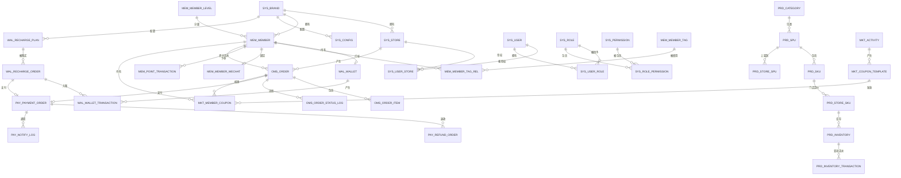
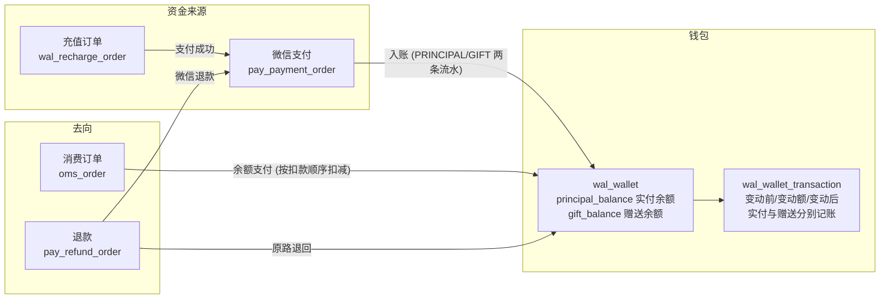

# TeaClub 数据库设计

| 项目 | 内容 |
| --- | --- |
| 文档编号 | TC-DOC-03 |
| 版本 | v1.0 |
| 编制日期 | 2026-11-19 |
| 编写角色 | 系统架构师 / Java 后端工程师 |
| 数据库 | MySQL 8.4，字符集 `utf8mb4`，排序规则 `utf8mb4_unicode_ci`，引擎 InnoDB |
| 迁移工具 | Flyway（`backend/src/main/resources/db/migration`） |
| 状态 | 待评审 |

---

## 0. 前置说明：现有 SQL 审查结论

任务要求"如果项目目录存在 teaclub.sql，先检查并审查"。执行结果：

```
检索范围：H:\ 全盘（递归，深度 4），匹配 teaclub*.sql
检索结果：无匹配文件
目标目录 H:\奶茶店会员与储值营销系统 递归文件数：0
```

**结论**：项目目录为空，不存在 `teaclub.sql`，无历史 SQL 需要审查或兼容。本设计从零开始，全部 DDL 通过 Flyway 版本化迁移管理，**不创建独立于 Flyway 之外的手工 SQL 脚本**。

---

## 1. 数据库设计规范

### 1.1 命名规范

| 对象 | 规范 | 示例 |
| --- | --- | --- |
| 表 | `模块前缀_业务名`，小写下划线 | `wal_wallet_transaction` |
| 字段 | 小写下划线 | `principal_balance` |
| 主键 | 统一 `id`，`BIGINT UNSIGNED AUTO_INCREMENT` | `id` |
| 外键字段 | `引用表主键名`，如 `store_id` | `store_id` |
| 唯一索引 | `uk_表_字段` | `uk_wallet_member` |
| 普通索引 | `idx_表_字段` | `idx_order_store_time` |
| 布尔字段 | `is_xxx`，`TINYINT(1)`，0/1 | `is_default` |
| 状态字段 | `status`，`VARCHAR(32)`，存枚举报文名 | `status='PAID'` |
| 时间字段 | `_time`，`DATETIME(3)` | `create_time` |

**模块前缀**：

| 前缀 | 模块 |
| --- | --- |
| `sys_` | 系统管理（品牌、门店、用户、角色、权限、配置、日志） |
| `mem_` | 会员（会员、等级、标签、积分、微信绑定） |
| `wal_` | 储值（钱包、流水、充值方案、充值订单） |
| `prd_` | 商品（分类、SPU、SKU、门店商品、库存） |
| `oms_` | 订单 |
| `pay_` | 支付与退款 |
| `mkt_` | 营销（优惠券、活动、签到） |
| `svc_` | 服务支撑（异常记录） |
| `rpt_` | 报表（本期不建表，走实时聚合） |

### 1.2 金额与数值规范

1. **所有金额统一使用 `BIGINT`，单位为人民币分**。禁止 `FLOAT`、`DOUBLE`、`DECIMAL` 存金额。
2. 金额字段统一以 `_amount` 结尾：`pay_amount`、`gift_amount`、`refund_amount`。
3. 余额字段以 `_balance` 结尾：`principal_balance`、`gift_balance`。
4. 折扣率使用 `INT` 存"万分比"（如 88 折 = 8800），避免小数。
5. 数量使用 `INT`。

### 1.3 通用字段

除纯关联表与流水表外，所有业务表包含：

| 字段 | 类型 | 说明 |
| --- | --- | --- |
| `id` | BIGINT UNSIGNED | 主键 |
| `brand_id` | BIGINT UNSIGNED | 品牌 ID（单品牌期固定，预留多品牌） |
| `create_time` | DATETIME(3) | 创建时间，默认 CURRENT_TIMESTAMP(3) |
| `update_time` | DATETIME(3) | 更新时间，ON UPDATE CURRENT_TIMESTAMP(3) |
| `deleted` | TINYINT(1) | 逻辑删除，0 未删 1 已删（MyBatis-Plus `@TableLogic`） |

> **流水类表（`wal_wallet_transaction`、`mem_point_transaction`、`pay_notify_log`、`sys_operation_log`）不设 `deleted` 字段**，从表结构层面禁止删除。

### 1.4 主键与关联规范

- 采用**逻辑外键**：所有关联都建立索引，但**不创建物理 FOREIGN KEY 约束**。
  理由：资金表高并发写入时物理外键会造成额外锁与级联风险；业务约束由服务层与唯一索引保证。
- 例外：纯字典型关联表（`sys_role_permission`、`sys_user_role`）使用**联合唯一索引**代替主键约束。
- 单表必须有且仅有一个 `AUTO_INCREMENT` 主键列。

### 1.5 索引规范

- 所有 `xxx_id` 关联字段建立普通索引。
- 所有查询高频组合建立联合索引，遵循最左前缀：`(store_id, create_time)`。
- 所有业务单号（`order_no`、`recharge_no`、`payment_no`、`refund_no`、`biz_no`）建立**唯一索引**。
- 状态 + 时间的高频统计组合建立索引：`(status, pay_time)`。
- 单表索引数量上限 8 个。

### 1.6 并发与幂等相关的表级约束

| 表 | 唯一索引 | 作用 |
| --- | --- | --- |
| `wal_wallet` | `(brand_id, member_id)` | 一个会员在一个品牌下只有一个钱包 |
| `wal_wallet_transaction` | `biz_no` | 同一业务单号只能入账一次 |
| `wal_recharge_order` | `recharge_no` | 充值单号唯一 |
| `oms_order` | `order_no` | 订单号唯一 |
| `pay_payment_order` | `payment_no`、`(biz_type, biz_no)` | 支付单号唯一；同一业务单只能有一个有效支付单 |
| `pay_notify_log` | `(provider, notify_id)` | 微信通知 ID 唯一，重复通知直接拒绝 |
| `pay_refund_order` | `refund_no` | 退款单号唯一 |
| `mkt_member_coupon` | `(member_id, coupon_template_id, grant_batch)` | 同批次发放防重 |

---

## 2. 数据库 E-R 图

### 2.1 全局实体关系图



### 2.2 资金流转关系图



---

## 3. 表清单总览（41 张）

| # | 表名 | 中文名 | 模块 | 说明 |
| --- | --- | --- | --- | --- |
| 1 | `sys_brand` | 品牌 | 系统 | 顶层业务主体 |
| 2 | `sys_store` | 门店 | 系统 | 多门店核心 |
| 3 | `sys_user` | 后台账号 | 系统 | 员工登录账号 |
| 4 | `sys_role` | 角色 | 系统 | RBAC 角色 |
| 5 | `sys_permission` | 权限点 | 系统 | 菜单/按钮/接口权限 |
| 6 | `sys_user_role` | 用户角色关联 | 系统 | 多对多 |
| 7 | `sys_role_permission` | 角色权限关联 | 系统 | 多对多 |
| 8 | `sys_user_store` | 用户门店授权 | 系统 | **数据权限核心** |
| 9 | `sys_config` | 品牌配置 | 系统 | 储值/支付/积分规则 |
| 10 | `sys_idempotency_record` | 幂等记录 | 系统 | 接口幂等兜底 |
| 11 | `sys_operation_log` | 操作日志 | 系统 | 审计 |
| 12 | `mem_member_level` | 会员等级 | 会员 | 等级与折扣 |
| 13 | `mem_member` | 会员 | 会员 | 品牌级会员 |
| 14 | `mem_member_tag` | 会员标签 | 会员 | 标签库 |
| 15 | `mem_member_tag_rel` | 会员标签关联 | 会员 | 多对多 |
| 16 | `mem_member_wechat` | 微信绑定 | 会员 | openid/unionid |
| 17 | `mem_point_transaction` | 积分流水 | 会员 | 积分不可篡改 |
| 18 | `wal_wallet` | 会员钱包 | 储值 | 双余额 |
| 19 | `wal_wallet_transaction` | 钱包流水 | 储值 | **资金核心** |
| 20 | `wal_recharge_plan` | 充值方案 | 储值 | 充值套餐 |
| 21 | `wal_recharge_plan_store` | 充值方案参与门店 | 储值 | 多对多，空表示全部门店 |
| 22 | `wal_recharge_order` | 充值订单 | 储值 | 充值业务单 |
| 23 | `prd_category` | 商品分类 | 商品 | 树形分类 |
| 24 | `prd_spu` | 商品 | 商品 | 标准商品单元 |
| 25 | `prd_sku` | 商品规格 | 商品 | 库存单元 |
| 26 | `prd_store_spu` | 门店商品 | 商品 | 上下架 |
| 27 | `prd_store_sku` | 门店规格价格 | 商品 | **差异化定价** |
| 28 | `prd_inventory` | 库存 | 商品 | 门店 SKU 库存 |
| 29 | `prd_inventory_transaction` | 库存流水 | 商品 | 变动可追溯 |
| 30 | `oms_order` | 订单 | 订单 | **必含 store_id** |
| 31 | `oms_order_item` | 订单明细 | 订单 | 商品快照 |
| 32 | `oms_order_status_log` | 订单状态日志 | 订单 | 状态机留痕 |
| 33 | `pay_payment_order` | 支付单 | 支付 | 支付业务单 |
| 34 | `pay_notify_log` | 支付通知记录 | 支付 | 幂等与审计 |
| 35 | `pay_refund_order` | 退款单 | 支付 | 退款业务单 |
| 36 | `mkt_coupon_template` | 优惠券模板 | 营销 | 券规则 |
| 37 | `mkt_member_coupon` | 会员优惠券 | 营销 | 持券与核销 |
| 38 | `mkt_activity` | 营销活动 | 营销 | 活动配置 |
| 39 | `mkt_activity_store` | 活动参与门店 | 营销 | 多对多，空表示全部门店 |
| 40 | `mkt_checkin_record` | 签到记录 | 营销 | 签到 |
| 41 | `svc_anomaly_record` | 资金异常记录 | 支撑 | 对账差异 |

> **数量核对**：共 **41 张表**，与 §5 中 `CREATE TABLE` 语句数量一一对应（已用脚本校验）。
>
> **分类统计**：
> - 系统管理 11 张（`sys_*`）
> - 会员 6 张（`mem_*`）
> - 储值 5 张（`wal_*`）
> - 商品 7 张（`prd_*`）
> - 订单 3 张（`oms_*`）
> - 支付 3 张（`pay_*`）
> - 营销 5 张（`mkt_*`）
> - 支撑 1 张（`svc_*`）
>
> 合计 11 + 6 + 5 + 7 + 3 + 3 + 5 + 1 = **41 张**。
>
> 覆盖需求文档 「至少覆盖」清单：系统用户、角色权限、品牌、门店、员工门店关联、会员、会员等级、会员钱包、钱包流水、充值方案、充值订单、商品分类、商品、商品规格、门店商品、订单、订单详情、支付订单、支付通知记录、退款订单、优惠券模板、会员优惠券、积分流水、营销活动、库存、库存流水、操作日志 —— 全部覆盖，并额外补充了门店差异化定价、库存流水、幂等记录、异常记录等支撑表。

---

## 4. 关键设计决策

### 4.1 为什么钱包要拆成两个余额列而不是两条钱包记录

```
方案 A（采用）：wal_wallet 一行，两列 principal_balance + gift_balance
方案 B（放弃）：一个会员两条钱包记录，用 wallet_type 区分
```

- 方案 B 在"扣款顺序可配置"时需要在一次事务中锁两行，增大死锁概率。
- 方案 A 单行锁即可保证两个余额的原子一致性，且"变动前/后余额"能在一条流水中完整表达。
- 方案 A 更利于对账：一行即一个会员的完整余额视图。

### 4.2 为什么扣款构成要单独存表

`wal_wallet_transaction` 每次余额变动同时记录：
- `principal_change` / `gift_change`：本次变动额
- `principal_before` / `principal_after` / `gift_before` / `gift_after`：四组余额快照
- `biz_type` / `biz_no` / `store_id`：业务来源与发生门店

这样退款时可以**精确还原**"本次订单扣了多少实付金、多少赠送金"，实现按资金来源原路退回。

### 4.3 订单与支付的分离

`oms_order` 只表达"消费行为"，`pay_payment_order` 表达"资金行为"。一次订单可能有多条支付记录（首次失败、重试成功），也可能走余额支付而不产生微信支付单。`pay_payment_order.channel` 区分 `WECHAT_JSAPI` / `WECHAT_NATIVE` / `BALANCE`。

### 4.4 状态字段使用字符串而非数字

- 可读性强，日志与排障成本低。
- 与 Java 枚举名称一致，避免"数字 3 到底代表什么"的沟通成本。
- 代价是存储略大，通过 `VARCHAR(32)` 控制。

### 4.5 快照字段

订单明细 `oms_order_item` 冗余存储 `sku_name`、`spec_json`、`unit_price`、`image_url`，保证历史订单不因商品改价改名而失真。这是有意的反范式设计。

---

## 5. 详细表结构（DDL）

> 以下 DDL 为设计基线。**实际执行以 `backend/src/main/resources/db/migration/V*.sql` 中的 Flyway 脚本为准**，两者必须保持一致；如不一致以 Flyway 为准并回写本文档。

### 5.1 系统管理模块

#### 5.1.1 sys_brand 品牌

```sql
CREATE TABLE sys_brand (
  id                BIGINT UNSIGNED NOT NULL AUTO_INCREMENT COMMENT '主键',
  brand_code        VARCHAR(32)  NOT NULL COMMENT '品牌编码',
  brand_name        VARCHAR(64)  NOT NULL COMMENT '品牌名称',
  logo_url          VARCHAR(512) NULL     COMMENT '品牌 Logo',
  contact_phone     VARCHAR(32)  NULL     COMMENT '客服电话',
  -- 储值业务规则（品牌级配置，直接内聚在此便于读取）
  wallet_cross_store_enabled TINYINT(1) NOT NULL DEFAULT 1 COMMENT '储值是否允许跨店消费 1是 0否',
  wallet_deduct_order        VARCHAR(16) NOT NULL DEFAULT 'GIFT_FIRST' COMMENT '扣款顺序 GIFT_FIRST/PRINCIPAL_FIRST',
  gift_expire_days           INT NOT NULL DEFAULT 365 COMMENT '赠送金有效天数 0=永久',
  status            VARCHAR(16)  NOT NULL DEFAULT 'ENABLED' COMMENT 'ENABLED/DISABLED',
  create_time       DATETIME(3)  NOT NULL DEFAULT CURRENT_TIMESTAMP(3),
  update_time       DATETIME(3)  NOT NULL DEFAULT CURRENT_TIMESTAMP(3) ON UPDATE CURRENT_TIMESTAMP(3),
  deleted           TINYINT(1)   NOT NULL DEFAULT 0,
  PRIMARY KEY (id),
  UNIQUE KEY uk_brand_code (brand_code)
) ENGINE=InnoDB DEFAULT CHARSET=utf8mb4 COLLATE=utf8mb4_unicode_ci COMMENT='品牌';
```

#### 5.1.2 sys_store 门店

```sql
CREATE TABLE sys_store (
  id            BIGINT UNSIGNED NOT NULL AUTO_INCREMENT,
  brand_id      BIGINT UNSIGNED NOT NULL COMMENT '所属品牌',
  store_code    VARCHAR(32)  NOT NULL COMMENT '门店编码',
  store_name    VARCHAR(64)  NOT NULL COMMENT '门店名称',
  province      VARCHAR(32)  NULL,
  city          VARCHAR(32)  NULL,
  district      VARCHAR(32)  NULL,
  address       VARCHAR(255) NOT NULL COMMENT '详细地址',
  longitude     DECIMAL(10,6) NULL COMMENT '经度（经纬度为地理坐标，非金额，允许 DECIMAL）',
  latitude      DECIMAL(10,6) NULL COMMENT '纬度',
  phone         VARCHAR(32)  NULL COMMENT '门店电话',
  manager_name  VARCHAR(32)  NULL COMMENT '店长姓名',
  business_hours VARCHAR(64) NULL COMMENT '营业时间 如 09:00-22:00',
  open_date     DATE         NULL COMMENT '开业日期',
  status        VARCHAR(16)  NOT NULL DEFAULT 'OPEN' COMMENT 'OPEN/SUSPENDED/CLOSED',
  remark        VARCHAR(255) NULL,
  create_time   DATETIME(3)  NOT NULL DEFAULT CURRENT_TIMESTAMP(3),
  update_time   DATETIME(3)  NOT NULL DEFAULT CURRENT_TIMESTAMP(3) ON UPDATE CURRENT_TIMESTAMP(3),
  deleted       TINYINT(1)   NOT NULL DEFAULT 0,
  PRIMARY KEY (id),
  UNIQUE KEY uk_store_code (brand_id, store_code),
  KEY idx_store_brand_status (brand_id, status)
) ENGINE=InnoDB DEFAULT CHARSET=utf8mb4 COLLATE=utf8mb4_unicode_ci COMMENT='门店';
```

#### 5.1.3 sys_user 后台账号

```sql
CREATE TABLE sys_user (
  id            BIGINT UNSIGNED NOT NULL AUTO_INCREMENT,
  brand_id      BIGINT UNSIGNED NOT NULL,
  username      VARCHAR(64)  NOT NULL COMMENT '登录账号',
  password      VARCHAR(100) NOT NULL COMMENT 'BCrypt 密文',
  real_name     VARCHAR(32)  NOT NULL COMMENT '真实姓名',
  phone         VARCHAR(20)  NULL COMMENT '手机号',
  email         VARCHAR(128) NULL,
  avatar_url    VARCHAR(512) NULL,
  user_type     VARCHAR(16)  NOT NULL DEFAULT 'STORE' COMMENT 'HQ 总部 / STORE 门店',
  status        VARCHAR(16)  NOT NULL DEFAULT 'ENABLED' COMMENT 'ENABLED/DISABLED/LOCKED',
  -- 登录安全
  login_fail_count INT       NOT NULL DEFAULT 0 COMMENT '连续登录失败次数',
  lock_until    DATETIME(3)  NULL COMMENT '锁定截止时间',
  last_login_time DATETIME(3) NULL,
  last_login_ip VARCHAR(64)  NULL,
  password_update_time DATETIME(3) NULL COMMENT '密码最后修改时间',
  create_time   DATETIME(3)  NOT NULL DEFAULT CURRENT_TIMESTAMP(3),
  update_time   DATETIME(3)  NOT NULL DEFAULT CURRENT_TIMESTAMP(3) ON UPDATE CURRENT_TIMESTAMP(3),
  deleted       TINYINT(1)   NOT NULL DEFAULT 0,
  PRIMARY KEY (id),
  UNIQUE KEY uk_user_username (brand_id, username),
  KEY idx_user_phone (brand_id, phone),
  KEY idx_user_type_status (brand_id, user_type, status)
) ENGINE=InnoDB DEFAULT CHARSET=utf8mb4 COLLATE=utf8mb4_unicode_ci COMMENT='后台账号';
```

#### 5.1.4 sys_role 角色 / sys_permission 权限点

```sql
CREATE TABLE sys_role (
  id          BIGINT UNSIGNED NOT NULL AUTO_INCREMENT,
  brand_id    BIGINT UNSIGNED NOT NULL,
  role_code   VARCHAR(64) NOT NULL COMMENT '角色编码 如 STORE_MANAGER',
  role_name   VARCHAR(64) NOT NULL,
  data_scope  VARCHAR(16) NOT NULL DEFAULT 'STORE' COMMENT 'ALL 全品牌 / STORE 授权门店',
  is_builtin  TINYINT(1)  NOT NULL DEFAULT 0 COMMENT '内置角色不可删除',
  sort        INT         NOT NULL DEFAULT 0,
  status      VARCHAR(16) NOT NULL DEFAULT 'ENABLED',
  remark      VARCHAR(255) NULL,
  create_time DATETIME(3) NOT NULL DEFAULT CURRENT_TIMESTAMP(3),
  update_time DATETIME(3) NOT NULL DEFAULT CURRENT_TIMESTAMP(3) ON UPDATE CURRENT_TIMESTAMP(3),
  deleted     TINYINT(1)  NOT NULL DEFAULT 0,
  PRIMARY KEY (id),
  UNIQUE KEY uk_role_code (brand_id, role_code)
) ENGINE=InnoDB DEFAULT CHARSET=utf8mb4 COMMENT='角色';

CREATE TABLE sys_permission (
  id           BIGINT UNSIGNED NOT NULL AUTO_INCREMENT,
  parent_id    BIGINT UNSIGNED NOT NULL DEFAULT 0 COMMENT '父级，0 为根',
  perm_code    VARCHAR(96)  NOT NULL COMMENT '权限标识 如 store:order:list',
  perm_name    VARCHAR(64)  NOT NULL,
  perm_type    VARCHAR(16)  NOT NULL COMMENT 'MENU 菜单 / BUTTON 按钮 / API 接口',
  route_path   VARCHAR(128) NULL COMMENT '前端路由路径',
  component    VARCHAR(128) NULL COMMENT '前端组件路径',
  icon         VARCHAR(64)  NULL,
  sort         INT          NOT NULL DEFAULT 0,
  visible      TINYINT(1)   NOT NULL DEFAULT 1,
  status       VARCHAR(16)  NOT NULL DEFAULT 'ENABLED',
  create_time  DATETIME(3)  NOT NULL DEFAULT CURRENT_TIMESTAMP(3),
  update_time  DATETIME(3)  NOT NULL DEFAULT CURRENT_TIMESTAMP(3) ON UPDATE CURRENT_TIMESTAMP(3),
  deleted      TINYINT(1)   NOT NULL DEFAULT 0,
  PRIMARY KEY (id),
  UNIQUE KEY uk_perm_code (perm_code),
  KEY idx_perm_parent (parent_id)
) ENGINE=InnoDB DEFAULT CHARSET=utf8mb4 COMMENT='权限点';
```

#### 5.1.5 关联表

```sql
CREATE TABLE sys_user_role (
  id          BIGINT UNSIGNED NOT NULL AUTO_INCREMENT,
  user_id     BIGINT UNSIGNED NOT NULL,
  role_id     BIGINT UNSIGNED NOT NULL,
  create_time DATETIME(3) NOT NULL DEFAULT CURRENT_TIMESTAMP(3),
  PRIMARY KEY (id),
  UNIQUE KEY uk_user_role (user_id, role_id),
  KEY idx_ur_role (role_id)
) ENGINE=InnoDB DEFAULT CHARSET=utf8mb4 COMMENT='用户角色关联';

CREATE TABLE sys_role_permission (
  id            BIGINT UNSIGNED NOT NULL AUTO_INCREMENT,
  role_id       BIGINT UNSIGNED NOT NULL,
  permission_id BIGINT UNSIGNED NOT NULL,
  create_time   DATETIME(3) NOT NULL DEFAULT CURRENT_TIMESTAMP(3),
  PRIMARY KEY (id),
  UNIQUE KEY uk_role_perm (role_id, permission_id),
  KEY idx_rp_perm (permission_id)
) ENGINE=InnoDB DEFAULT CHARSET=utf8mb4 COMMENT='角色权限关联';

-- 数据权限核心表：用户可访问的门店
CREATE TABLE sys_user_store (
  id          BIGINT UNSIGNED NOT NULL AUTO_INCREMENT,
  user_id     BIGINT UNSIGNED NOT NULL,
  store_id    BIGINT UNSIGNED NOT NULL,
  is_default  TINYINT(1) NOT NULL DEFAULT 0 COMMENT '是否默认门店（收银台默认进入）',
  create_time DATETIME(3) NOT NULL DEFAULT CURRENT_TIMESTAMP(3),
  PRIMARY KEY (id),
  UNIQUE KEY uk_user_store (user_id, store_id),
  KEY idx_us_store (store_id)
) ENGINE=InnoDB DEFAULT CHARSET=utf8mb4 COMMENT='用户门店授权（数据权限）';
```

#### 5.1.6 sys_config 品牌配置

```sql
CREATE TABLE sys_config (
  id           BIGINT UNSIGNED NOT NULL AUTO_INCREMENT,
  brand_id     BIGINT UNSIGNED NOT NULL,
  config_key   VARCHAR(96)  NOT NULL COMMENT '配置键',
  config_value VARCHAR(1024) NOT NULL COMMENT '配置值（JSON 或字面量）',
  value_type   VARCHAR(16)  NOT NULL DEFAULT 'STRING' COMMENT 'STRING/INT/BOOL/JSON',
  remark       VARCHAR(255) NULL,
  create_time  DATETIME(3) NOT NULL DEFAULT CURRENT_TIMESTAMP(3),
  update_time  DATETIME(3) NOT NULL DEFAULT CURRENT_TIMESTAMP(3) ON UPDATE CURRENT_TIMESTAMP(3),
  PRIMARY KEY (id),
  UNIQUE KEY uk_config_key (brand_id, config_key)
) ENGINE=InnoDB DEFAULT CHARSET=utf8mb4 COMMENT='品牌配置';
```

#### 5.1.7 sys_idempotency_record 幂等记录

```sql
CREATE TABLE sys_idempotency_record (
  id             BIGINT UNSIGNED NOT NULL AUTO_INCREMENT,
  idem_key       VARCHAR(128) NOT NULL COMMENT '幂等键',
  biz_type       VARCHAR(64)  NOT NULL,
  request_hash   VARCHAR(64)  NULL COMMENT '请求体摘要，校验同键不同体',
  response_body  TEXT         NULL COMMENT '首次成功响应，重复请求直接返回',
  expire_time    DATETIME(3)  NOT NULL COMMENT '过期时间，定时清理',
  create_time    DATETIME(3)  NOT NULL DEFAULT CURRENT_TIMESTAMP(3),
  PRIMARY KEY (id),
  UNIQUE KEY uk_idem_key (idem_key),
  KEY idx_idem_expire (expire_time)
) ENGINE=InnoDB DEFAULT CHARSET=utf8mb4 COMMENT='接口幂等记录';
```

#### 5.1.8 sys_operation_log 操作日志

```sql
CREATE TABLE sys_operation_log (
  id            BIGINT UNSIGNED NOT NULL AUTO_INCREMENT,
  brand_id      BIGINT UNSIGNED NOT NULL,
  operator_id   BIGINT UNSIGNED NULL COMMENT '操作人，系统任务为空',
  operator_name VARCHAR(64)  NULL,
  store_id      BIGINT UNSIGNED NULL COMMENT '操作涉及门店',
  module        VARCHAR(64)  NOT NULL COMMENT '模块',
  operation     VARCHAR(128) NOT NULL COMMENT '操作描述',
  request_uri   VARCHAR(255) NULL,
  request_method VARCHAR(16) NULL,
  request_param TEXT         NULL COMMENT '脱敏后的入参',
  response_code INT          NULL,
  success       TINYINT(1)   NOT NULL DEFAULT 1,
  error_msg     VARCHAR(1024) NULL,
  ip            VARCHAR(64)  NULL,
  user_agent    VARCHAR(255) NULL,
  trace_id      VARCHAR(64)  NULL,
  cost_ms       INT          NULL,
  create_time   DATETIME(3)  NOT NULL DEFAULT CURRENT_TIMESTAMP(3),
  PRIMARY KEY (id),
  KEY idx_oplog_brand_time (brand_id, create_time),
  KEY idx_oplog_operator (operator_id, create_time)
) ENGINE=InnoDB DEFAULT CHARSET=utf8mb4 COMMENT='操作日志（禁止删除）';
```

### 5.2 会员模块

#### 5.2.1 mem_member_level 会员等级

```sql
CREATE TABLE mem_member_level (
  id             BIGINT UNSIGNED NOT NULL AUTO_INCREMENT,
  brand_id       BIGINT UNSIGNED NOT NULL,
  level_code     VARCHAR(32)  NOT NULL COMMENT '等级编码',
  level_name     VARCHAR(32)  NOT NULL COMMENT '等级名称',
  level_no       INT          NOT NULL COMMENT '等级序号，越大越高',
  upgrade_type   VARCHAR(16)  NOT NULL DEFAULT 'CONSUME_AMOUNT' COMMENT 'CONSUME_AMOUNT 累计消费 / RECHARGE_AMOUNT 累计充值 / MANUAL',
  upgrade_threshold BIGINT    NOT NULL DEFAULT 0 COMMENT '升级门槛（金额为分）',
  discount_rate  INT          NOT NULL DEFAULT 10000 COMMENT '折扣万分比，10000=不打折，8800=8.8折',
  point_rate     INT          NOT NULL DEFAULT 100 COMMENT '积分倍率百分比，100=1倍',
  icon_url       VARCHAR(512) NULL,
  benefits       VARCHAR(1024) NULL COMMENT '权益描述 JSON',
  status         VARCHAR(16)  NOT NULL DEFAULT 'ENABLED',
  create_time    DATETIME(3)  NOT NULL DEFAULT CURRENT_TIMESTAMP(3),
  update_time    DATETIME(3)  NOT NULL DEFAULT CURRENT_TIMESTAMP(3) ON UPDATE CURRENT_TIMESTAMP(3),
  deleted        TINYINT(1)   NOT NULL DEFAULT 0,
  PRIMARY KEY (id),
  UNIQUE KEY uk_level_code (brand_id, level_code),
  KEY idx_level_no (brand_id, level_no)
) ENGINE=InnoDB DEFAULT CHARSET=utf8mb4 COMMENT='会员等级';
```

#### 5.2.2 mem_member 会员

```sql
CREATE TABLE mem_member (
  id              BIGINT UNSIGNED NOT NULL AUTO_INCREMENT,
  brand_id        BIGINT UNSIGNED NOT NULL COMMENT '会员属于品牌，不绑定门店',
  member_no       VARCHAR(32)  NOT NULL COMMENT '会员号',
  phone           VARCHAR(20)  NOT NULL COMMENT '手机号（品牌内唯一）',
  password        VARCHAR(100) NULL COMMENT 'BCrypt 密文，可为空（纯微信登录）',
  nickname        VARCHAR(64)  NULL,
  avatar_url      VARCHAR(512) NULL,
  gender          VARCHAR(16)  NOT NULL DEFAULT 'UNKNOWN' COMMENT 'MALE/FEMALE/UNKNOWN',
  birthday        DATE         NULL COMMENT '生日，用于生日券',
  level_id        BIGINT UNSIGNED NULL COMMENT '当前等级',
  register_store_id BIGINT UNSIGNED NULL COMMENT '注册来源门店（仅记录来源，非归属）',
  register_channel VARCHAR(16) NOT NULL DEFAULT 'MINIAPP' COMMENT 'MINIAPP/POS/ADMIN',
  -- 累计统计（冗余字段，由业务写入，用于快速升级判定与排行）
  total_consume_amount BIGINT NOT NULL DEFAULT 0 COMMENT '累计消费金额（分）',
  total_recharge_amount BIGINT NOT NULL DEFAULT 0 COMMENT '累计充值实付金额（分）',
  total_order_count INT NOT NULL DEFAULT 0 COMMENT '累计订单数',
  points          BIGINT NOT NULL DEFAULT 0 COMMENT '当前可用积分',
  last_consume_time DATETIME(3) NULL COMMENT '最后消费时间，用于沉睡判定',
  status          VARCHAR(16)  NOT NULL DEFAULT 'NORMAL' COMMENT 'NORMAL/FROZEN',
  freeze_reason   VARCHAR(255) NULL,
  remark          VARCHAR(255) NULL,
  create_time     DATETIME(3)  NOT NULL DEFAULT CURRENT_TIMESTAMP(3),
  update_time     DATETIME(3)  NOT NULL DEFAULT CURRENT_TIMESTAMP(3) ON UPDATE CURRENT_TIMESTAMP(3),
  deleted         TINYINT(1)   NOT NULL DEFAULT 0,
  PRIMARY KEY (id),
  UNIQUE KEY uk_member_no (brand_id, member_no),
  UNIQUE KEY uk_member_phone (brand_id, phone),
  KEY idx_member_level (level_id),
  KEY idx_member_status_time (brand_id, status, create_time),
  KEY idx_member_last_consume (brand_id, last_consume_time)
) ENGINE=InnoDB DEFAULT CHARSET=utf8mb4 COMMENT='会员（品牌级）';
```

#### 5.2.3 mem_member_tag 会员标签

```sql
CREATE TABLE mem_member_tag (
  id          BIGINT UNSIGNED NOT NULL AUTO_INCREMENT,
  brand_id    BIGINT UNSIGNED NOT NULL,
  tag_name    VARCHAR(32) NOT NULL,
  tag_color   VARCHAR(16) NULL COMMENT '展示颜色',
  tag_type    VARCHAR(16) NOT NULL DEFAULT 'MANUAL' COMMENT 'MANUAL 手动 / AUTO 系统自动',
  remark      VARCHAR(255) NULL,
  create_time DATETIME(3) NOT NULL DEFAULT CURRENT_TIMESTAMP(3),
  update_time DATETIME(3) NOT NULL DEFAULT CURRENT_TIMESTAMP(3) ON UPDATE CURRENT_TIMESTAMP(3),
  deleted     TINYINT(1)  NOT NULL DEFAULT 0,
  PRIMARY KEY (id),
  UNIQUE KEY uk_tag_name (brand_id, tag_name)
) ENGINE=InnoDB DEFAULT CHARSET=utf8mb4 COMMENT='会员标签';

CREATE TABLE mem_member_tag_rel (
  id          BIGINT UNSIGNED NOT NULL AUTO_INCREMENT,
  member_id   BIGINT UNSIGNED NOT NULL,
  tag_id      BIGINT UNSIGNED NOT NULL,
  create_time DATETIME(3) NOT NULL DEFAULT CURRENT_TIMESTAMP(3),
  PRIMARY KEY (id),
  UNIQUE KEY uk_member_tag (member_id, tag_id),
  KEY idx_mtr_tag (tag_id)
) ENGINE=InnoDB DEFAULT CHARSET=utf8mb4 COMMENT='会员标签关联';
```

#### 5.2.4 mem_member_wechat 微信绑定

```sql
CREATE TABLE mem_member_wechat (
  id          BIGINT UNSIGNED NOT NULL AUTO_INCREMENT,
  brand_id    BIGINT UNSIGNED NOT NULL,
  member_id   BIGINT UNSIGNED NOT NULL,
  app_id      VARCHAR(64)  NOT NULL COMMENT '小程序 AppID',
  open_id     VARCHAR(64)  NOT NULL,
  union_id    VARCHAR(64)  NULL,
  nickname    VARCHAR(64)  NULL,
  avatar_url  VARCHAR(512) NULL,
  bind_time   DATETIME(3)  NOT NULL DEFAULT CURRENT_TIMESTAMP(3),
  update_time DATETIME(3)  NOT NULL DEFAULT CURRENT_TIMESTAMP(3) ON UPDATE CURRENT_TIMESTAMP(3),
  PRIMARY KEY (id),
  UNIQUE KEY uk_wechat_openid (app_id, open_id),
  UNIQUE KEY uk_wechat_member (brand_id, member_id),
  KEY idx_wechat_unionid (union_id)
) ENGINE=InnoDB DEFAULT CHARSET=utf8mb4 COMMENT='会员微信绑定';
```

#### 5.2.5 mem_point_transaction 积分流水

```sql
CREATE TABLE mem_point_transaction (
  id             BIGINT UNSIGNED NOT NULL AUTO_INCREMENT,
  brand_id       BIGINT UNSIGNED NOT NULL,
  member_id      BIGINT UNSIGNED NOT NULL,
  store_id       BIGINT UNSIGNED NULL COMMENT '发生门店',
  biz_type       VARCHAR(32)  NOT NULL COMMENT 'ORDER_EARN/ORDER_REFUND_DEDUCT/EXCHANGE/CHECKIN/ADMIN_ADJUST/EXPIRE',
  biz_no         VARCHAR(64)  NOT NULL COMMENT '关联业务单号',
  change_points  BIGINT       NOT NULL COMMENT '变动积分 正数增加 负数扣减',
  points_before  BIGINT       NOT NULL,
  points_after   BIGINT       NOT NULL,
  remark         VARCHAR(255) NULL,
  operator_id    BIGINT UNSIGNED NULL COMMENT '人工调整时的操作人',
  create_time    DATETIME(3)  NOT NULL DEFAULT CURRENT_TIMESTAMP(3),
  PRIMARY KEY (id),
  UNIQUE KEY uk_point_biz (biz_type, biz_no, member_id),
  KEY idx_point_member_time (member_id, create_time)
) ENGINE=InnoDB DEFAULT CHARSET=utf8mb4 COMMENT='积分流水（禁止修改删除）';
```

### 5.3 储值模块

#### 5.3.1 wal_wallet 会员钱包

```sql
CREATE TABLE wal_wallet (
  id                BIGINT UNSIGNED NOT NULL AUTO_INCREMENT,
  brand_id          BIGINT UNSIGNED NOT NULL COMMENT '钱包属于品牌',
  member_id         BIGINT UNSIGNED NOT NULL,
  principal_balance BIGINT NOT NULL DEFAULT 0 COMMENT '实付余额（分）',
  gift_balance      BIGINT NOT NULL DEFAULT 0 COMMENT '赠送余额（分）',
  total_principal_in BIGINT NOT NULL DEFAULT 0 COMMENT '累计实付充值（分）',
  total_gift_in     BIGINT NOT NULL DEFAULT 0 COMMENT '累计赠送入账（分）',
  total_principal_out BIGINT NOT NULL DEFAULT 0 COMMENT '累计实付消费（分）',
  total_gift_out    BIGINT NOT NULL DEFAULT 0 COMMENT '累计赠送消费（分）',
  total_refund_in   BIGINT NOT NULL DEFAULT 0 COMMENT '累计退款回冲（分）',
  version           INT NOT NULL DEFAULT 0 COMMENT '乐观锁版本',
  status            VARCHAR(16) NOT NULL DEFAULT 'NORMAL' COMMENT 'NORMAL/FROZEN',
  create_time       DATETIME(3) NOT NULL DEFAULT CURRENT_TIMESTAMP(3),
  update_time       DATETIME(3) NOT NULL DEFAULT CURRENT_TIMESTAMP(3) ON UPDATE CURRENT_TIMESTAMP(3),
  PRIMARY KEY (id),
  UNIQUE KEY uk_wallet_member (brand_id, member_id),
  KEY idx_wallet_member (member_id)
) ENGINE=InnoDB DEFAULT CHARSET=utf8mb4 COMMENT='会员钱包（品牌级，双余额）';
```

> **重要**：`wal_wallet` 无 `deleted` 字段。钱包记录一旦创建永不删除。余额字段**只允许通过 WalletService 的事务方法修改**，禁止任何直接 UPDATE。

#### 5.3.2 wal_wallet_transaction 钱包流水

```sql
CREATE TABLE wal_wallet_transaction (
  id               BIGINT UNSIGNED NOT NULL AUTO_INCREMENT,
  brand_id         BIGINT UNSIGNED NOT NULL,
  wallet_id        BIGINT UNSIGNED NOT NULL,
  member_id        BIGINT UNSIGNED NOT NULL,
  store_id         BIGINT UNSIGNED NULL COMMENT '发生门店，必填（退款/调整可为原单门店）',
  txn_no           VARCHAR(64) NOT NULL COMMENT '流水号',
  biz_type         VARCHAR(32) NOT NULL COMMENT 'RECHARGE_IN/CONSUME_OUT/REFUND_IN/ADMIN_ADJUST/GIFT_EXPIRE/FREEZE',
  biz_no           VARCHAR(64) NOT NULL COMMENT '关联业务单号（幂等键）',
  -- 实付金变动
  principal_change BIGINT NOT NULL DEFAULT 0 COMMENT '实付金变动额（分），正入负出',
  principal_before BIGINT NOT NULL COMMENT '变动前实付余额',
  principal_after  BIGINT NOT NULL COMMENT '变动后实付余额',
  -- 赠送金变动
  gift_change      BIGINT NOT NULL DEFAULT 0 COMMENT '赠送金变动额（分）',
  gift_before      BIGINT NOT NULL,
  gift_after       BIGINT NOT NULL,
  -- 业务上下文
  amount_paid      BIGINT NOT NULL DEFAULT 0 COMMENT '本次实际支付的现金（充值场景），分',
  gift_amount      BIGINT NOT NULL DEFAULT 0 COMMENT '本次获赠金额（充值场景），分',
  gift_expire_time DATETIME(3) NULL COMMENT '赠送金过期时间',
  remark           VARCHAR(255) NULL,
  operator_id      BIGINT UNSIGNED NULL COMMENT '操作人（收银员/系统）',
  operator_type    VARCHAR(16) NOT NULL DEFAULT 'SYSTEM' COMMENT 'MEMBER/STAFF/SYSTEM',
  trace_id         VARCHAR(64) NULL,
  create_time      DATETIME(3) NOT NULL DEFAULT CURRENT_TIMESTAMP(3),
  PRIMARY KEY (id),
  UNIQUE KEY uk_txn_no (txn_no),
  UNIQUE KEY uk_txn_biz (biz_type, biz_no),
  KEY idx_txn_wallet_time (wallet_id, create_time),
  KEY idx_txn_store_time (store_id, create_time),
  KEY idx_txn_member_time (member_id, create_time)
) ENGINE=InnoDB DEFAULT CHARSET=utf8mb4 COMMENT='钱包流水（不可修改、不可删除）';
```

> **设计要点**：
> 1. `uk_txn_biz (biz_type, biz_no)` 是资金幂等的最终防线——同一业务单号同一类型只能入账一次，重复通知在数据库层直接被拒绝。
> 2. 每次余额变动同时写入 `principal_change / principal_before / principal_after` 与 `gift_change / gift_before / gift_after`，满足"必须保留交易前余额、变动金额和交易后余额"。
> 3. `amount_paid` 与 `gift_amount` 分列，满足"实付金额和赠送金额必须分别记账"。
> 4. 无 `update_time`、无 `deleted`：结构层面禁止修改与删除。

#### 5.3.3 wal_recharge_plan 充值方案

```sql
CREATE TABLE wal_recharge_plan (
  id              BIGINT UNSIGNED NOT NULL AUTO_INCREMENT,
  brand_id        BIGINT UNSIGNED NOT NULL,
  plan_code       VARCHAR(32)  NOT NULL,
  plan_name       VARCHAR(64)  NOT NULL,
  recharge_amount BIGINT       NOT NULL COMMENT '充值金额（分）',
  gift_amount     BIGINT       NOT NULL DEFAULT 0 COMMENT '赠送金额（分）',
  gift_coupon_template_id BIGINT UNSIGNED NULL COMMENT '赠送优惠券模板',
  gift_points     BIGINT       NOT NULL DEFAULT 0 COMMENT '赠送积分',
  gift_expire_days INT         NOT NULL DEFAULT 365 COMMENT '赠送金有效期天数',
  min_level_id    BIGINT UNSIGNED NULL COMMENT '最低会员等级要求',
  custom_amount_enabled TINYINT(1) NOT NULL DEFAULT 0 COMMENT '是否为自定义金额方案',
  sort            INT          NOT NULL DEFAULT 0,
  status          VARCHAR(16)  NOT NULL DEFAULT 'ENABLED' COMMENT 'ENABLED/DISABLED',
  start_time      DATETIME(3)  NULL,
  end_time        DATETIME(3)  NULL,
  remark          VARCHAR(255) NULL,
  create_time     DATETIME(3)  NOT NULL DEFAULT CURRENT_TIMESTAMP(3),
  update_time     DATETIME(3)  NOT NULL DEFAULT CURRENT_TIMESTAMP(3) ON UPDATE CURRENT_TIMESTAMP(3),
  deleted         TINYINT(1)   NOT NULL DEFAULT 0,
  PRIMARY KEY (id),
  UNIQUE KEY uk_plan_code (brand_id, plan_code),
  KEY idx_plan_status (brand_id, status, sort)
) ENGINE=InnoDB DEFAULT CHARSET=utf8mb4 COMMENT='充值方案';

CREATE TABLE wal_recharge_plan_store (
  id          BIGINT UNSIGNED NOT NULL AUTO_INCREMENT,
  plan_id     BIGINT UNSIGNED NOT NULL,
  store_id    BIGINT UNSIGNED NOT NULL,
  create_time DATETIME(3) NOT NULL DEFAULT CURRENT_TIMESTAMP(3),
  PRIMARY KEY (id),
  UNIQUE KEY uk_plan_store (plan_id, store_id),
  KEY idx_rps_store (store_id)
) ENGINE=InnoDB DEFAULT CHARSET=utf8mb4 COMMENT='充值方案参与门店（为空表示全部门店）';
```

#### 5.3.4 wal_recharge_order 充值订单

```sql
CREATE TABLE wal_recharge_order (
  id              BIGINT UNSIGNED NOT NULL AUTO_INCREMENT,
  brand_id        BIGINT UNSIGNED NOT NULL,
  recharge_no     VARCHAR(64)  NOT NULL COMMENT '充值业务单号（幂等键）',
  member_id       BIGINT UNSIGNED NOT NULL,
  store_id        BIGINT UNSIGNED NOT NULL COMMENT '发生门店，必填',
  plan_id         BIGINT UNSIGNED NULL COMMENT '充值方案，自定义金额时为空',
  recharge_amount BIGINT       NOT NULL COMMENT '充值金额（分）',
  gift_amount     BIGINT       NOT NULL DEFAULT 0 COMMENT '赠送金额（分）',
  gift_expire_days INT         NOT NULL DEFAULT 365,
  pay_channel     VARCHAR(32)  NOT NULL COMMENT 'WECHAT_JSAPI/WECHAT_NATIVE/BALANCE/CASH',
  status          VARCHAR(32)  NOT NULL DEFAULT 'PENDING' COMMENT 'PENDING/PAYING/PAID/CANCELLED/REFUNDED/FAILED',
  payment_no      VARCHAR(64)  NULL COMMENT '关联支付单号',
  pay_time        DATETIME(3)  NULL COMMENT '支付成功时间',
  cancel_time     DATETIME(3)  NULL,
  remark          VARCHAR(255) NULL,
  create_time     DATETIME(3)  NOT NULL DEFAULT CURRENT_TIMESTAMP(3),
  update_time     DATETIME(3)  NOT NULL DEFAULT CURRENT_TIMESTAMP(3) ON UPDATE CURRENT_TIMESTAMP(3),
  deleted         TINYINT(1)   NOT NULL DEFAULT 0,
  PRIMARY KEY (id),
  UNIQUE KEY uk_recharge_no (recharge_no),
  KEY idx_recharge_member_time (member_id, create_time),
  KEY idx_recharge_store_time (store_id, create_time),
  KEY idx_recharge_status (status, pay_time)
) ENGINE=InnoDB DEFAULT CHARSET=utf8mb4 COMMENT='充值订单';
```

### 5.4 商品模块

```sql
CREATE TABLE prd_category (
  id          BIGINT UNSIGNED NOT NULL AUTO_INCREMENT,
  brand_id    BIGINT UNSIGNED NOT NULL,
  parent_id   BIGINT UNSIGNED NOT NULL DEFAULT 0,
  category_name VARCHAR(64) NOT NULL,
  icon_url    VARCHAR(512) NULL,
  sort        INT         NOT NULL DEFAULT 0,
  status      VARCHAR(16) NOT NULL DEFAULT 'ENABLED',
  create_time DATETIME(3) NOT NULL DEFAULT CURRENT_TIMESTAMP(3),
  update_time DATETIME(3) NOT NULL DEFAULT CURRENT_TIMESTAMP(3) ON UPDATE CURRENT_TIMESTAMP(3),
  deleted     TINYINT(1)  NOT NULL DEFAULT 0,
  PRIMARY KEY (id),
  KEY idx_cat_brand_parent (brand_id, parent_id, sort)
) ENGINE=InnoDB DEFAULT CHARSET=utf8mb4 COMMENT='商品分类';

CREATE TABLE prd_spu (
  id            BIGINT UNSIGNED NOT NULL AUTO_INCREMENT,
  brand_id      BIGINT UNSIGNED NOT NULL,
  category_id   BIGINT UNSIGNED NOT NULL,
  spu_code      VARCHAR(32)  NOT NULL,
  spu_name      VARCHAR(128) NOT NULL,
  subtitle      VARCHAR(255) NULL COMMENT '副标题/卖点',
  description   TEXT         NULL,
  main_image    VARCHAR(512) NULL,
  images_json   JSON         NULL COMMENT '多图',
  base_price    BIGINT       NOT NULL COMMENT '总部建议起售价（分）',
  min_price     BIGINT       NOT NULL DEFAULT 0 COMMENT '最低保护价（分），门店定价不得低于此值',
  unit          VARCHAR(16)  NOT NULL DEFAULT '杯',
  has_sku       TINYINT(1)   NOT NULL DEFAULT 1 COMMENT '是否多规格',
  sort          INT          NOT NULL DEFAULT 0,
  status        VARCHAR(16)  NOT NULL DEFAULT 'ON_SALE' COMMENT 'ON_SALE/OFF_SALE',
  create_time   DATETIME(3)  NOT NULL DEFAULT CURRENT_TIMESTAMP(3),
  update_time   DATETIME(3)  NOT NULL DEFAULT CURRENT_TIMESTAMP(3) ON UPDATE CURRENT_TIMESTAMP(3),
  deleted       TINYINT(1)   NOT NULL DEFAULT 0,
  PRIMARY KEY (id),
  UNIQUE KEY uk_spu_code (brand_id, spu_code),
  KEY idx_spu_cat (category_id, status, sort)
) ENGINE=InnoDB DEFAULT CHARSET=utf8mb4 COMMENT='商品 SPU';

CREATE TABLE prd_sku (
  id          BIGINT UNSIGNED NOT NULL AUTO_INCREMENT,
  brand_id    BIGINT UNSIGNED NOT NULL,
  spu_id      BIGINT UNSIGNED NOT NULL,
  sku_code    VARCHAR(32)  NOT NULL,
  sku_name    VARCHAR(128) NOT NULL COMMENT '如 大杯/正常冰/半糖',
  spec_json   JSON         NULL COMMENT '规格键值对 {"杯型":"大杯","温度":"少冰"}',
  price       BIGINT       NOT NULL COMMENT '总部建议价（分）',
  cost_price  BIGINT       NOT NULL DEFAULT 0 COMMENT '成本价（分）',
  image_url   VARCHAR(512) NULL,
  sort        INT          NOT NULL DEFAULT 0,
  status      VARCHAR(16)  NOT NULL DEFAULT 'ENABLED',
  create_time DATETIME(3)  NOT NULL DEFAULT CURRENT_TIMESTAMP(3),
  update_time DATETIME(3)  NOT NULL DEFAULT CURRENT_TIMESTAMP(3) ON UPDATE CURRENT_TIMESTAMP(3),
  deleted     TINYINT(1)   NOT NULL DEFAULT 0,
  PRIMARY KEY (id),
  UNIQUE KEY uk_sku_code (brand_id, sku_code),
  KEY idx_sku_spu (spu_id, status)
) ENGINE=InnoDB DEFAULT CHARSET=utf8mb4 COMMENT='商品 SKU';

CREATE TABLE prd_store_spu (
  id          BIGINT UNSIGNED NOT NULL AUTO_INCREMENT,
  brand_id    BIGINT UNSIGNED NOT NULL,
  store_id    BIGINT UNSIGNED NOT NULL,
  spu_id      BIGINT UNSIGNED NOT NULL,
  is_on_sale  TINYINT(1) NOT NULL DEFAULT 1 COMMENT '门店上下架',
  sort        INT        NOT NULL DEFAULT 0,
  create_time DATETIME(3) NOT NULL DEFAULT CURRENT_TIMESTAMP(3),
  update_time DATETIME(3) NOT NULL DEFAULT CURRENT_TIMESTAMP(3) ON UPDATE CURRENT_TIMESTAMP(3),
  deleted     TINYINT(1)  NOT NULL DEFAULT 0,
  PRIMARY KEY (id),
  UNIQUE KEY uk_store_spu (store_id, spu_id),
  KEY idx_ss_spu (spu_id)
) ENGINE=InnoDB DEFAULT CHARSET=utf8mb4 COMMENT='门店商品上下架';

CREATE TABLE prd_store_sku (
  id            BIGINT UNSIGNED NOT NULL AUTO_INCREMENT,
  brand_id      BIGINT UNSIGNED NOT NULL,
  store_id      BIGINT UNSIGNED NOT NULL,
  sku_id        BIGINT UNSIGNED NOT NULL,
  store_price   BIGINT       NOT NULL COMMENT '门店售价（分）',
  is_on_sale    TINYINT(1)   NOT NULL DEFAULT 1,
  create_time   DATETIME(3)  NOT NULL DEFAULT CURRENT_TIMESTAMP(3),
  update_time   DATETIME(3)  NOT NULL DEFAULT CURRENT_TIMESTAMP(3) ON UPDATE CURRENT_TIMESTAMP(3),
  deleted       TINYINT(1)   NOT NULL DEFAULT 0,
  PRIMARY KEY (id),
  UNIQUE KEY uk_store_sku (store_id, sku_id),
  KEY idx_sts_sku (sku_id)
) ENGINE=InnoDB DEFAULT CHARSET=utf8mb4 COMMENT='门店 SKU 差异化定价';

CREATE TABLE prd_inventory (
  id          BIGINT UNSIGNED NOT NULL AUTO_INCREMENT,
  brand_id    BIGINT UNSIGNED NOT NULL,
  store_id    BIGINT UNSIGNED NOT NULL,
  sku_id      BIGINT UNSIGNED NOT NULL,
  quantity    INT          NOT NULL DEFAULT 0 COMMENT '当前库存',
  locked_quantity INT      NOT NULL DEFAULT 0 COMMENT '锁定库存',
  warning_quantity INT     NOT NULL DEFAULT 0 COMMENT '预警值',
  version     INT          NOT NULL DEFAULT 0,
  create_time DATETIME(3)  NOT NULL DEFAULT CURRENT_TIMESTAMP(3),
  update_time DATETIME(3)  NOT NULL DEFAULT CURRENT_TIMESTAMP(3) ON UPDATE CURRENT_TIMESTAMP(3),
  PRIMARY KEY (id),
  UNIQUE KEY uk_inventory (store_id, sku_id),
  KEY idx_inv_sku (sku_id)
) ENGINE=InnoDB DEFAULT CHARSET=utf8mb4 COMMENT='门店 SKU 库存';

CREATE TABLE prd_inventory_transaction (
  id          BIGINT UNSIGNED NOT NULL AUTO_INCREMENT,
  brand_id    BIGINT UNSIGNED NOT NULL,
  store_id    BIGINT UNSIGNED NOT NULL,
  sku_id      BIGINT UNSIGNED NOT NULL,
  biz_type    VARCHAR(32) NOT NULL COMMENT 'SALE_OUT/REFUND_IN/PURCHASE_IN/CHECK_ADJUST',
  biz_no      VARCHAR(64) NOT NULL,
  change_quantity INT     NOT NULL COMMENT '变动数量',
  quantity_before INT     NOT NULL,
  quantity_after  INT     NOT NULL,
  operator_id BIGINT UNSIGNED NULL,
  remark      VARCHAR(255) NULL,
  create_time DATETIME(3) NOT NULL DEFAULT CURRENT_TIMESTAMP(3),
  PRIMARY KEY (id),
  UNIQUE KEY uk_inv_txn_biz (biz_type, biz_no, sku_id, store_id),
  KEY idx_inv_txn_store_time (store_id, create_time)
) ENGINE=InnoDB DEFAULT CHARSET=utf8mb4 COMMENT='库存流水';
```

### 5.5 订单模块

```sql
CREATE TABLE oms_order (
  id               BIGINT UNSIGNED NOT NULL AUTO_INCREMENT,
  brand_id         BIGINT UNSIGNED NOT NULL,
  order_no         VARCHAR(64)  NOT NULL COMMENT '订单号（业务唯一）',
  store_id         BIGINT UNSIGNED NOT NULL COMMENT '所属门店，必填',
  member_id        BIGINT UNSIGNED NULL COMMENT '会员，散客可为空',
  order_source     VARCHAR(16)  NOT NULL COMMENT 'MINIAPP 小程序 / POS 收银台 / ADMIN 后台',
  -- 金额（全部由服务端计算）
  total_amount     BIGINT NOT NULL DEFAULT 0 COMMENT '商品总额（分）',
  discount_amount  BIGINT NOT NULL DEFAULT 0 COMMENT '优惠合计（分）',
  coupon_amount    BIGINT NOT NULL DEFAULT 0 COMMENT '券优惠（分）',
  level_discount_amount BIGINT NOT NULL DEFAULT 0 COMMENT '等级折扣优惠（分）',
  activity_discount_amount BIGINT NOT NULL DEFAULT 0 COMMENT '活动优惠（分）',
  payable_amount   BIGINT NOT NULL DEFAULT 0 COMMENT '应付金额（分）',
  paid_amount      BIGINT NOT NULL DEFAULT 0 COMMENT '实付金额（分）',
  refunded_amount  BIGINT NOT NULL DEFAULT 0 COMMENT '已退款金额（分）',
  -- 余额支付构成
  balance_principal_amount BIGINT NOT NULL DEFAULT 0 COMMENT '余额支付中的实付金部分（分）',
  balance_gift_amount      BIGINT NOT NULL DEFAULT 0 COMMENT '余额支付中的赠送金部分（分）',
  -- 状态
  status           VARCHAR(32) NOT NULL DEFAULT 'UNPAID' COMMENT 'UNPAID/PAID/COMPLETED/CANCELLED/REFUNDING/REFUNDED',
  pay_channel      VARCHAR(32) NULL COMMENT 'BALANCE/WECHAT_JSAPI/WECHAT_NATIVE/CASH',
  payment_no       VARCHAR(64) NULL,
  -- 券与积分
  member_coupon_id BIGINT UNSIGNED NULL COMMENT '使用的会员券',
  points_earned    BIGINT NOT NULL DEFAULT 0 COMMENT '本单获得积分',
  -- 时间
  pay_time         DATETIME(3) NULL,
  complete_time    DATETIME(3) NULL,
  cancel_time      DATETIME(3) NULL,
  cancel_reason    VARCHAR(255) NULL,
  -- 冗余便于查询
  pickup_no        VARCHAR(16) NULL COMMENT '取餐号',
  remark           VARCHAR(255) NULL,
  operator_id      BIGINT UNSIGNED NULL COMMENT '收银员（POS 下单）',
  create_time      DATETIME(3) NOT NULL DEFAULT CURRENT_TIMESTAMP(3),
  update_time      DATETIME(3) NOT NULL DEFAULT CURRENT_TIMESTAMP(3) ON UPDATE CURRENT_TIMESTAMP(3),
  deleted          TINYINT(1)  NOT NULL DEFAULT 0,
  PRIMARY KEY (id),
  UNIQUE KEY uk_order_no (order_no),
  KEY idx_order_store_time (store_id, create_time),
  KEY idx_order_member_time (member_id, create_time),
  KEY idx_order_status_pay (status, pay_time),
  KEY idx_order_brand_time (brand_id, create_time)
) ENGINE=InnoDB DEFAULT CHARSET=utf8mb4 COMMENT='订单（必含 store_id）';

CREATE TABLE oms_order_item (
  id            BIGINT UNSIGNED NOT NULL AUTO_INCREMENT,
  brand_id      BIGINT UNSIGNED NOT NULL,
  order_id      BIGINT UNSIGNED NOT NULL,
  order_no      VARCHAR(64)  NOT NULL,
  store_id      BIGINT UNSIGNED NOT NULL,
  spu_id        BIGINT UNSIGNED NOT NULL,
  sku_id        BIGINT UNSIGNED NOT NULL,
  -- 快照字段：保证历史订单不因商品变更而失真
  spu_name      VARCHAR(128) NOT NULL,
  sku_name      VARCHAR(128) NOT NULL,
  spec_json     JSON         NULL,
  image_url     VARCHAR(512) NULL,
  unit_price    BIGINT       NOT NULL COMMENT '成交单价（分）',
  quantity      INT          NOT NULL,
  total_amount  BIGINT       NOT NULL COMMENT '行小计（分）',
  discount_amount BIGINT     NOT NULL DEFAULT 0 COMMENT '行级优惠分摊（分）',
  actual_amount BIGINT       NOT NULL COMMENT '行实付（分）',
  refunded_quantity INT      NOT NULL DEFAULT 0 COMMENT '已退数量',
  create_time   DATETIME(3)  NOT NULL DEFAULT CURRENT_TIMESTAMP(3),
  PRIMARY KEY (id),
  KEY idx_item_order (order_id),
  KEY idx_item_sku_time (sku_id, create_time),
  KEY idx_item_store_time (store_id, create_time)
) ENGINE=InnoDB DEFAULT CHARSET=utf8mb4 COMMENT='订单明细';

CREATE TABLE oms_order_status_log (
  id          BIGINT UNSIGNED NOT NULL AUTO_INCREMENT,
  brand_id    BIGINT UNSIGNED NOT NULL,
  order_id    BIGINT UNSIGNED NOT NULL,
  order_no    VARCHAR(64) NOT NULL,
  from_status VARCHAR(32) NULL,
  to_status   VARCHAR(32) NOT NULL,
  operator_id BIGINT UNSIGNED NULL,
  operator_type VARCHAR(16) NOT NULL DEFAULT 'SYSTEM',
  remark      VARCHAR(255) NULL,
  create_time DATETIME(3) NOT NULL DEFAULT CURRENT_TIMESTAMP(3),
  PRIMARY KEY (id),
  KEY idx_status_log_order (order_id, create_time)
) ENGINE=InnoDB DEFAULT CHARSET=utf8mb4 COMMENT='订单状态流转日志';
```

### 5.6 支付模块

```sql
CREATE TABLE pay_payment_order (
  id             BIGINT UNSIGNED NOT NULL AUTO_INCREMENT,
  brand_id       BIGINT UNSIGNED NOT NULL,
  payment_no     VARCHAR(64)  NOT NULL COMMENT '平台支付单号（即微信 out_trade_no）',
  biz_type       VARCHAR(32)  NOT NULL COMMENT 'ORDER 消费订单 / RECHARGE 充值订单',
  biz_no         VARCHAR(64)  NOT NULL COMMENT '业务单号（order_no / recharge_no）',
  store_id       BIGINT UNSIGNED NULL,
  member_id      BIGINT UNSIGNED NULL,
  channel        VARCHAR(32)  NOT NULL COMMENT 'WECHAT_JSAPI/WECHAT_NATIVE/BALANCE/CASH',
  provider       VARCHAR(32)  NOT NULL DEFAULT 'MOCK' COMMENT 'MOCK / WECHAT_V3，用于区分演示与真实数据',
  amount         BIGINT       NOT NULL COMMENT '支付金额（分）',
  currency       VARCHAR(8)   NOT NULL DEFAULT 'CNY',
  status         VARCHAR(32)  NOT NULL DEFAULT 'CREATED' COMMENT 'CREATED/PAYING/SUCCESS/FAILED/CLOSED/REFUNDING/REFUNDED',
  -- 微信侧信息
  prepay_id      VARCHAR(128) NULL,
  transaction_id VARCHAR(64)  NULL COMMENT '微信支付订单号',
  code_url       VARCHAR(512) NULL COMMENT 'Native 二维码链接',
  payer_openid   VARCHAR(64)  NULL,
  -- 结果
  success_time   DATETIME(3)  NULL,
  fail_reason    VARCHAR(512) NULL,
  expire_time    DATETIME(3)  NULL COMMENT '支付超时时间',
  notify_received TINYINT(1)  NOT NULL DEFAULT 0,
  create_time    DATETIME(3)  NOT NULL DEFAULT CURRENT_TIMESTAMP(3),
  update_time    DATETIME(3)  NOT NULL DEFAULT CURRENT_TIMESTAMP(3) ON UPDATE CURRENT_TIMESTAMP(3),
  PRIMARY KEY (id),
  UNIQUE KEY uk_payment_no (payment_no),
  UNIQUE KEY uk_payment_biz (biz_type, biz_no),
  UNIQUE KEY uk_payment_txn (transaction_id),
  KEY idx_payment_status (status, create_time),
  KEY idx_payment_member (member_id, create_time)
) ENGINE=InnoDB DEFAULT CHARSET=utf8mb4 COMMENT='支付单';

CREATE TABLE pay_notify_log (
  id            BIGINT UNSIGNED NOT NULL AUTO_INCREMENT,
  provider      VARCHAR(32)  NOT NULL DEFAULT 'WECHAT_V3',
  notify_id     VARCHAR(128) NOT NULL COMMENT '微信通知 ID，幂等键',
  notify_type   VARCHAR(32)  NOT NULL COMMENT 'PAY/REFUND',
  event_type    VARCHAR(64)  NULL COMMENT '如 TRANSACTION.SUCCESS',
  out_trade_no  VARCHAR(64)  NULL,
  transaction_id VARCHAR(64) NULL,
  headers_json  JSON         NULL COMMENT '仅保留验签相关头，非敏感',
  raw_body      TEXT         NULL COMMENT '原始报文（已脱敏，不含密钥）',
  decrypt_body  JSON         NULL COMMENT '解密后业务 JSON',
  verify_result TINYINT(1)   NOT NULL DEFAULT 0 COMMENT '验签结果',
  process_status VARCHAR(32) NOT NULL DEFAULT 'RECEIVED' COMMENT 'RECEIVED/PROCESSED/IGNORED/FAILED',
  process_msg   VARCHAR(512) NULL,
  retry_count   INT          NOT NULL DEFAULT 0,
  create_time   DATETIME(3)  NOT NULL DEFAULT CURRENT_TIMESTAMP(3),
  update_time   DATETIME(3)  NOT NULL DEFAULT CURRENT_TIMESTAMP(3) ON UPDATE CURRENT_TIMESTAMP(3),
  PRIMARY KEY (id),
  UNIQUE KEY uk_notify_id (provider, notify_id),
  KEY idx_notify_trade (out_trade_no),
  KEY idx_notify_status (process_status, create_time)
) ENGINE=InnoDB DEFAULT CHARSET=utf8mb4 COMMENT='支付通知记录（幂等与审计）';

```sql
CREATE TABLE pay_refund_order (
  id              BIGINT UNSIGNED NOT NULL AUTO_INCREMENT,
  brand_id        BIGINT UNSIGNED NOT NULL,
  refund_no       VARCHAR(64)  NOT NULL COMMENT '退款单号（幂等键）',
  payment_no      VARCHAR(64)  NOT NULL COMMENT '原支付单号',
  biz_type        VARCHAR(32)  NOT NULL COMMENT 'ORDER/RECHARGE',
  biz_no          VARCHAR(64)  NOT NULL,
  store_id        BIGINT UNSIGNED NULL,
  member_id       BIGINT UNSIGNED NULL,
  channel         VARCHAR(32)  NOT NULL COMMENT 'WECHAT/BALANCE',
  refund_amount   BIGINT       NOT NULL COMMENT '本次退款总额（分）',
  refund_principal_amount BIGINT NOT NULL DEFAULT 0 COMMENT '退回实付余额部分（分）',
  refund_gift_amount      BIGINT NOT NULL DEFAULT 0 COMMENT '退回赠送余额部分（分）',
  refund_cash_amount      BIGINT NOT NULL DEFAULT 0 COMMENT '微信原路退回现金部分（分）',
  reason          VARCHAR(255) NULL,
  status          VARCHAR(32)  NOT NULL DEFAULT 'CREATED' COMMENT 'CREATED/PROCESSING/SUCCESS/FAILED/CANCELLED',
  wx_refund_id    VARCHAR(64)  NULL COMMENT '微信退款单号',
  refund_status_wx VARCHAR(32) NULL COMMENT '微信退款状态',
  success_time    DATETIME(3)  NULL,
  fail_reason     VARCHAR(512) NULL,
  apply_user_id   BIGINT UNSIGNED NULL COMMENT '申请人',
  audit_user_id   BIGINT UNSIGNED NULL COMMENT '审批人',
  audit_time      DATETIME(3)  NULL,
  create_time     DATETIME(3)  NOT NULL DEFAULT CURRENT_TIMESTAMP(3),
  update_time     DATETIME(3)  NOT NULL DEFAULT CURRENT_TIMESTAMP(3) ON UPDATE CURRENT_TIMESTAMP(3),
  PRIMARY KEY (id),
  UNIQUE KEY uk_refund_no (refund_no),
  KEY idx_refund_payment (payment_no),
  KEY idx_refund_status (status, create_time),
  KEY idx_refund_biz (biz_type, biz_no)
) ENGINE=InnoDB DEFAULT CHARSET=utf8mb4 COMMENT='退款单';
```

### 5.7 营销模块

```sql
CREATE TABLE mkt_coupon_template (
  id             BIGINT UNSIGNED NOT NULL AUTO_INCREMENT,
  brand_id       BIGINT UNSIGNED NOT NULL,
  template_code  VARCHAR(32)  NOT NULL,
  template_name  VARCHAR(64)  NOT NULL,
  coupon_type    VARCHAR(16)  NOT NULL COMMENT 'FULL_CUT 满减 / DISCOUNT 折扣 / CASH 现金券 / GIFT 赠品券',
  face_amount    BIGINT       NOT NULL DEFAULT 0 COMMENT '面额（分），满减/现金券',
  discount_rate  INT          NOT NULL DEFAULT 10000 COMMENT '折扣万分比，8800=8.8折',
  max_discount_amount BIGINT  NOT NULL DEFAULT 0 COMMENT '折扣券最高优惠（分），0 表示不限',
  threshold_amount BIGINT     NOT NULL DEFAULT 0 COMMENT '使用门槛（分），0 表示无门槛',
  total_quantity INT          NOT NULL DEFAULT 0 COMMENT '发行总量，0 表示不限',
  issued_quantity INT         NOT NULL DEFAULT 0 COMMENT '已发放数量',
  per_member_limit INT        NOT NULL DEFAULT 1 COMMENT '每人限领',
  valid_type     VARCHAR(16)  NOT NULL DEFAULT 'FIXED_DAYS' COMMENT 'FIXED_DAYS 领取后N天 / FIXED_RANGE 固定区间',
  valid_days     INT          NOT NULL DEFAULT 30,
  valid_start    DATETIME(3)  NULL,
  valid_end      DATETIME(3)  NULL,
  scope_type     VARCHAR(16)  NOT NULL DEFAULT 'ALL' COMMENT 'ALL 全部商品 / CATEGORY 指定分类 / SPU 指定商品',
  scope_ids_json JSON         NULL,
  min_level_id   BIGINT UNSIGNED NULL COMMENT '可领取的最低会员等级',
  activity_id    BIGINT UNSIGNED NULL COMMENT '关联营销活动',
  status         VARCHAR(16)  NOT NULL DEFAULT 'DRAFT' COMMENT 'DRAFT/PUBLISHED/PAUSED/ENDED',
  remark         VARCHAR(255) NULL,
  create_time    DATETIME(3)  NOT NULL DEFAULT CURRENT_TIMESTAMP(3),
  update_time    DATETIME(3)  NOT NULL DEFAULT CURRENT_TIMESTAMP(3) ON UPDATE CURRENT_TIMESTAMP(3),
  deleted        TINYINT(1)   NOT NULL DEFAULT 0,
  PRIMARY KEY (id),
  UNIQUE KEY uk_template_code (brand_id, template_code),
  KEY idx_template_status (brand_id, status)
) ENGINE=InnoDB DEFAULT CHARSET=utf8mb4 COMMENT='优惠券模板';

CREATE TABLE mkt_member_coupon (
  id              BIGINT UNSIGNED NOT NULL AUTO_INCREMENT,
  brand_id        BIGINT UNSIGNED NOT NULL,
  member_id       BIGINT UNSIGNED NOT NULL,
  coupon_template_id BIGINT UNSIGNED NOT NULL,
  coupon_code     VARCHAR(32)  NOT NULL COMMENT '券码',
  grant_batch     VARCHAR(64)  NOT NULL DEFAULT 'DEFAULT' COMMENT '发放批次，用于防重',
  coupon_name     VARCHAR(64)  NOT NULL,
  coupon_type     VARCHAR(16)  NOT NULL,
  face_amount     BIGINT       NOT NULL DEFAULT 0,
  discount_rate   INT          NOT NULL DEFAULT 10000,
  max_discount_amount BIGINT   NOT NULL DEFAULT 0,
  threshold_amount BIGINT      NOT NULL DEFAULT 0,
  scope_type      VARCHAR(16)  NOT NULL DEFAULT 'ALL',
  scope_ids_json  JSON         NULL,
  valid_start     DATETIME(3)  NOT NULL,
  valid_end       DATETIME(3)  NOT NULL,
  status          VARCHAR(16)  NOT NULL DEFAULT 'UNUSED' COMMENT 'UNUSED/USED/EXPIRED/FROZEN',
  use_time        DATETIME(3)  NULL,
  use_order_id    BIGINT UNSIGNED NULL,
  use_order_no    VARCHAR(64)  NULL,
  use_store_id    BIGINT UNSIGNED NULL,
  used_discount_amount BIGINT  NOT NULL DEFAULT 0 COMMENT '实际抵扣金额（分）',
  source_type     VARCHAR(16)  NOT NULL DEFAULT 'MANUAL' COMMENT 'MANUAL/REGISTER/BIRTHDAY/RECHARGE/ACTIVITY/POINT_EXCHANGE',
  create_time     DATETIME(3)  NOT NULL DEFAULT CURRENT_TIMESTAMP(3),
  update_time     DATETIME(3)  NOT NULL DEFAULT CURRENT_TIMESTAMP(3) ON UPDATE CURRENT_TIMESTAMP(3),
  PRIMARY KEY (id),
  UNIQUE KEY uk_coupon_code (coupon_code),
  UNIQUE KEY uk_member_coupon_batch (member_id, coupon_template_id, grant_batch),
  KEY idx_mc_member_status (member_id, status, valid_end),
  KEY idx_mc_use_order (use_order_no)
) ENGINE=InnoDB DEFAULT CHARSET=utf8mb4 COMMENT='会员优惠券';

CREATE TABLE mkt_activity (
  id            BIGINT UNSIGNED NOT NULL AUTO_INCREMENT,
  brand_id      BIGINT UNSIGNED NOT NULL,
  activity_code VARCHAR(32)  NOT NULL,
  activity_name VARCHAR(128) NOT NULL,
  activity_type VARCHAR(32)  NOT NULL COMMENT 'RECHARGE_GIFT 充值赠送 / FULL_CUT 满减 / DISCOUNT 折扣 / REGISTER_GIFT 新人 / BIRTHDAY 生日 / CHECKIN 签到 / POINT_EXCHANGE 积分兑换',
  start_time    DATETIME(3)  NOT NULL,
  end_time      DATETIME(3)  NOT NULL,
  scope_all_stores TINYINT(1) NOT NULL DEFAULT 1 COMMENT '是否全部门店参与',
  level_ids_json JSON        NULL COMMENT '参与会员等级，为空表示不限',
  rule_json     JSON         NOT NULL COMMENT '活动规则（满减阶梯/赠送规则等）',
  per_member_limit INT       NOT NULL DEFAULT 0 COMMENT '每人参与上限，0 不限',
  priority      INT          NOT NULL DEFAULT 0 COMMENT '优先级，数值越大越优先',
  status        VARCHAR(16)  NOT NULL DEFAULT 'DRAFT' COMMENT 'DRAFT/PUBLISHED/PAUSED/ENDED',
  remark        VARCHAR(255) NULL,
  create_time   DATETIME(3)  NOT NULL DEFAULT CURRENT_TIMESTAMP(3),
  update_time   DATETIME(3)  NOT NULL DEFAULT CURRENT_TIMESTAMP(3) ON UPDATE CURRENT_TIMESTAMP(3),
  deleted       TINYINT(1)   NOT NULL DEFAULT 0,
  PRIMARY KEY (id),
  UNIQUE KEY uk_activity_code (brand_id, activity_code),
  KEY idx_activity_time (brand_id, status, start_time, end_time)
) ENGINE=InnoDB DEFAULT CHARSET=utf8mb4 COMMENT='营销活动';

CREATE TABLE mkt_activity_store (
  id          BIGINT UNSIGNED NOT NULL AUTO_INCREMENT,
  activity_id BIGINT UNSIGNED NOT NULL,
  store_id    BIGINT UNSIGNED NOT NULL,
  create_time DATETIME(3) NOT NULL DEFAULT CURRENT_TIMESTAMP(3),
  PRIMARY KEY (id),
  UNIQUE KEY uk_activity_store (activity_id, store_id),
  KEY idx_as_store (store_id)
) ENGINE=InnoDB DEFAULT CHARSET=utf8mb4 COMMENT='活动参与门店';

CREATE TABLE mkt_checkin_record (
  id          BIGINT UNSIGNED NOT NULL AUTO_INCREMENT,
  brand_id    BIGINT UNSIGNED NOT NULL,
  member_id   BIGINT UNSIGNED NOT NULL,
  checkin_date DATE        NOT NULL,
  continuous_days INT      NOT NULL DEFAULT 1 COMMENT '连续签到天数',
  reward_points BIGINT     NOT NULL DEFAULT 0,
  create_time DATETIME(3)  NOT NULL DEFAULT CURRENT_TIMESTAMP(3),
  PRIMARY KEY (id),
  UNIQUE KEY uk_checkin_member_date (member_id, checkin_date),
  KEY idx_checkin_member (member_id, create_time)
) ENGINE=InnoDB DEFAULT CHARSET=utf8mb4 COMMENT='签到记录';
```

### 5.8 支撑模块

```sql
CREATE TABLE svc_anomaly_record (
  id            BIGINT UNSIGNED NOT NULL AUTO_INCREMENT,
  brand_id      BIGINT UNSIGNED NOT NULL,
  anomaly_type  VARCHAR(32)  NOT NULL COMMENT 'BALANCE_MISMATCH 余额与流水不符 / NOTIFY_FAILED 通知处理失败 / PAY_TIMEOUT 支付超时 / DUPLICATE_REQUEST 重复请求 / AMOUNT_MISMATCH 金额不符',
  biz_type      VARCHAR(32)  NULL,
  biz_no        VARCHAR(64)  NULL,
  store_id      BIGINT UNSIGNED NULL,
  member_id     BIGINT UNSIGNED NULL,
  severity      VARCHAR(16)  NOT NULL DEFAULT 'WARN' COMMENT 'INFO/WARN/ERROR',
  detail_json   JSON         NULL COMMENT '异常详情（余额快照、期望值与实际值）',
  handle_status VARCHAR(16)  NOT NULL DEFAULT 'OPEN' COMMENT 'OPEN/RESOLVED/IGNORED',
  handle_user_id BIGINT UNSIGNED NULL,
  handle_time   DATETIME(3)  NULL,
  handle_remark VARCHAR(512) NULL,
  create_time   DATETIME(3)  NOT NULL DEFAULT CURRENT_TIMESTAMP(3),
  update_time   DATETIME(3)  NOT NULL DEFAULT CURRENT_TIMESTAMP(3) ON UPDATE CURRENT_TIMESTAMP(3),
  PRIMARY KEY (id),
  KEY idx_anomaly_status (brand_id, handle_status, create_time),
  KEY idx_anomaly_biz (biz_type, biz_no)
) ENGINE=InnoDB DEFAULT CHARSET=utf8mb4 COMMENT='资金与业务异常记录';
```

---

## 6. 事务与并发设计要点

### 6.1 充值入账事务边界

```text
@Transactional(rollbackFor = Exception.class)
processRechargeSuccess(rechargeNo, wxTransactionId):
  1. SELECT ... FOR UPDATE  wal_recharge_order  WHERE recharge_no = ?      -- 锁充值单
  2. if status == PAID → 直接返回（幂等）
  3. SELECT ... FOR UPDATE  wal_wallet          WHERE id = ?                -- 锁钱包
  4. INSERT wal_wallet_transaction (biz_type=RECHARGE_IN, biz_no=rechargeNo,
        principal_change=+, gift_change=+, 前后余额快照)
       ↑ 若触发 uk_txn_biz 唯一冲突 → 捕获 DuplicateKeyException → 视为已处理，回滚本次
  5. UPDATE wal_wallet SET principal_balance = principal_balance + ?, gift_balance = gift_balance + ?, version = version + 1
  6. UPDATE wal_recharge_order SET status='PAID', pay_time=now(), payment_no=?
  7. UPDATE mem_member SET total_recharge_amount = total_recharge_amount + ?
  8. 发放赠送券 / 赠送积分（失败不影响主流程，记录异常表）
COMMIT
```

### 6.2 余额消费事务边界

```text
@Transactional(rollbackFor = Exception.class)
payByBalance(orderNo, storeId, memberId):
  1. SELECT ... FOR UPDATE oms_order WHERE order_no = ?   -- 锁订单
  2. 校验订单状态 == UNPAID 且门店匹配
  3. SELECT ... FOR UPDATE wal_wallet WHERE brand_id=? AND member_id=?   -- 锁钱包
  4. 校验跨店规则、钱包状态、余额充足
  5. 按配置的 deductOrder 计算 principalDeduct / giftDeduct
  6. INSERT wal_wallet_transaction (biz_type=CONSUME_OUT, biz_no=orderNo, 负向变动)
  7. UPDATE wal_wallet SET principal_balance = principal_balance - ?, gift_balance = gift_balance - ?
  8. UPDATE oms_order SET status='PAID', paid_amount=?, pay_channel='BALANCE',
       balance_principal_amount=?, balance_gift_amount=?, pay_time=now()
  9. INSERT oms_order_status_log
 10. 核销优惠券 + 累加积分 + 累加销量（同事务）
COMMIT
```

### 6.3 并发场景防护清单

| 场景 | 防护措施 |
| --- | --- |
| 同一会员并发充值 | 钱包行锁串行化；流水唯一索引二次兜底 |
| 同一订单重复支付 | 订单行锁 + 状态机校验（仅 UNPAID 可支付） |
| 微信重复通知 | `pay_notify_log(provider, notify_id)` 唯一索引 + 充值单行锁 + 流水唯一索引三重防护 |
| 并发退款超额 | 退款前 `SELECT ... FOR UPDATE` 原支付单，校验 `已退金额 + 本次 ≤ 支付金额` |
| 库存超卖 | 库存行锁或 `UPDATE ... SET quantity = quantity - ? WHERE quantity >= ?` 条件更新 |
| 优惠券重复核销 | `UPDATE mkt_member_coupon SET status='USED' WHERE id=? AND status='UNUSED'` 影响行数校验 |

---

## 7. 统计口径定义（避免口径争议）

| 指标 | SQL 口径 |
| --- | --- |
| 营业额 | `SUM(paid_amount - refunded_amount)` FROM `oms_order` WHERE `status IN ('PAID','COMPLETED','REFUNDING')` AND `pay_time` 落在区间。已全额退款订单 `refunded_amount = paid_amount`，净额为 0，故无需额外排除 |
| 订单量 | `COUNT(*)` 同口径 |
| 充值金额 | `SUM(recharge_amount)` FROM `wal_recharge_order` WHERE `status='PAID'` AND `pay_time` 落在区间（实付现金部分） |
| 赠送金额 | `SUM(gift_amount)` 同口径（**单独列示，不计入营业额**） |
| 退款金额 | `SUM(refund_amount)` FROM `pay_refund_order` WHERE `status='SUCCESS'` AND `success_time` 落在区间 |
| 新增会员 | `COUNT(*)` FROM `mem_member` WHERE `create_time` 落在区间 |
| 会员消费排行 | `SUM(paid_amount)` GROUP BY `member_id` |
| 商品销量排行 | `SUM(quantity - refunded_quantity)` GROUP BY `sku_id` FROM `oms_order_item` 关联已支付订单 |
| 门店营业额排行 | 营业额口径 GROUP BY `store_id` |
| 客单价 | 营业额 / 订单量（订单量为 0 时返回 0，不抛异常） |

> **口径冻结**：以上定义写入后端 `ReportSqlProvider` 常量，不允许在不同页面各写一份导致数字对不上。

---

## 8. 初始化数据规划（Flyway `V*__seed_*.sql`）

| 数据 | 内容 |
| --- | --- |
| 品牌 | 1 条：TeaClub |
| 门店 | 3 条：TeaClub·西湖旗舰店 / TeaClub·滨江店 / TeaClub·城西银泰店 |
| 权限点 | 约 60 条，覆盖菜单、按钮、接口 |
| 角色 | 7 条：SUPER_ADMIN、HQ_ADMIN、HQ_FINANCE、HQ_MARKETING、STORE_MANAGER、CASHIER、STORE_VIEWER |
| 管理员账号 | `admin`（SUPER_ADMIN）、`hq01`（HQ_ADMIN）、`mgr01`（STORE_MANAGER @ 门店1）、`cashier01`（CASHIER @ 门店1）、`mgr02`（STORE_MANAGER @ 门店2） |
| 会员等级 | 4 条：普通 / 银卡 / 金卡 / 黑金 |
| 商品分类 | 4 条：经典奶茶 / 鲜果茶 / 咖啡 / 小料 |
| 商品 | 12 个 SPU，约 30 个 SKU |
| 充值方案 | 4 条：充 100 送 10 / 充 200 送 30 / 充 500 送 100 / 充 1000 送 250 |
| 优惠券模板 | 3 条：新人券、满减券、折扣券 |
| 演示会员 | 3 条（手机号 13800000001 ~ 13800000003），带初始钱包 |

> **账号密码规范**：所有演示账号初始密码以 BCrypt 密文入库，**仓库内不得出现明文密码**。初始密码在部署文档中单独说明。

---

## 9. 待确认事项（采用合理默认值）

| # | 事项 | 采用的默认值 |
| --- | --- | --- |
| 1 | 扣款顺序默认值 | `GIFT_FIRST`（先扣赠送金，对会员更有利，也便于营销成本先行核销） |
| 2 | 赠送金是否过期 | 默认 365 天过期，品牌可配 |
| 3 | 跨店消费默认 | 允许（`wallet_cross_store_enabled = 1`） |
| 4 | 退款是否可部分多次 | 允许，累计不超过原支付金额 |
| 5 | 积分获取比例 | 每消费 1 元得 1 分（`point_rate = 100`），按等级倍率放大 |
| 6 | 订单自动取消时限 | 未支付 30 分钟自动取消（定时任务） |
| 7 | 散客是否可下单 | POS 允许散客下单；小程序必须登录 |
