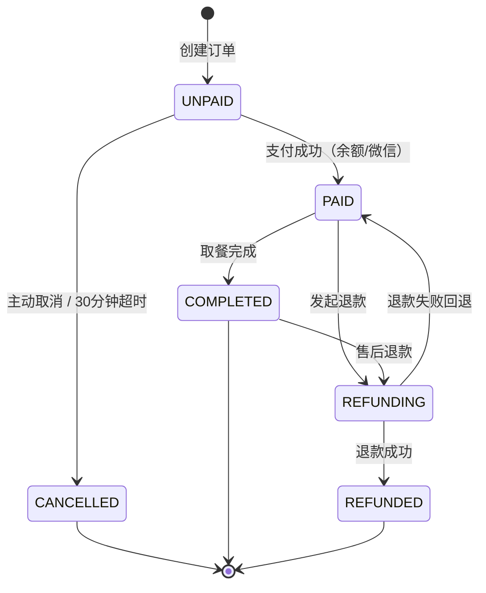

# TeaClub 核心业务规则与资金安全设计

| 项目 | 内容 |
| --- | --- |
| 文档编号 | TC-DOC-04 |
| 版本 | v1.0 |
| 编制日期 | 2026-11-19 |
| 编写角色 | 系统架构师 / Java 后端工程师 |
| 状态 | 待评审 |
| 重要性 | **本文档是第四阶段资金业务的唯一实现依据** |

---

## 1. 资金模型总览

### 1.1 三个层次

```
第一层  资金入口  ── 充值订单（wal_recharge_order）
                    消费订单（oms_order）
                    ↓
第二层  资金账户  ── 会员钱包（wal_wallet）
                    principal_balance  实付余额
                    gift_balance       赠送余额
                    ↓
第三层  资金凭证  ── 钱包流水（wal_wallet_transaction）
                    每一次余额变动一条，含变动前/变动额/变动后
```

**铁律**：任何余额变化必须满足 `余额变化 = 对应流水的变动额`，且**只能通过 `WalletService` 的四个原子方法完成**：
`rechargeIn()`、`consumeOut()`、`refundIn()`、`adjust()`。

### 1.2 余额不变量

```text
I1: principal_balance >= 0  AND  gift_balance >= 0           -- 永不为负
I2: principal_balance = SUM(principal_change) 对应该钱包       -- 余额可被流水完全解释
I3: gift_balance      = SUM(gift_change)      对应该钱包
I4: 每条流水 principal_after = principal_before + principal_change
I5: 每条流水 gift_after      = gift_before      + gift_change
I6: 流水 prin_before/gift_before 必须等于上一条流水的 after 值（链式一致）
```

I1~I5 在各方法内**强制校验**，违反直接抛 `FundConsistencyException` 并回滚。
I6 由每日对账任务校验（见 §7）。

---

## 2. 钱包原子操作定义

### 2.1 充值入账 `rechargeIn`

```java
/**
 * 充值入账：实付金与赠送金分列记账
 * @param cmd 包含 rechargeNo（幂等键）、payAmount（实付分）、giftAmount（赠分）、storeId、expireDays
 */
RechargeInResult rechargeIn(RechargeInCmd cmd);

// 前置校验
//   1. payAmount > 0
//   2. giftAmount >= 0
//   3. cmd.rechargeNo 非空（幂等键）
// 执行步骤（单事务）
//   1. SELECT wal_wallet WHERE brand_id=? AND member_id=? FOR UPDATE
//   2. 校验钱包状态 != FROZEN
//   3. 计算 after 值：principalAfter = before + payAmount
//                    giftAfter      = before + giftAmount
//   4. INSERT wal_wallet_transaction(
//         biz_type      = 'RECHARGE_IN',
//         biz_no        = cmd.rechargeNo,
//         principal_change = +payAmount, principal_before, principal_after,
//         gift_change      = +giftAmount, gift_before, gift_after,
//         amount_paid   = payAmount,
//         gift_amount   = giftAmount,
//         gift_expire_time = now + expireDays,
//         store_id      = cmd.storeId )
//      → uk_txn_biz 冲突则抛 DuplicateKeyException，上层捕获视为已完成
//   5. UPDATE wal_wallet SET principal_balance=principalAfter,
//                            gift_balance=giftAfter,
//                            total_principal_in=total_principal_in+payAmount,
//                            total_gift_in=total_gift_in+giftAmount,
//                            version=version+1
```

### 2.2 消费扣款 `consumeOut`

```java
ConsumeOutResult consumeOut(ConsumeOutCmd cmd);
// 入参：orderNo（幂等键）、payableAmount（应付分）、storeId、memberId、deductOrder（可选覆盖）

// 前置校验
//   1. payableAmount > 0
//   2. 钱包状态 == NORMAL
//   3. principal_balance + gift_balance >= payableAmount，否则抛 InsufficientBalanceException
//   4. 若要求赠送金不可用于本单（如购买特定商品）→ 按扣款策略只从实付金扣
//   注：钱包为品牌级，天然跨店；早期设计的跨店开关从未被扣款链路读取，已移除

// 扣款构成计算（核心算法）
//   deductOrder = GIFT_FIRST（默认）:
//       giftDeduct      = min(gift_balance, payableAmount)
//       principalDeduct = payableAmount - giftDeduct
//   deductOrder = PRINCIPAL_FIRST:
//       principalDeduct = min(principal_balance, payableAmount)
//       giftDeduct      = payableAmount - principalDeduct
//
//   ⚠ 禁止"按比例分摊"。按配置顺序扣减，语义明确，退款可精确还原。

// 执行步骤（单事务）
//   1. SELECT wal_wallet ... FOR UPDATE
//   2. INSERT wal_wallet_transaction(biz_type='CONSUME_OUT', biz_no=orderNo,
//         principal_change = -principalDeduct, gift_change = -giftDeduct, 前后余额, store_id)
//   3. UPDATE wal_wallet SET principal_balance = principal_balance - principalDeduct,
//                            gift_balance      = gift_balance - giftDeduct,
//                            total_principal_out = ..., total_gift_out = ..., version+1
// 返回扣款构成，供订单记录 balance_principal_amount / balance_gift_amount
```

### 2.3 退款回冲 `refundIn`

**这是最容易写错的环节。** 退款不是"把订单金额加回余额"，而是按**原扣款的资金构成**分别回冲。

```java
RefundInResult refundIn(RefundInCmd cmd);
// 入参：refundNo（幂等键）、原订单号、refundPrincipalAmount、refundGiftAmount、storeId、reason

// 计算 refundPrincipalAmount / refundGiftAmount 的规则：
//   场景 A：原订单用余额支付
//       直接取原 CONSUME_OUT 流水的 |principal_change| 与 |gift_change|
//       部分退款时按退款比例分摊：
//         ratio = refundAmount / originalPaidAmount
//         refundPrincipalAmount = round(originalPrincipalDeduct * ratio)
//         refundGiftAmount      = refundAmount - refundPrincipalAmount
//   ⚠ 用减法保证两者之和精确等于 refundAmount，避免浮点/四舍五入导致对不平
//
//   场景 B：原订单用微信支付
//       走微信退款，不进钱包；refundIn 不参与
//
//   场景 C：充值单退款
//       需要同时扣回实付金与赠送金：
//         若钱包当前余额不足扣回 → 拒绝退款或部分退款
//         记录 biz_type='RECHARGE_REFUND_OUT'

// 执行步骤（单事务）
//   1. SELECT wal_wallet ... FOR UPDATE
//   2. 校验回冲后余额不溢出（无上限，但需保证 I4/I5 数学一致）
//   3. INSERT wal_wallet_transaction(biz_type='REFUND_IN', biz_no=refundNo,
//         principal_change=+refundPrincipalAmount, gift_change=+refundGiftAmount, 前后余额)
//   4. UPDATE wal_wallet ... version+1
```

### 2.4 人工调整 `adjust`

```java
// 仅 HQ_FINANCE / SUPER_ADMIN 可用；必须填写原因；强制记入操作日志与流水
AdjustResult adjust(AdjustCmd cmd);  // 需要 approvalNo（审批单号）作为幂等键
```

---

## 3. 退款资金处理矩阵

| 原支付方式 | 退款资金去向 | 处理要点 |
| --- | --- | --- |
| 微信支付（JSAPI/Native） | 原路退回微信，**不进钱包** | 调 `/v3/refund/domestic/refunds`；校验 `已退+本次 ≤ 支付金额` |
| 余额支付（实付金部分） | 回冲 `principal_balance` | 从原 `CONSUME_OUT` 流水的 `|principal_change|` 还原 |
| 余额支付（赠送金部分） | 回冲 `gift_balance` | 同上；**赠送金不折现**，只能退回余额 |
| 混合支付（券 + 余额 + 微信） | 分别处理 | 券按规则退回（见 §4.3）；余额与微信各自原路 |

**绝对禁止的反模式**：

```text
❌ UPDATE wal_wallet SET principal_balance = principal_balance + 订单总额
   —— 忽略资金构成，导致实付/赠送串账，且绕过流水

❌ 退款时不写流水，只改余额
   —— 破坏 I2/I3 不变量，对账必然不平

❌ 全额退款时把赠送金也折算成现金退回微信
   —— 赠送金是营销成本，不能提现
```

---

## 4. 优惠券与积分的资金语义

### 4.1 优惠券成本不计入钱包

券抵扣的 `coupon_amount` 属于**营销费用**，直接减少订单 `payable_amount`，**不影响钱包余额，也不产生钱包流水**。

### 4.2 订单金额计算顺序（服务端唯一算法）

```text
1. total_amount   = Σ (门店 SKU 现价 × 数量)                     -- 全部服务端取价，不信任前端
2. activityDiscount = 匹配活动规则计算（优先级 priority 降序，取最优一个）
3. levelDiscount  = if 会员等级有折扣:
                       round((total_amount - activityDiscount) × (10000 - discount_rate) / 10000)
4. couponDiscount = 按券规则计算，基数 = total_amount - activityDiscount - levelDiscount
                     且 couponDiscount ≤ 该基数
5. payable_amount = total_amount - activityDiscount - levelDiscount - couponDiscount
6. 断言 payable_amount >= 0，否则截断为 0 并记录异常
```

> **断言是硬性的**：任何情况下 `payable_amount` 不得为负。若因规则叠加导致负数，截断为 0 并写入 `svc_anomaly_record`（AMOUNT_MISMATCH），以便运营修正规则。

### 4.3 退款时优惠券的退回规则

| 券状态 | 退款场景 | 处理 |
| --- | --- | --- |
| 已核销（USED） | 全额退款 | 券恢复为 `UNUSED`，有效期不延长（防套利）；若已过期则置 `EXPIRED` |
| 已核销（USED） | 部分退款 | **不退回**（券已实际享受优惠，部分退款保留优惠结果） |
| 已核销 | 订单取消（未支付） | 不涉及，核销发生在支付成功时 |

### 4.4 积分处理

```text
获得：订单支付成功 → 积分 = floor(payable_amount / 100分) × point_rate% × 等级倍率
扣减：订单全额退款 → 收回本单已发积分（可能为负，允许负积分或截断为 0 并记异常）

积分流水唯一键：uk_point_biz(biz_type, biz_no, member_id)
  ORDER_EARN 用 order_no，天然幂等
```

---

## 5. 订单状态机

### 5.1 状态定义

| 状态 | 含义 | 是否终态 |
| --- | --- | --- |
| `UNPAID` | 待支付 | 否 |
| `PAID` | 已支付 | 否 |
| `COMPLETED` | 已完成（已取餐） | 是 |
| `CANCELLED` | 已取消 | 是 |
| `REFUNDING` | 退款中 | 否 |
| `REFUNDED` | 已退款 | 是 |

### 5.2 合法流转



### 5.3 非法流转（必须拒绝）

| 尝试 | 结果 |
| --- | --- |
| `CANCELLED → PAID` | 拒绝：订单已取消 |
| `REFUNDED → PAID` | 拒绝 |
| `UNPAID → COMPLETED` | 拒绝：未支付不能完成 |
| `PAID → CANCELLED` | 拒绝：已支付只能走退款 |
| `REFUNDED → REFUNDING` | 拒绝：已退完 |

**实现方式**：`OrderStatusMachine` 枚举表驱动，`canTransit(from, to)` 静态校验，Service 层统一调用，并在 `oms_order_status_log` 留痕。

---

## 6. 支付状态机与通知处理

### 6.1 支付单状态

```
CREATED ──下单成功──► PAYING ──通知/查单──► SUCCESS
   │                    │
   │                    ├──超时──► CLOSED
   └──下单失败──► FAILED
SUCCESS ──退款──► REFUNDING ──► REFUNDED
```

### 6.2 通知处理严格顺序（不可调换）

```text
1. 记录原始通知到 pay_notify_log（status=RECEIVED, verify_result=0）
   —— 目的：即使后续失败也有完整审计痕迹
2. 若 (provider, notify_id) 已存在 → 直接返回 200 且 status=IGNORED（幂等，微信不再重推）
3. 验签：使用微信平台证书验证 Wechatpay-Signature
   —— 失败：status=FAILED，返回 4xx（让微信重推，可能是证书轮换）
4. 解密：使用 APIv3 密钥 AES-256-GCM 解密 resource
5. 业务校验（全部必须通过）：
   a. mchid         == 配置的商户号
   b. appid         == 配置的 AppID
   c. out_trade_no  == 我方的 payment_no
   d. amount.total  == pay_payment_order.amount     ← 金额必须逐分相等
   e. trade_state   == 'SUCCESS'
6. 幂等 + 业务处理在**同一事务**中：
   a. SELECT pay_payment_order ... FOR UPDATE
   b. if status == SUCCESS → status=PROCESSED, 返回 200（重复通知）
   c. 更新支付单为 SUCCESS
   d. 按 biz_type 分发：
        ORDER    → OrderService.processPaySuccess(bizNo, paymentNo)
        RECHARGE → RechargeService.processPaySuccess(bizNo, paymentNo)
   e. 更新 notify_log status=PROCESSED
7. 返回 HTTP 200 + {"code":"SUCCESS","message":"成功"}
   —— 任何非 200 都会导致微信持续重推，必须确保只有"已妥善处理"或"确定无法处理"才返回非 200
```

### 6.3 主动查单兜底

定时任务每 2 分钟扫描 `status='PAYING'` 且 `create_time < now - 2min` 的支付单，调用查单接口：
- `SUCCESS` → 走与通知一致的处理逻辑（复用同一 Service 方法，保证一致性）
- `CLOSED` / `NOTPAY` 超时 → 置 `CLOSED`，业务单置 `CANCELLED`
- 网络异常 → 记录异常，下轮重试（最多 5 次后转人工）

### 6.4 微信支付退款状态机

```
CREATED ──提交退款──► PROCESSING ──退款通知/查询──► SUCCESS
                          └──CLOSED/ABNORMAL──► FAILED
```
退款成功后才回冲钱包（场景 C）或标记业务单退款完成。

---

## 7. 对账与一致性巡检

### 7.1 每日定时任务（凌晨 02:00）

| 任务 | 检查内容 | 异常处理 |
| --- | --- | --- |
| T1 余额-流水一致性 | I2 / I3 | 写 `svc_anomaly_record(BALANCE_MISMATCH)`，含快照 |
| T2 流水链连续性 | I6 | 同上 |
| T3 支付单/业务单一致性 | 支付单 SUCCESS 但业务单非 PAID（或反之） | 写 `PAY_TIMEOUT` / `AMOUNT_MISMATCH` |
| T4 退款超额 | `SUM(refund) > paid_amount` | 写异常，冻结该单后续退款 |
| T5 优惠券超发 | `issued_quantity > total_quantity` | 写异常 |

### 7.2 一致性校验 SQL（T1 实现）

```sql
SELECT w.id, w.member_id,
       w.principal_balance, COALESCE(SUM(t.principal_change),0) AS calc_principal,
       w.gift_balance,      COALESCE(SUM(t.gift_change),0)      AS calc_gift
FROM wal_wallet w
LEFT JOIN wal_wallet_transaction t ON t.wallet_id = w.id
GROUP BY w.id, w.member_id, w.principal_balance, w.gift_balance
HAVING w.principal_balance <> calc_principal
    OR w.gift_balance      <> calc_gift;
```

### 7.3 流水链校验（T2 实现思路）

对每个钱包按 `id ASC` 遍历流水，断言：
```
txn[n].principal_before == txn[n-1].principal_after
txn[n].gift_before      == txn[n-1].gift_after
txn[0].principal_before == 0 且 gift_before == 0
最后一条.after == wal_wallet.当前余额
```

---

## 8. 权限校验实现规范

### 8.1 必须在后端强制校验的点

| 校验点 | 实现位置 | 失败响应 |
| --- | --- | --- |
| 是否登录 | Security Filter | 401 / 40100 |
| 是否有功能权限 | `@PreAuthorize("hasAuthority('store:order:list')")` | 403 / 40300 |
| 是否有该门店数据权限 | `storeScope.assertAccessible(storeId)` | 403 / 40301 |
| 列表查询是否自动过滤门店 | MyBatis 数据权限拦截器 | 静默过滤（不报错） |
| 是否可操作他店资源 | Service 方法首行校验目标对象的 `store_id` | 403 / 40301 |

### 8.2 收银员的额外限制

- 不可访问：`/api/admin/store/**`（门店配置）、`/api/admin/system/**`（系统管理）、`/api/admin/report/hq/**`（总部报表）
- 可访问：收银工作台、本店订单查询、会员查询、充值办理
- **不可看到成本价、毛利、其他门店任何数据**

### 8.3 前端与后端的分工

```
前端：根据 /api/admin/auth/menus 返回的菜单树动态生成路由与侧边栏（体验层面）
后端：每个接口独立做权限与数据范围校验（安全层面）
结论：前端隐藏菜单不是安全措施，仅影响体验；所有校验以后端为准。
```

---

## 9. 关键业务规则速查表

| 编号 | 规则 | 违反后果 |
| --- | --- | --- |
| F-01 | 钱包余额只能由 WalletService 修改 | 对账不平 |
| F-02 | 每次变动必须有流水，且含前后余额 | 不可审计 |
| F-03 | 实付/赠送分列记账 | 财务串账 |
| F-04 | 退款按原资金构成回冲 | 财务损失 |
| F-05 | 幂等键唯一索引兜底 | 重复入账 |
| F-06 | 金额全为分（BIGINT） | 精度丢失 |
| F-07 | 服务端重算金额 | 前端篡改价格 |
| F-08 | 支付成功以后端通知/查单为准 | 虚假入账 |
| F-09 | 订单状态机校验 | 数据错乱 |
| F-10 | 门店数据权限后端校验 | 越权访问 |
| F-11 | 券核销使用条件更新校验影响行数 | 重复核销 |
| F-12 | 赠送金不可提现、不可转赠 | 营销成本流失 |

---

## 10. 测试用例设计要点（供测试工程师执行）

| 编号 | 用例 | 期望 |
| --- | --- | --- |
| T-01 | 充值 100 送 10，入账后余额 | principal=10000, gift=1000，两条变动合一条流水 |
| T-02 | 重复投递同一 rechargeNo 通知 | 第二次不产生流水，余额不变，返回成功 |
| T-03 | 并发 10 次消费同一钱包，每次 30 元，余额 100 元 | 成功 3 次，失败 7 次，余额 10 元，绝不为负 |
| T-04 | 余额支付 100 元（gift=30, principal=100），GIFT_FIRST | gift 扣 30，principal 扣 70 |
| T-05 | 上单全额退款 | gift 回 30，principal 回 70，与 T-04 对称 |
| T-06 | 部分退款 50 元（比例 50%） | gift 回 15，principal 回 35，合计 50 |
| T-07 | 微信支付回调金额与服务端不符 | 拒绝处理，写 AMOUNT_MISMATCH，返回非 200 |
| T-08 | 收银员访问他店订单详情 | 403 |
| T-09 | 店长查询订单列表 | 结果集只含授权门店 |
| T-10 | 订单从 CANCELLED 尝试置为 PAID | 抛 BizException |
| T-11 | 跨店消费（A 店充值、B 店消费） | 同一品牌钱包正常扣款 |
| T-12 | 优惠叠加导致 payable 为负 | 截断为 0 并写异常记录 |
| T-13 | 并发退款两次相同 refundNo | 只成功一次 |
| T-14 | 余额支付时前端传入被篡改的金额 | 服务端忽略，按重算结果扣款 |
| T-15 | 流水链校验任务 | 构造缝隙后能被检出 |
