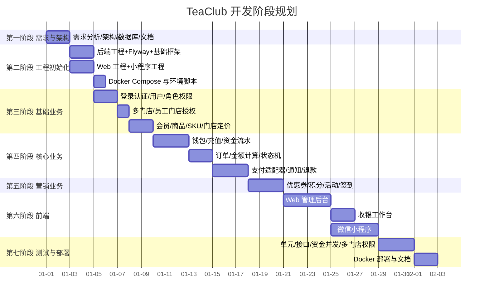

# TeaClub 开发计划与里程碑

| 项目 | 内容 |
| --- | --- |
| 文档编号 | TC-DOC-07 |
| 版本 | v1.0 |
| 编制日期 | 2026-11-19 |
| 编写角色 | 产品经理 / 系统架构师 |
| 状态 | 待评审 |

---

## 1. 阶段总览



> 工期为相对估算，实际以"每阶段验收通过"为推进条件，而非日历日期。

---

## 2. 各阶段详细任务

### 第一阶段：需求与架构（✅ 当前阶段，已完成）

| # | 任务 | 产出 | 状态 |
| --- | --- | --- | --- |
| 1.1 | 检查项目目录与现有文件 | 环境盘点结论 | ✅ |
| 1.2 | 检索 teaclub.sql 并审查 | 审查结论（不存在） | ✅ |
| 1.3 | 需求分析与功能清单 | `docs/01` | ✅ |
| 1.4 | 系统架构设计（含架构图） | `docs/02` | ✅ |
| 1.5 | 数据库设计（含 E-R 图与 DDL） | `docs/03` | ✅ |
| 1.6 | 核心业务规则与资金安全设计 | `docs/04` | ✅ |
| 1.7 | 接口规范与安全设计 | `docs/05` | ✅ |
| 1.8 | 项目目录规划 | `docs/06` | ✅ |
| 1.9 | 开发计划与里程碑 | `docs/07` | ✅ |
| 1.10 | 环境预研与部署规划 | `docs/08` | ✅ |

**阶段验收**：用户确认需求范围、技术选型、数据库设计、核心业务规则无误。

---

### 第二阶段：工程初始化（⏳ 下一阶段）

| # | 任务 | 验收标准 |
| --- | --- | --- |
| 2.1 | 创建 Spring Boot 3.5.16 工程（Maven） | `mvn compile` 通过 |
| 2.2 | 集成 MyBatis-Plus、Validation、SpringDoc、Flyway、Redis | 依赖解析成功，无版本冲突 |
| 2.3 | 统一响应 `Result<T>`、`GlobalExceptionHandler`、错误码枚举 | 单元测试通过 |
| 2.4 | JWT 认证骨架 + Security Filter Chain（admin/app 双链） | 未授权访问返回 401 |
| 2.5 | `CacheService` 双实现（redis/local） | 配置切换可运行 |
| 2.6 | `StoreScopeResolver` + MyBatis 数据权限拦截器 | 单元测试覆盖 |
| 2.7 | Flyway V1~V6 建表脚本 | 本机 MySQL 执行成功，表齐全 |
| 2.8 | Flyway V7~V8 种子数据 | 品牌/门店/权限/角色/账号/商品/充值方案可查 |
| 2.9 | 创建 Vue 3 + Vite + TS + Element Plus 工程 | `npm run build` 通过 |
| 2.10 | Axios 封装 + 路由骨架 + Pinia + 布局框架 | 可访问登录页 |
| 2.11 | 创建 uni-app 小程序工程 | 编译产出微信小程序包 |
| 2.12 | Docker Compose + Nginx 配置 + 开发脚本 | 配置通过语法检查 |

**阶段验收**：后端可启动并连接 MySQL，`/actuator/health` 返回 UP，Swagger 可访问；Web 可打开登录页；小程序可编译。

---

### 第三阶段：基础业务

| # | 任务 | 验收标准 |
| --- | --- | --- |
| 3.1 | 管理端登录/登出/刷新/改密 | 登录返回 JWT，错误密码 5 次锁定 |
| 3.2 | 菜单接口 `/auth/menus` | 按角色返回不同菜单树 |
| 3.3 | 员工管理 CRUD + 重置密码 + 启停 | 接口测试通过 |
| 3.4 | 角色管理 + 权限点绑定 | 修改角色权限后立即生效 |
| 3.5 | 门店管理 CRUD + 品牌信息 | 总部可管理，店长只能看本店 |
| 3.6 | 员工门店授权 | 授权后数据范围立即变化 |
| 3.7 | 会员管理（查询/详情/冻结/标签） | 手机号查询可用 |
| 3.8 | 会员等级配置 | 折扣与升级门槛可配 |
| 3.9 | 商品分类/SPU/SKU 管理 | 支持多规格 |
| 3.10 | 门店商品上下架 + 差异化定价 | 价格校验（不低于保护价） |
| 3.11 | 库存查询与调整（写流水） | 调整生成流水 |

**阶段验收**：管理员能登录，能管理门店/员工/角色/会员/商品；多门店权限测试通过。

---

### 第四阶段：核心业务（最高风险阶段）

| # | 任务 | 验收标准 |
| --- | --- | --- |
| 4.1 | `WalletService` 四个原子方法 | 单元测试覆盖充值/消费/退款/调整 |
| 4.2 | 钱包行锁 + 幂等键 + 唯一索引三重防护 | 并发测试余额不为负 |
| 4.3 | 充值方案 CRUD + 参与门店 | — |
| 4.4 | 创建充值订单 + 支付 + 入账 | 完整链路贯通 |
| 4.5 | 充值赠送金额/积分计算 | 实付与赠送分列 |
| 4.6 | 订单金额计算器（服务端唯一算法） | 单元测试覆盖券/等级/活动叠加 |
| 4.7 | 订单状态机 | 非法流转被拒绝 |
| 4.8 | POS 下单 + 余额支付 | 扣款构成正确 |
| 4.9 | `PaymentGateway` 接口 + Mock 实现 | Mock 全流程可用 |
| 4.10 | `WechatPayV3Gateway` 骨架（签名/验签/解密） | 签名工具类单元测试通过 |
| 4.11 | 支付通知处理（验签→解密→校验→幂等→入账） | 重复通知不重复入账 |
| 4.12 | 主动查单兜底 + 定时任务 | 模拟超时能被查单修复 |
| 4.13 | 退款（微信 + 余额，按资金构成回冲） | 全额/部分退款资金正确 |
| 4.14 | 对账一致性任务 | 构造脏数据能被检出 |

**阶段验收**：资金业务测试全部通过（见 `docs/04` §10 的 T-01 ~ T-15）。

---

### 第五阶段：营销业务

| # | 任务 | 验收标准 |
| --- | --- | --- |
| 5.1 | 优惠券模板 CRUD + 发布 | — |
| 5.2 | 发券（手动/新人/生日/充值赠送） | 每人限领生效 |
| 5.3 | 用券校验与核销（条件更新防重复） | 重复核销被拒绝 |
| 5.4 | 券过期定时任务 | 到期置 EXPIRED |
| 5.5 | 积分获得/扣减/流水 | 幂等键生效 |
| 5.6 | 积分兑换 | 积分不足报错 |
| 5.7 | 签到 + 连续签到加成 | 同日重复签到被拒绝 |
| 5.8 | 营销活动 CRUD + 参与门店/等级 | — |
| 5.9 | 会员等级折扣接入订单计算 | 折扣正确 |
| 5.10 | 沉睡会员圈选 | 按未消费天数筛选 |

**阶段验收**：优惠券可发放与核销，积分可增减，等级折扣生效。

---

### 第六阶段：前端开发

| # | 任务 | 验收标准 |
| --- | --- | --- |
| 6.1 | 登录页 + 权限路由 + 布局框架 | 登录后按角色展示菜单 |
| 6.2 | 总部看板（统计卡片 + ECharts 图表） | 数据来自真实接口 |
| 6.3 | 门店管理页 | CRUD + 分页 + 筛选 |
| 6.4 | 商品与门店定价页 | 支持批量上下架 |
| 6.5 | 会员管理页 + 详情抽屉（钱包/流水/券） | — |
| 6.6 | 充值方案 + 充值记录 + 钱包流水页 | — |
| 6.7 | 订单列表 + 详情抽屉（含退款） | — |
| 6.8 | **收银工作台**（选品/购物车/选会员/用券/收款） | 可完成真实支付 |
| 6.9 | 营销管理页（券/活动/积分/签到） | — |
| 6.10 | 报表页（趋势/排行） | — |
| 6.11 | 系统管理页（用户/角色/权限/日志/配置） | — |
| 6.12 | 小程序首页 + 点单 + 购物车 | 可下单 |
| 6.13 | 小程序充值中心 + 支付 | 可充值 |
| 6.14 | 小程序会员中心（余额/流水/券/积分/订单） | — |
| 6.15 | 全站加载态/空态/错误态 | 逐页检查 |

**阶段验收**：所有页面使用真实接口，无静态假数据；按钮均有实际业务行为。

---

### 第七阶段：测试与部署

| # | 任务 | 验收标准 |
| --- | --- | --- |
| 7.1 | 单元测试（钱包/金额计算/状态机/验签） | 覆盖率 ≥ 70% |
| 7.2 | 接口测试 | 全模块通过 |
| 7.3 | 支付流程测试（Mock 全链路） | 充值/消费/退款/重复通知 |
| 7.4 | 多门店权限测试 | 越权访问全部被拒绝 |
| 7.5 | 资金并发测试 | 无超扣、无重复入账 |
| 7.6 | 前端构建与联调 | `npm run build` 通过 |
| 7.7 | 小程序编译 | 产出可导入微信开发者工具的包 |
| 7.8 | Docker Compose 部署 | 一键启动，健康检查通过 |
| 7.9 | 部署与运维手册 | `docs/10` |
| 7.10 | 测试报告 | `docs/09` |

**阶段验收**：满足需求文档第十三节全部 18 条验收标准。

---

## 3. 关键风险与缓解

| # | 风险 | 影响阶段 | 缓解措施 |
| --- | --- | --- | --- |
| R1 | 本机无 Docker，Compose 部署无法实测 | 7 | 同时提供本机直跑方案；文档明确标注"容器方案基于配置校验，未在本机实测" |
| R2 | 本机 MySQL root 密码未知 | 2 | 见 `docs/08` §3 的分级处理路径 |
| R3 | 本机无 Redis | 2、4 | `CacheService` 抽象 + local 实现，生产用 Redis |
| R4 | 无微信商户资质 | 4 | Mock 适配器完整实现真实流程；真实适配器骨架 + 文档标注未联调 |
| R5 | 依赖版本更新过快（Vite8/Pinia4/TS7） | 2、6 | 已在架构文档锁定稳定线，`package.json` 精确固定版本 |
| R6 | 资金并发逻辑复杂易错 | 4 | 先写测试再实现；对账任务兜底；代码评审逐行核对 |
| R7 | 小程序无 AppID，无法真机调试 | 6 | 使用测试号配置；以编译通过 + H5 预览验证功能 |
| R8 | `mvn` 命令被 Node 包装器劫持 | 2 | 统一使用 `C:\Users\Admin\apache-maven-3.9.6\bin\mvn.cmd` 或项目 Wrapper |

---

## 4. 质量门禁（每阶段必须通过才进入下一阶段）

```text
□ 后端 mvn compile 无错误
□ 后端 mvn test 全部通过
□ 前端 npm run build 无错误
□ 小程序编译无错误
□ 新增接口已加入 Swagger 且可调通
□ 新增功能有对应单元测试或接口测试
□ 无硬编码密钥、无真实用户数据
□ 无 TODO 遗留（或已登记到文档）
□ 文档已同步更新
□ 已向用户汇报本阶段完成内容与遗留问题
```

---

## 5. 交付物清单

| 类别 | 交付物 |
| --- | --- |
| 设计文档 | `docs/01` ~ `docs/08` |
| 测试文档 | `docs/09-测试方案与用例.md`、测试报告 |
| 部署文档 | `docs/10-部署与运维手册.md` |
| 后端 | `backend/` 完整可运行工程 + 单元测试 |
| Web 前端 | `web/` 完整可构建工程 |
| 小程序 | `miniapp/` 完整可编译工程 |
| 部署编排 | `deploy/` Docker Compose + Nginx + Dockerfile |
| 脚本 | `scripts/` 开发、构建、测试、重置数据库脚本 |
| 数据 | Flyway 迁移脚本（建表 + 种子数据） |
