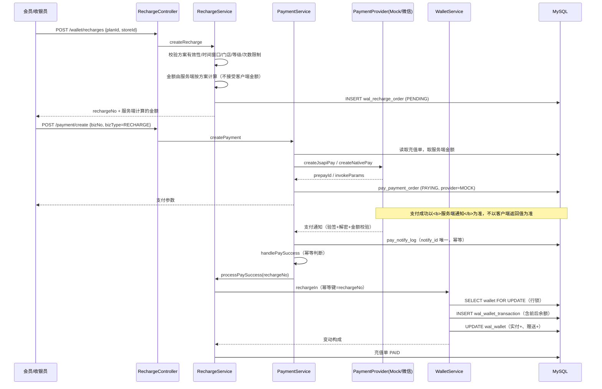
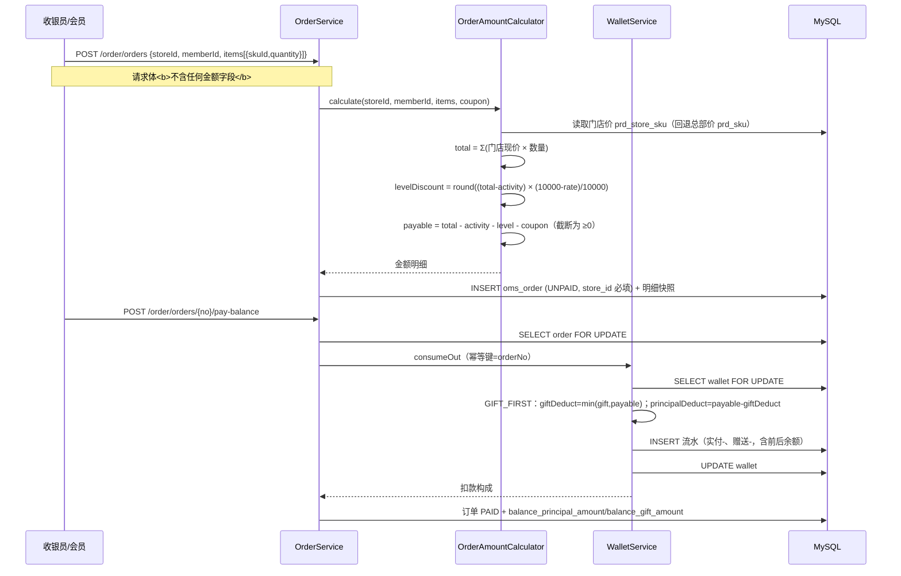
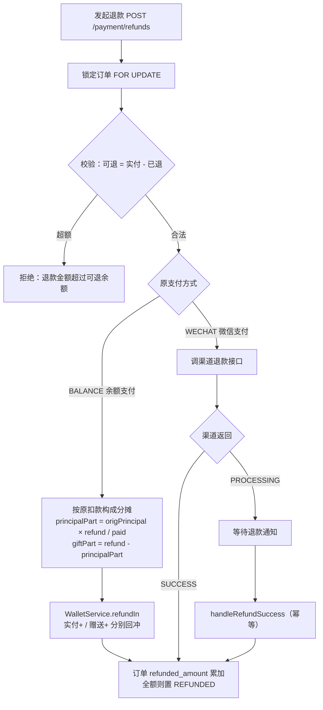

# TeaClub 资金业务设计（储值 · 订单 · 支付 · 退款）

| 项目 | 内容 |
| --- | --- |
| 文档编号 | TC-DOC-12 |
| 版本 | v1.0 |
| 编制日期 | 2026-11-19 |
| 编写角色 | 系统架构师 / Java 后端工程师 |
| 阶段 | 第四阶段：核心资金业务 |
| 状态 | 已实现并通过测试（Mock 渠道） |

---

## 1. 资金流程图

### 1.1 充值流程（含赠送金分账）



### 1.2 消费流程（余额支付，实付/赠送混合扣款）



### 1.3 退款流程（按原资金构成回冲）



---

## 2. 资金安全设计

### 2.1 不变量

| 编号 | 不变量 | 强制位置 |
| --- | --- | --- |
| I1 | 实付余额 ≥ 0 且 赠送余额 ≥ 0 | `assertNonNegative` |
| I2 | 实付余额 = Σ 该钱包所有流水的 principal_change | 对账任务 |
| I3 | 赠送余额 = Σ 该钱包所有流水的 gift_change | 对账任务 |
| I4 | 流水 principal_after = principal_before + principal_change | 构造流水时 |
| I5 | 流水 gift_after = gift_before + gift_change | 构造流水时 |
| I6 | 相邻流水首尾相接（before == 上一条 after） | 对账任务 |

**对账接口**：`GET /api/admin/wallet/reconcile`，返回 `consistent` 与不一致明细。

### 2.2 并发方案：悲观行锁为主

```text
BEGIN
  SELECT * FROM wal_wallet WHERE brand_id=? AND member_id=? FOR UPDATE   -- 行锁
  -- 在锁内读取余额、计算变动、写流水、更新余额
  INSERT INTO wal_wallet_transaction (...)                                -- uk_txn_biz 唯一
  UPDATE wal_wallet SET principal_balance=?, gift_balance=?, version=version+1
COMMIT
```

为什么用行锁而非乐观锁重试：资金写入需要**确定性语义**。锁冲突时让后到者等待，
也不能让其基于过期余额计算。乐观锁（`@Version`）仅作为版本审计字段保留。

### 2.3 幂等三层防护

| 层级 | 机制 | 位置 |
| --- | --- | --- |
| 1 | 进入时按 `biz_no` 查流水，已存在直接返回 | `WalletServiceImpl.findTxn` |
| 2 | `uk_txn_biz(biz_type, biz_no)` 唯一索引，冲突转幂等命中 | `insertTxnIdempotent` |
| 3 | 业务单状态机（充值单 PAID / 订单 PAID / 支付单 SUCCESS） | 各 Service |

支付通知额外有 `pay_notify_log(provider, notify_id)` 唯一索引。

### 2.4 金额可信来源

| 场景 | 金额来源 | 客户端能否影响 |
| --- | --- | --- |
| 充值 | 按 `wal_recharge_plan` 服务端计算 | ❌ 请求体无金额字段 |
| 消费 | 按 `prd_store_sku`/`prd_sku` 现价 × 数量 | ❌ 请求体只有 skuId + quantity |
| 支付 | 读业务单的 `payable_amount`/`recharge_amount` | ❌ |
| 退款 | 读订单 `paid_amount - refunded_amount` | ❌ 只能指定不超过可退额 |

**支付通知金额校验**：通知金额与服务端记录的 `amount` 必须**逐分相等**，否则拒绝处理并记录异常。

### 2.5 扣款顺序

`GIFT_FIRST`（默认）：先扣赠送金，不足部分扣实付金。
`PRINCIPAL_FIRST`：反之。

**明确禁止按比例分摊**——比例分摊会导致退款无法精确还原资金构成。

---

## 3. 支付渠道抽象

```java
public interface PaymentProvider {
    String providerName();                                  // MOCK / WECHAT_V3
    PayCreateResult createJsapiPay(PayCreateCmd cmd);       // 小程序
    PayCreateResult createNativePay(PayCreateCmd cmd);      // Web 扫码
    PayQueryResult queryByOutTradeNo(String paymentNo);     // 主动查单
    void closeOrder(String paymentNo);
    RefundResult createRefund(RefundCreateCmd cmd);
    RefundResult queryRefund(String refundNo);
    NotifyPayload verifyAndDecryptNotify(Map<String,String> headers, String body);
    NotifyPayload verifyAndDecryptRefundNotify(Map<String,String> headers, String body);
}
```

实现由 `teaclub.payment.provider` 决定（`@ConditionalOnProperty`）：

| 值 | 实现 | Mock 通知接口 |
| --- | --- | --- |
| `mock`（默认） | `MockPaymentProvider` | **存在** |
| `wechat-v3` | `WechatPayV3Provider` | **物理不存在（404）** |

业务代码只依赖接口，**不允许出现 `if (isMock)` 分支**。

---

## 4. 微信支付实现状态（如实说明）

### 4.1 已完成（可验证）

- `PaymentProvider` 接口完整定义
- `WechatPayV3Provider` 骨架：配置完整性校验，缺配置时**启动即抛异常**，不静默降级
- `MockPaymentProvider`：完整实现业务流程验证所需的全部能力
- 支付单 provider 字段区分 `MOCK` / `WECHAT_V3`，报表可按此过滤
- 通知处理链路（幂等、金额校验、业务分发）与渠道无关，已通过 Mock 完整验证

### 4.2 未完成（缺少真实商户资质，无法验证）

| 项 | 状态 | 说明 |
| --- | --- | --- |
| RSA 私钥签名 | ❌ 未实现 | 无商户私钥文件 |
| 平台证书验签 | ❌ 未实现 | 无平台证书 |
| AES-256-GCM 通知解密 | ❌ 未实现 | 无 APIv3 密钥 |
| 真实下单 HTTP 调用 | ❌ 未实现 | 无法联调 |
| 真实查单 / 退款 | ❌ 未实现 | 无法联调 |

**上述未实现方法在调用时抛出明确异常，绝不返回伪造的成功结果。**

```text
微信支付[小程序下单]尚未实现或未联调：当前环境无真实商户资质，
请使用 teaclub.payment.provider=mock 进行业务流程验证
```

### 4.3 启用真实支付需要的配置

```bash
TEACLUB_PAYMENT_PROVIDER=wechat-v3
WXPAY_MCH_ID=<商户号>
WXPAY_MCH_SERIAL=<商户证书序列号>
WXPAY_API_V3_KEY=<APIv3 密钥>
WXPAY_PRIVATE_KEY_PATH=<商户私钥路径>
WXPAY_PLATFORM_CERT_PATH=<平台证书路径>
WXPAY_APP_ID=<小程序 AppID>
WXPAY_NOTIFY_URL=<支付回调地址>
WXPAY_REFUND_NOTIFY_URL=<退款回调地址>
```

---

## 5. 为什么种子钱包需要 V8 期初流水

V7 直接给会员 1/2 写入了初始余额，但从资金不变量角度看，**没有流水的余额是"凭空出现"的**，
会导致对账接口永远报不一致。

V8 迁移为既有余额补一条 `ADMIN_ADJUST` 类型的期初入账流水，使 I2/I3 成立。
这是本次开发中发现并修正的真实设计缺陷。

---

## 6. 已知限制

| # | 限制 | 影响 |
| --- | --- | --- |
| 1 | 真实微信支付未实现 | 只能跑 Mock 链路 |
| 2 | 优惠券 / 积分 / 会员等级升级未接入订单 | 订单 `couponDiscount` 目前恒为 0 |
| 3 | 无订单超时自动取消定时任务 | 未支付订单不会自动取消 |
| 4 | 无赠送金过期核销定时任务 | `gift_expire_time` 已记录但未执行核销 |
| 5 | 充值自定义金额方案不计算赠送 | 自定义方案 `giftAmount` 恒为 0 |
| 6 | 退款未回退订单明细 `refunded_quantity` | 明细级退款数量未更新 |
