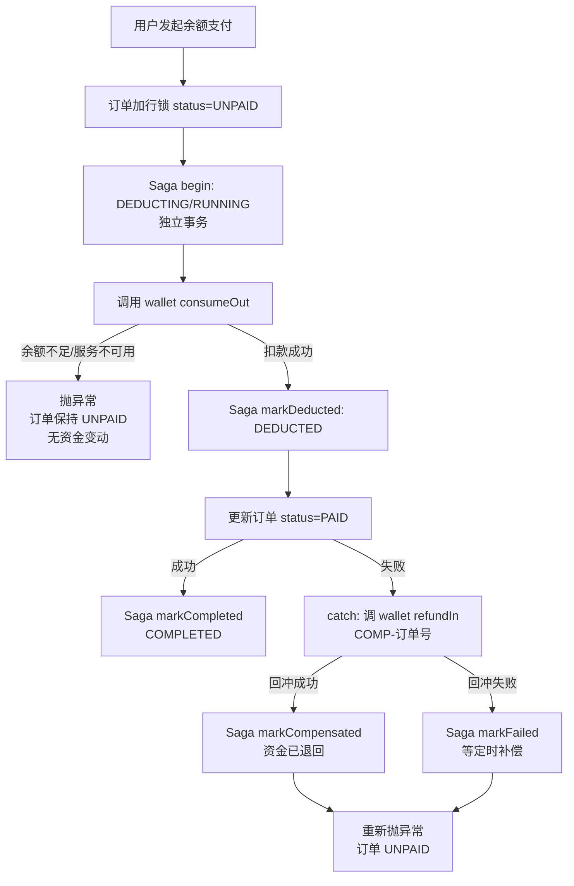
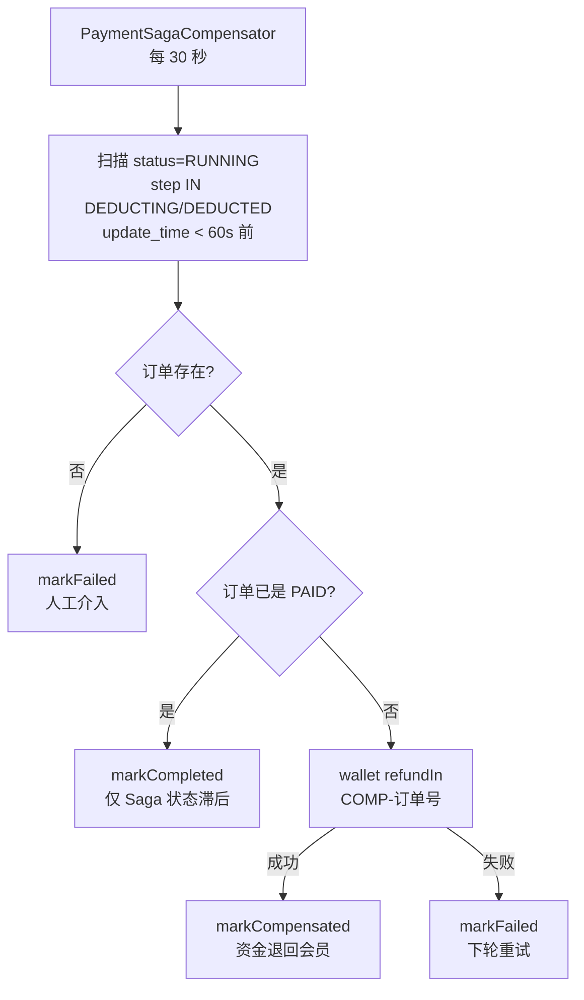
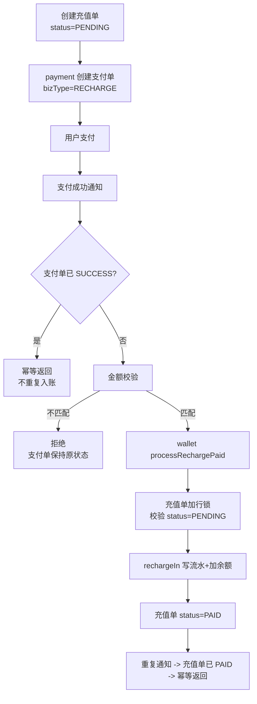
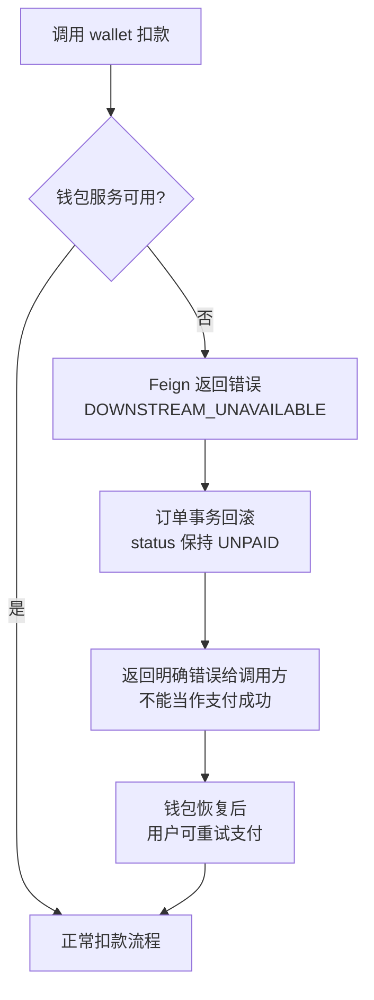
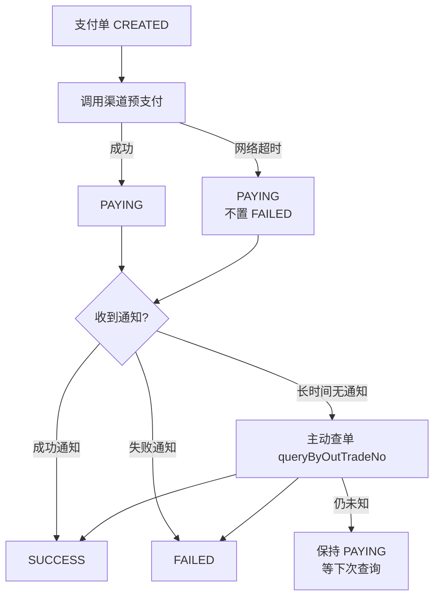
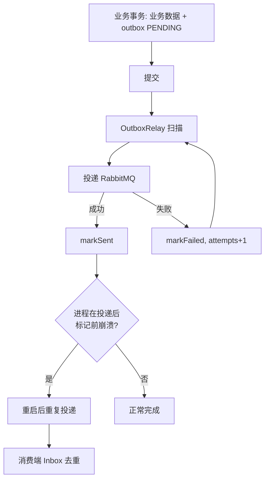

# TeaClub 第五阶段·任务四：异常恢复流程图

| 项目 | 内容 |
| --- | --- |
| 文档编号 | TC-T4-06 |
| 日期 | 2026-11-20 |
| 核心命题 | 任何异常都不得导致「钱已扣但订单永久待支付」或「钱丢了」 |

---

## 一、余额支付 Saga：正常路径与补偿路径



**关键点**：补偿在一次请求内同步完成；即使进程在 G 之后崩溃，定时补偿任务也能兜底。

---

## 二、滞留 Saga 的定时补偿（进程崩溃兜底）



**实测**：构造 `DEDUCTED/RUNNING` 300 秒前记录，30 秒内被自动回冲，余额 44210 → 45925。

---

## 三、充值链路：支付成功到入账



**实测**：连续 5 次成功通知，余额只 +10000/+2000 一次，流水仅 1 条。

---

## 四、退款：申请 → 平台确认

```mermaid
flowchart TD
    A[申请退款] --> B[查订单状态<br/>PAID/COMPLETED/REFUNDING]
    B --> C[计算可退<br/>= 实付 - SUM(有效退款单)]
    C -->|可退 <= 0| D[拒绝：已无可退金额]
    C -->|申请额 > 可退| E[拒绝：超过可退余额]
    C -->|通过| F[INSERT 退款单 PROCESSING]
    F --> G{渠道}
    G -->|WECHAT| H[调渠道退款]
    G -->|BALANCE| I[wallet refundIn<br/>按原扣款构成]
    H --> J[等平台通知]
    J -->|成功通知| K[退款单 SUCCESS<br/>订单 REFUNDED/REFUNDING]
    J -->|失败通知| L[退款单 FAILED<br/>额度释放，可重新申请]
    I --> K
```

**关键**：第二次申请时 F 插入的退款单已被 `SUM` 计入，因此被 C 拦截。

---

## 五、冻结超时释放（消费确认超时）

```mermaid
flowchart TD
    A[冻结余额<br/>写 wal_wallet_freeze FROZEN] --> B{订单确认扣款?}
    B -->|正常确认| C[confirmFreeze<br/>按冻结构成扣款+写流水]
    B -->|订单失败| D[releaseFreeze<br/>仅改 RELEASED]
    B -->|进程崩溃/超时| E[FreezeExpiryScheduler<br/>每 10 秒扫描]
    E --> F[expire_time < NOW()<br/>status=FROZEN]
    F --> G[条件更新 status=RELEASED]
    G --> H[可用余额恢复<br/>不写流水]
```

**关键**：冻结与释放都不写流水、不动余额，因此 `余额 = 流水累计` 始终成立。

---

## 六、服务宕机恢复



**实测**：停止 `teaclub-wallet` 容器 → 支付返回错误，订单保持 UNPAID；
恢复容器后重试 → 支付成功，状态 PAID。全程无资金错账。

---

## 七、支付结果未知（不误判失败）



---

## 八、Outbox 投递失败恢复



---

## 九、状态机总览

| 业务实体 | 状态集合 | 终态 | 可补偿 |
| --- | --- | --- | --- |
| 订单 | UNPAID / PAID / COMPLETED / REFUNDING / REFUNDED / CANCELLED | REFUNDED / CANCELLED | 部分退款可再退 |
| 支付单 | CREATED / PAYING / SUCCESS / FAILED | SUCCESS / FAILED | PAYING 可查单推进 |
| 退款单 | CREATED / PROCESSING / SUCCESS / FAILED | SUCCESS / FAILED | FAILED 可重新申请 |
| 充值单 | PENDING / PAID / CANCELLED | PAID / CANCELLED | PENDING 可重发支付 |
| 冻结记录 | FROZEN / CONFIRMED / RELEASED | CONFIRMED / RELEASED | FROZEN 可自动释放 |
| Saga | DEDUCTING / DEDUCTED / ORDER_PAID / COMPENSATED + FAILED | COMPLETED / COMPENSATED | FAILED 可重试补偿 |

---

## 十、验证结论

| 命题 | 验证方式 | 结果 |
| --- | --- | --- |
| 不会钱扣了订单永久待支付 | 真实宕机 + 构造滞留 Saga | 通过（自动回冲） |
| 不会重复扣款 | 30 并发同单号 | 通过（只扣 1 次） |
| 不会负余额 | 20 并发超余额 | 通过（余额 1900） |
| 不会重复退款 | 连续两次全额退款 | 通过（第二次被拒） |
| 资金守恒 | 全库对账 | 通过（0 不一致） |
