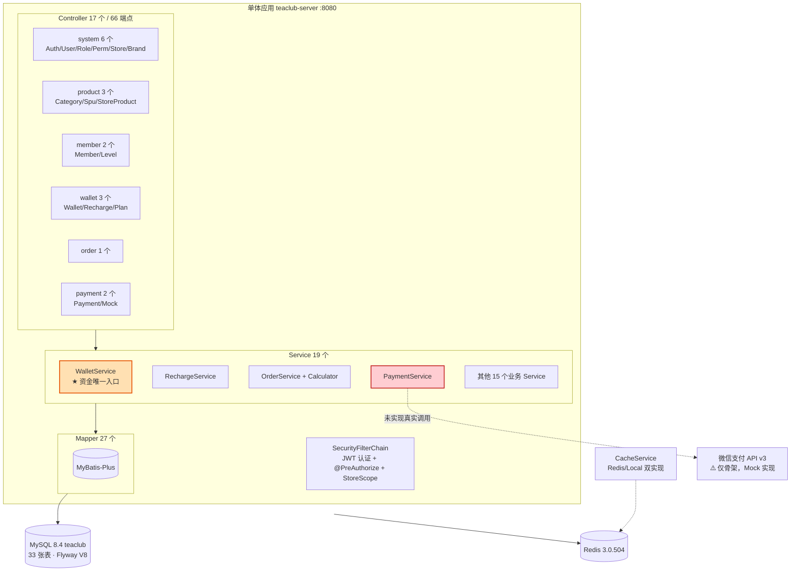

# TeaClub 现有项目审计报告

| 项目 | 内容 |
| --- | --- |
| 文档编号 | TC-MSA-01 |
| 版本 | v1.0 |
| 编制日期 | 2026-11-19 |
| 阶段 | 第五阶段·任务一 |
| 审计方式 | **实际读取代码与数据库**，非基于名称推测 |
| 结论 | 后端单模块完整实现；前端与部署目录为空；存在 3 处跨域直连需拆分 |

---

## 1. 审计方法与范围

本次审计执行了以下**实际动作**，所有结论均有工具输出支撑：

| # | 动作 | 手段 |
| --- | --- | --- |
| 1 | 目录结构清点 | `Get-ChildItem -Recurse` 统计文件数 |
| 2 | Java 类清点 | 扫描 `*Controller / *Service / *ServiceImpl / *Mapper / entity` |
| 3 | 跨模块依赖分析 | 正则提取 `import com.teaclub.<module>.*` 构建矩阵 |
| 4 | 数据库结构核对 | 连接 MySQL 查询 `information_schema` |
| 5 | 数据量与金额核对 | 逐表 `COUNT(*)` + 汇总金额 SQL |
| 6 | API 清单提取 | 调用运行中的 `/v3/api-docs` |
| 7 | 版本兼容性验证 | Maven 元数据查询 + **实际依赖解析（BUILD SUCCESS）** |

---

## 2. 项目目录审计结果

```text
H:\奶茶店会员与储值营销系统\
├── backend\        238 files   ← 唯一有实际代码的模块
├── docs\            14 files   ← 设计文档
├── scripts\          7 files   ← 测试与工具脚本
├── deploy\           0 files   ← 空
├── web\              0 files   ← 空
├── miniapp\          0 files   ← 空
└── .idea\            6 files   ← IDE 配置
```

### 2.1 结论：前端与部署未开发

| 目录 | 文件数 | 实际状态 |
| --- | --- | --- |
| `web/` | **0** | Vue 管理后台**完全未开发** |
| `miniapp/` | **0** | uni-app 小程序**完全未开发** |
| `deploy/` | **0** | Docker Compose **完全未开发** |

> ⚠️ 这三项在需求文档中属于第六、七阶段，本轮微服务化**不应假设前端存在**。
> 微服务迁移期间前端为零，意味着**没有存量前端需要适配**，反而降低了迁移风险。

### 2.2 后端包结构与规模

| 包 | Java 文件数 | 职责 |
| --- | --- | --- |
| `common` | 26 | 统一响应、异常、JWT、安全、缓存、审计日志 |
| `system` | **58** | 品牌、门店、用户、角色、权限、门店授权 |
| `wallet` | **36** | 钱包、流水、充值方案、充值订单 |
| `product` | 30 | 分类、SPU、SKU、门店商品、门店定价 |
| `payment` | 27 | 支付单、通知、退款、Mock/微信适配器 |
| `order` | 19 | 订单、明细、状态机、金额计算 |
| `member` | 15 | 会员、会员等级 |
| **合计** | **220** | 约 12,500 行 |

---

## 3. 分层实现情况

### 3.1 Controller（17 个，66 个端点）

| 模块 | Controller | 端点数 |
| --- | --- | --- |
| system | AuthController | 5 |
| system | SysUserController | 10 |
| system | SysRoleController | 7 |
| system | SysPermissionController | 6 |
| system | SysStoreController | 7 |
| system | SysBrandController | 2 |
| member | MemMemberController | 6 |
| member | MemMemberLevelController | 5 |
| product | PrdCategoryController | 5 |
| product | PrdSpuController | 6 |
| product | PrdStoreProductController | 6 |
| wallet | WalletController | 6 |
| wallet | RechargeController | 4 |
| wallet | RechargePlanController | 6 |
| order | OrderController | 7 |
| payment | PaymentController | 6 |
| payment | MockPaymentController | 3 |
| **合计** | **17** | **66** |

### 3.2 Service（18 个接口 + 18 个实现）

全部为**接口 + 实现类**结构，无空实现：

| 域 | Service 接口 | 实现 |
| --- | --- | --- |
| system | AuthService / SysUserService / SysRoleService / SysPermissionService / SysStoreService / SysBrandService | 6 |
| member | MemMemberService / MemMemberLevelService | 2 |
| product | PrdCategoryService / PrdSpuService / PrdStoreProductService | 3 |
| wallet | WalletService / WalletQueryService / RechargeService / RechargePlanService | 4 |
| order | OrderService / OrderAmountCalculator | 2 |
| payment | PaymentService / MockPaymentService | 2 |
| **合计** | | **19** |

### 3.3 Entity（27 个）/ Mapper（27 个）

**Entity 与表 1:1 对应**，全部使用 MyBatis-Plus 注解：

```text
system : SysBrand, SysStore, SysUser, SysRole, SysPermission,
         SysUserRole, SysRolePermission, SysUserStore, SysOperationLog   (9)
member : MemMember, MemMemberLevel                                       (2)
product: PrdCategory, PrdSpu, PrdSku, PrdStoreSpu, PrdStoreSku            (5)
wallet : WalWallet, WalWalletTransaction, WalRechargePlan,
         WalRechargePlanStore, WalRechargeOrder                          (5)
order  : OmsOrder, OmsOrderItem, OmsOrderStatusLog                       (3)
payment: PayPaymentOrder, PayNotifyLog, PayRefundOrder                    (3)
合计   : 27
```

---

## 4. 数据库实际状态

### 4.1 表清单（33 张，含 flyway 元表）

Flyway 版本：**V8**

| 归属前缀 | 表数 | 表名 |
| --- | --- | --- |
| `sys_` | 9 | brand, store, user, role, permission, user_role, role_permission, user_store, operation_log |
| `sys_config`, `sys_idempotency_record` | 2 | 配置、幂等（**当前无 Entity，未被使用**） |
| `mem_` | 4 | member, member_level, member_tag, member_tag_rel |
| `prd_` | 7 | category, spu, sku, store_spu, store_sku, inventory（空表） |
| `wal_` | 5 | wallet, wallet_transaction, recharge_plan, recharge_plan_store, recharge_order |
| `oms_` | 3 | order, order_item, order_status_log |
| `pay_` | 3 | payment_order, notify_log, refund_order |

### 4.2 实际数据量（迁移核对基线）

```text
sys_brand                    1      mem_member                   3
sys_store                    4      mem_member_level             5
sys_user                     6      prd_category                 5
sys_role                     5      prd_spu                      7
sys_permission              68      prd_sku                     14
sys_user_role                6      prd_store_spu               20
sys_role_permission        179      prd_store_sku               17
sys_user_store               4      wal_wallet                   3
sys_operation_log          770      wal_wallet_transaction       5
                                    wal_recharge_plan            6
oms_order                    1      wal_recharge_plan_store      2
oms_order_item               1      wal_recharge_order           2
oms_order_status_log         3
pay_payment_order            1      prd_inventory                0  (空)
pay_notify_log               1      mem_member_tag               0  (空)
pay_refund_order             2      mem_member_tag_rel           0  (空)
                                    sys_config                   0  (空)
                                    sys_idempotency_record       0  (空)
```

### 4.3 关键金额核对基线（迁移前后必须一致）

```text
钱包实付余额合计     255000 分
钱包赠送余额合计      38000 分
流水实付变动合计     255000 分   ← 与钱包实付**完全相等** ✅
流水赠送变动合计      38000 分   ← 与钱包赠送**完全相等** ✅

已支付充值金额        5000 分
订单实付合计          1750 分
订单已退合计          1750 分
支付成功合计          5000 分
退款成功合计          3500 分
```

> **这组数字就是迁移验收的黄金基线。** 迁移后必须逐项复核，任何一项不等即为迁移失败。

---

## 5. 跨模块依赖审计（微服务拆分的关键依据）

### 5.1 依赖矩阵（行=引用方，列=被引用方，数字=引用该模块的 Java 文件数）

```text
from\to   common  system  member  product  wallet  order  payment
common        -       2       .       .       .      .      .
system       15       -       .       .       .      .      .
member        5       1       -       .       .      .      .
product       8       1       .       -       .      .      .
wallet        9       3       3       .       -      .      .
order         4       1       2       1       1      -      .
payment       6       .       .       .       1      1      -
```

### 5.2 具体耦合点（决定 Feign 接口设计）

| 引用方 | 被引用方 | 具体类 | 性质 | 拆分难度 |
| --- | --- | --- | --- | --- |
| wallet | member | `MemMember`、`MemMemberLevel`、两个 Mapper | **同库跨模块直读** | 🟡 需改 Feign |
| wallet | system | `SysStore`、`SysBrand`、Mapper | **同库跨模块直读** | 🟡 需改 Feign |
| order | member | `MemMember`、`MemMemberLevel`、Mapper | **同库跨模块直读** | 🟡 需改 Feign |
| order | product | `PrdSku`、`PrdSpu`、`PrdStoreSku`、`PrdStoreSpu` + 4 Mapper | **同库跨模块直读** | 🟡 需改 Feign |
| order | wallet | `WalletService`、`ConsumeOutCmd` | **同进程 Service 调用** | 🟢 直接改 Feign |
| payment | order | `OmsOrder`、`OmsOrderMapper`、`OrderService` | **同库直读 + Service 调用** | 🔴 **最难** |
| payment | wallet | `WalRechargeOrder`、Mapper、`RechargeService`、`WalletService` | **同库直读 + Service 调用** | 🔴 **最难** |
| member | system | `SysStore`、`SysStoreMapper` | 同库直读 | 🟡 |
| product | system | `SysStore`、`SysStoreMapper` | 同库直读 | 🟡 |

### 5.3 最严重的问题：payment 直接读写 order 与 wallet 的数据表

```java
// PaymentServiceImpl 当前实现（节选）
OmsOrder order = orderMapper.selectByNoForUpdate(request.getOrderNo());   // 直读 order 表
WalRechargeOrder recharge = rechargeMapper.selectByNo(request.getBizNo()); // 直读 wallet 表
orderService.processPaySuccess(...);                                       // 直调 order Service
rechargeService.processPaySuccess(...);                                    // 直调 wallet Service
walletService.refundIn(...);                                               // 直调 wallet Service
```

**这违反微服务"每个服务只管理自己的数据"原则**，是本次拆分必须解决的头号问题。
详见 `SERVICE-BOUNDARIES.md` §4 的支付-订单-钱包协作方案。

---

## 6. API 接口清单（66 个，实测提取）

### 6.1 按模块分布

| 前缀 | 端点数 | 迁移目标服务 |
| --- | --- | --- |
| `/api/admin/auth/**` | 5 | auth-service |
| `/api/admin/system/users/**` | 8 | auth-service |
| `/api/admin/system/roles/**` | 5 | auth-service |
| `/api/admin/system/permissions/**` | 4 | auth-service |
| `/api/admin/store/**` | 5 | auth-service |
| `/api/admin/member/**` | 11 | member-service |
| `/api/admin/product/**` | 17 | product-service |
| `/api/admin/wallet/**` | 16 | wallet-service |
| `/api/admin/order/**` | 7 | order-service |
| `/api/admin/payment/**` | 6 | payment-service |
| `/api/payment/mock/**` | 3 | payment-service（仅 mock 配置） |

### 6.2 全部接口路径

```text
/api/admin/auth/login
/api/admin/auth/logout
/api/admin/auth/me
/api/admin/auth/menus
/api/admin/auth/password

/api/admin/system/users            GET POST
/api/admin/system/users/{id}       GET PUT DELETE
/api/admin/system/users/{id}/reset-password
/api/admin/system/users/{id}/roles
/api/admin/system/users/{id}/status
/api/admin/system/users/{id}/stores

/api/admin/system/roles            GET POST
/api/admin/system/roles/all
/api/admin/system/roles/{id}       GET PUT DELETE
/api/admin/system/roles/{id}/permissions

/api/admin/system/permissions      POST
/api/admin/system/permissions/mine
/api/admin/system/permissions/tree
/api/admin/system/permissions/{id} GET PUT DELETE

/api/admin/store/brand             GET PUT
/api/admin/store/stores            GET POST
/api/admin/store/stores/accessible
/api/admin/store/stores/{id}       GET PUT DELETE
/api/admin/store/stores/{id}/status

/api/admin/member/members          GET
/api/admin/member/members/by-phone
/api/admin/member/members/{id}     GET PUT DELETE
/api/admin/member/members/{id}/status
/api/admin/member/levels           GET POST
/api/admin/member/levels/{id}      GET PUT DELETE

/api/admin/product/categories      GET POST
/api/admin/product/categories/{id} GET PUT DELETE
/api/admin/product/spus            GET POST
/api/admin/product/spus/{id}       GET PUT DELETE
/api/admin/product/spus/{id}/status
/api/admin/product/store-products  GET
/api/admin/product/store-products/{storeId}/batch-shelf
/api/admin/product/store-products/{storeId}/sku/{skuId}/price
/api/admin/product/store-products/{storeId}/spu/{spuId}          GET DELETE
/api/admin/product/store-products/{storeId}/spu/{spuId}/shelf

/api/admin/wallet/accounts         GET
/api/admin/wallet/accounts/member/{memberId}
/api/admin/wallet/accounts/member/{memberId}/open
/api/admin/wallet/plans            GET POST
/api/admin/wallet/plans/available
/api/admin/wallet/plans/{id}       GET PUT DELETE
/api/admin/wallet/recharges        GET POST
/api/admin/wallet/recharges/{rechargeNo}
/api/admin/wallet/recharges/{rechargeNo}/cancel
/api/admin/wallet/reconcile
/api/admin/wallet/transactions
/api/admin/wallet/transactions/member/{memberId}

/api/admin/order/quote
/api/admin/order/orders            GET POST
/api/admin/order/orders/{orderNo}  GET
/api/admin/order/orders/{orderNo}/cancel
/api/admin/order/orders/{orderNo}/pay-balance
/api/admin/order/orders/{orderNo}/status

/api/admin/payment/create
/api/admin/payment/orders
/api/admin/payment/orders/{paymentNo}/query
/api/admin/payment/refunds
/api/admin/payment/notify-logs

/api/payment/mock/notify
/api/payment/mock/fail
/api/payment/mock/refund-notify
```

---

## 7. 测试资产审计

### 7.1 单元测试（8 个类，44 个用例）

| 测试类 | 用例数 | 覆盖 |
| --- | --- | --- |
| `WalletInvariantTest` | 6 | 资金不变量 I1~I6 |
| `DeductOrderCalculationTest` | 7 | 扣款顺序 |
| `RefundAllocationTest` | 6 | 退款分摊 |
| `RefundAllocationConsistencyTest` | 5 | 退款一致性 |
| `AmountAllocationTest` | 8 | 订单折扣分摊 |
| `StoreScopeTest` | 5 | 门店数据范围 |
| `JwtProviderTest` | 4 | JWT |
| `PageResultTest` | 3 | 分页 |

### 7.2 集成测试脚本（4 个，199 项断言）

| 脚本 | 断言数 | 覆盖 |
| --- | --- | --- |
| `api-test.mjs` | 99 | 13 个模块 CRUD 与权限 |
| `security-isolation-test.mjs` | 19 | 多门店越权隔离 |
| `funds-test.mjs` | 59 | 10 个资金场景 |
| `funds-concurrency-test.mjs` | 21 | 并发扣款/幂等/退款 |

### 7.3 测试对迁移的价值

这些脚本是**迁移后回归验证的现成资产**：
- 只需把 BASE_URL 从 `localhost:8080` 改为 Gateway 地址（如 `localhost:9000`）
- 即可验证微服务化后**接口行为完全一致**
- 资金不变量测试与并发测试可复用于验证跨服务后资金规则未被破坏

---

## 8. 已实现 vs 仅接口/空壳

### 8.1 完整实现（可直接迁移）

| 功能域 | 状态 | 证据 |
| --- | --- | --- |
| 登录认证 / JWT / 权限 | ✅ 完整 | 66 端点 + 99 项测试通过 |
| 用户 / 角色 / 权限 / 门店授权 | ✅ 完整 | 同上 |
| 品牌 / 门店 | ✅ 完整 | 同上 |
| 会员 / 会员等级 | ✅ 完整 | 同上 |
| 商品 / SKU / 门店定价 | ✅ 完整 | 同上 |
| **会员钱包 / 双余额** | ✅ 完整 | 59 项资金测试 + 21 项并发测试 |
| **充值方案 / 充值订单** | ✅ 完整 | 同上 |
| **订单 / 金额计算 / 状态机** | ✅ 完整 | 同上 |
| **支付（Mock 渠道）** | ✅ 完整 | 同上 |
| **退款（按原构成回冲）** | ✅ 完整 | 同上 |

### 8.2 部分实现 / 未实现（如实标注）

| 功能 | 状态 | 说明 |
| --- | --- | --- |
| **真实微信支付** | ❌ **未实现** | `WechatPayV3Provider` 8 个方法全部抛异常；缺 RSA 签名、平台证书验签、AES-GCM 解密 |
| 优惠券 | ❌ 未开发 | 无表、无类、无接口 |
| 积分 | ❌ 未开发 | 同上 |
| 营销活动 | ❌ 未开发 | 同上 |
| 库存 | ❌ 未开发 | `prd_inventory` 空表，无 Entity |
| 报表统计 | ❌ 未开发 | 无代码 |
| 会员标签 | ❌ 未开发 | `mem_member_tag` 空表，无 Entity |
| 系统配置 | ❌ 未开发 | `sys_config` 空表，无 Entity |
| 幂等记录表 | ❌ 未使用 | `sys_idempotency_record` 空表，代码中靠唯一索引实现幂等 |
| 订单超时取消 | ❌ 未开发 | 无定时任务 |
| 赠送金过期核销 | ❌ 未开发 | 无定时任务 |
| Web 管理后台 | ❌ 未开发 | `web/` 0 文件 |
| 微信小程序 | ❌ 未开发 | `miniapp/` 0 文件 |
| Docker 部署 | ❌ 未开发 | `deploy/` 0 文件；Docker 已装但 WSL 未启用 |

---

## 9. 审计结论

### 9.1 可以直接迁移的部分

**220 个 Java 文件、27 张业务表、66 个 API、199 项集成测试断言**，
全部集中在单一 Spring Boot 应用内，业务逻辑完整、测试覆盖充分。

### 9.2 迁移的三大风险

| 风险 | 说明 | 缓解 |
| --- | --- | --- |
| **R1：payment 跨库直连** | `PaymentServiceImpl` 直接操作 order/wallet 的表与 Service | 重设计为"支付服务只存支付单，业务状态由事件/回调驱动"（见 SERVICE-BOUNDARIES §4） |
| **R2：资金一致性** | 拆分后订单支付跨 3 个服务，原单库事务失效 | 引入本地消息表 + 定时补偿，禁止裸分布式事务 |
| **R3：迁移数据核对** | 255000/38000 这两个数是硬基线 | 迁移脚本内置核对 SQL，不通过则回滚 |

### 9.3 迁移建议

**不建议一次性全拆**。按 `MICROSERVICE-MIGRATION-ROADMAP.md` 的 9 步渐进推进：
先拆无资金依赖的 auth/member/product，最后拆 wallet/order/payment 三角。

> **重要提示**：前端当前为 0 文件。这既是风险（无 UI 验证）也是机会
> （无需同时维护新旧前端）。建议前端开发延后到微服务骨架稳定后，直接对接 Gateway。

---

## 10. 原有项目架构图（迁移前实际结构）



### 10.1 架构特征说明

| 特征 | 现状 | 对迁移的影响 |
| --- | --- | --- |
| 进程模型 | 单进程单 JVM | 拆分后需管理 7 个进程 |
| 数据模型 | 单库单 Schema | 拆分为 6 库 |
| 事务边界 | 本地 ACID 事务 | 跨服务后失效，需补偿 |
| 资金入口 | `WalletService` 唯一 ✅ | 拆分后可平滑保留 |
| 跨域耦合 | payment 直连 order/wallet 🔴 | 必须重构 |

### 10.2 模块代码量分布

```text
system    ██████████████████████████████ 58 文件
wallet    ██████████████████          36 文件  ★资金
product   ███████████████             30 文件
payment   █████████████               27 文件  ⚠️跨域
common    █████████████               26 文件
order     █████████                   19 文件
member    ███████                     15 文件
                                   ─────────
                                   220 文件
```
