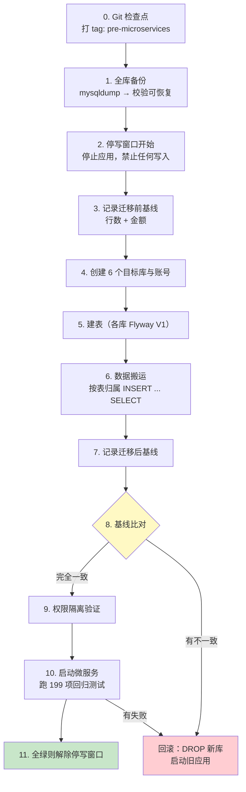
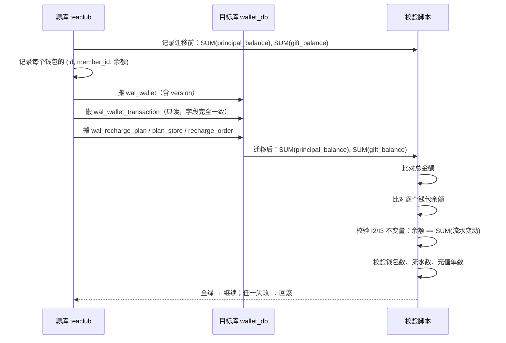
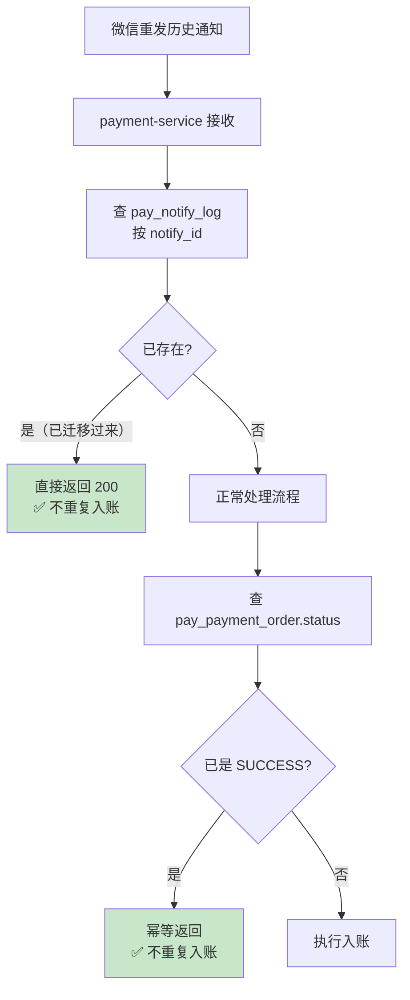
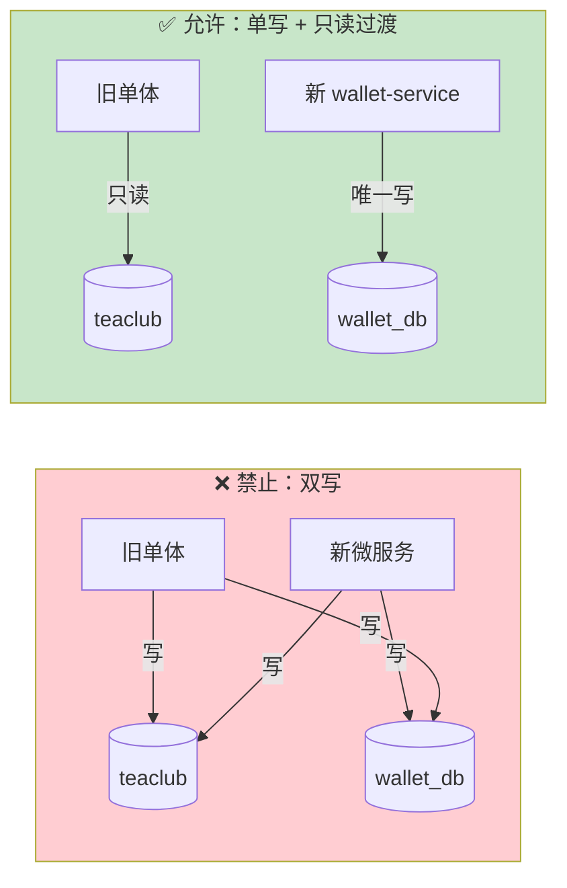

# TeaClub 数据迁移方案

| 项目 | 内容 |
| --- | --- |
| 文档编号 | TC-MSA-05 |
| 版本 | v1.0 |
| 编制日期 | 2026-11-19 |
| 源库 | `teaclub`（Flyway V8，33 张表） |
| 目标 | 6 个业务库（本期）+ 3 个预留库 |
| 核心要求 | **不丢失任何会员、钱包、订单、支付记录** |

---

## 1. 迁移黄金基线（验收硬指标）

以下数字来自 `CURRENT-PROJECT-AUDIT.md` 的**实际查询结果**，
迁移前后必须**逐项完全相等**，任何一项不等即为失败。

### 1.1 行数基线

```text
表名                        行数      目标库
sys_brand                     1      iam_db
sys_store                     4      iam_db
sys_user                      6      iam_db
sys_role                      5      iam_db
sys_permission               68      iam_db
sys_user_role                 6      iam_db
sys_role_permission         179      iam_db
sys_user_store                4      iam_db
sys_operation_log           770      iam_db
sys_config                    0      iam_db

mem_member                    3      member_db
mem_member_level              5      member_db
mem_member_tag                0      member_db
mem_member_tag_rel            0      member_db

prd_category                  5      product_db
prd_spu                       7      product_db
prd_sku                      14      product_db
prd_store_spu                20      product_db
prd_store_sku                17      product_db

wal_wallet                    3      wallet_db
wal_wallet_transaction        5      wallet_db
wal_recharge_plan             6      wallet_db
wal_recharge_plan_store       2      wallet_db
wal_recharge_order            2      wallet_db

oms_order                     1      order_db
oms_order_item                1      order_db
oms_order_status_log          3      order_db

pay_payment_order             1      payment_db
pay_notify_log                1      payment_db
pay_refund_order              2      payment_db
```

### 1.2 金额基线（最关键）

```text
指标                          基线值(分)   校验方式
钱包实付余额合计               255000    SUM(wal_wallet.principal_balance)
钱包赠送余额合计                38000    SUM(wal_wallet.gift_balance)
流水实付变动合计               255000    SUM(wal_wallet_transaction.principal_change)
流水赠送变动合计                38000    SUM(wal_wallet_transaction.gift_change)

已支付充值金额                  5000    SUM(wal_recharge_order.recharge_amount) WHERE status='PAID'
订单实付合计                    1750    SUM(oms_order.paid_amount)
订单已退合计                    1750    SUM(oms_order.refunded_amount)
支付成功合计                    5000    SUM(pay_payment_order.amount) WHERE status='SUCCESS'
退款成功合计                    3500    SUM(pay_refund_order.refund_amount) WHERE status='SUCCESS'
```

**核心不变量（必须保持）**：

```text
钱包实付余额合计 == 流水实付变动合计   (255000 == 255000) ✅
钱包赠送余额合计 == 流水赠送变动合计   ( 38000 ==  38000) ✅
```

---

## 2. 迁移总流程



---

## 3. 迁移脚本设计

### 3.1 脚本清单

| 脚本 | 作用 | 位置 |
| --- | --- | --- |
| `scripts/migration/00-backup.sh` | 全库备份 + 恢复校验 | deploy/backup |
| `scripts/migration/01-create-databases.sql` | 建 6 库 + 6 账号 + 授权 | — |
| `scripts/migration/02-verify-baseline.sql` | 输出行数与金额基线 | — |
| `scripts/migration/03-migrate-iam.sql` | 搬 iam 10 表 | — |
| `scripts/migration/04-migrate-member.sql` | 搬 member 4 表 | — |
| `scripts/migration/05-migrate-product.sql` | 搬 product 5 表 | — |
| `scripts/migration/06-migrate-wallet.sql` | 搬 wallet 5 表 | — |
| `scripts/migration/07-migrate-order.sql` | 搬 order 3 表 | — |
| `scripts/migration/08-migrate-payment.sql` | 搬 payment 3 表 | — |
| `scripts/migration/09-compare-baseline.mjs` | 自动比对前后基线 | — |
| `scripts/migration/10-verify-isolation.mjs` | 验证账号权限隔离 | — |

> **本轮只产出设计，不执行迁移**。脚本在下一阶段实现。

### 3.2 数据搬运原则

```sql
-- 关键：显式列名，绝不 SELECT *
INSERT INTO wallet_db.wal_wallet
  (id, brand_id, member_id, principal_balance, gift_balance,
   total_principal_in, total_gift_in, total_principal_out, total_gift_out,
   total_refund_in, version, status, create_time, update_time)
SELECT
   id, brand_id, member_id, principal_balance, gift_balance,
   total_principal_in, total_gift_in, total_principal_out, total_gift_out,
   total_refund_in, version, status, create_time, update_time
FROM teaclub.wal_wallet;

-- 保持自增起点，避免新数据 id 冲突
ALTER TABLE wallet_db.wal_wallet AUTO_INCREMENT = 1000;
```

**为什么显式列名**：防止源库新增列导致列错位，这是数据迁移最典型的事故来源。

---

## 4. 重点迁移分析一：会员钱包

### 4.1 迁移对象

| 表 | 行数 | 敏感度 |
| --- | --- | --- |
| `wal_wallet` | 3 | 🔴 余额 |
| `wal_wallet_transaction` | 5 | 🔴 流水 |
| `wal_recharge_plan` | 6 | 🟡 |
| `wal_recharge_plan_store` | 2 | 🟡 |
| `wal_recharge_order` | 2 | 🔴 充值单 |

### 4.2 现有钱包数据快照（实际查询）

```text
wallet_id  member_id  principal_balance  gift_balance  version  status
    1          1            50000            8000         0     NORMAL
    2          2           200000           30000         0     NORMAL
    3          3                0               0         1     NORMAL

合计：实付 255000 分，赠送 38000 分
```

### 4.3 迁移步骤



### 4.4 余额一致性核对 SQL

```sql
-- 迁移后在 wallet_db 执行，必须返回 0 行
SELECT w.id,
       w.principal_balance,
       COALESCE(SUM(t.principal_change), 0) AS calc_principal,
       w.gift_balance,
       COALESCE(SUM(t.gift_change), 0)      AS calc_gift
FROM wal_wallet w
LEFT JOIN wal_wallet_transaction t ON t.wallet_id = w.id
GROUP BY w.id, w.principal_balance, w.gift_balance
HAVING w.principal_balance <> calc_principal
    OR w.gift_balance      <> calc_gift;
-- 期望：Empty set（0 行）
```

### 4.5 防错措施

| 风险 | 措施 |
| --- | --- |
| 余额与流水不同步 | 上述 SQL 必须返回 0 行才允许继续 |
| version 字段丢失 | 显式搬运，不用 `SELECT *` |
| 自增 ID 冲突 | 迁移后设置 `AUTO_INCREMENT` 为当前 max+1 |
| 期初流水遗漏 | 现有 V8 已为钱包 1/2 补过流水，直接搬运即可 |

---

## 5. 重点迁移分析二：订单

### 5.1 迁移对象

| 表 | 行数 | 敏感度 |
| --- | --- | --- |
| `oms_order` | 1 | 🔴 |
| `oms_order_item` | 1 | 🔴 **商品快照** |
| `oms_order_status_log` | 3 | 🟡 |

### 5.2 商品快照必须原样保留

订单明细表存储的是**下单时刻的快照**，不是当前商品数据：

```text
oms_order_item 快照字段:
  spu_name   商品名称（下单时）
  sku_name   规格名称（下单时）
  spec_json  规格 JSON
  unit_price 成交单价（下单时）
  image_url  图片
```

**迁移要求**：这些字段**逐字节原样搬运**，禁止"迁移时顺便刷新为最新商品名"。
否则历史订单会显示错误信息，破坏订单可追溯性。

### 5.3 验证方法

```sql
-- 迁移前后对同一条订单明细做全字段比对
SELECT spu_name, sku_name, unit_price, quantity, total_amount, actual_amount
FROM oms_order_item WHERE order_id = 1;
-- 迁移前后必须完全相同
```

---

## 6. 重点迁移分析三：支付

### 6.1 迁移对象

| 表 | 行数 | 敏感度 |
| --- | --- | --- |
| `pay_payment_order` | 1 | 🔴 **支付单号对外契约** |
| `pay_notify_log` | 1 | 🔴 **防重放关键** |
| `pay_refund_order` | 2 | 🔴 |

### 6.2 支付单号必须保持不变

```text
当前: pay_payment_order.payment_no = "PAY20261119..."（示例）
迁移后必须完全一致
```

**为什么**：
- 支付单号是 `out_trade_no`，已发送给微信（未来真实支付时）
- 单号变化会导致微信侧无法匹配订单
- 也破坏"支付单 ↔ 订单"的历史关联

### 6.3 防止历史通知重放

这是**最关键的安全点**。迁移后必须保证：



**双重保护**：
1. `pay_notify_log.notify_id` 唯一索引 → 历史通知直接被识别
2. `pay_payment_order.status = SUCCESS` → 状态机拦截

**因此 `pay_notify_log` 必须完整迁移，一条都不能少**。

### 6.4 支付状态核验

```sql
-- 迁移后校验：支付单状态与订单状态是否自洽
SELECT p.payment_no, p.status AS pay_status, o.order_no, o.status AS order_status
FROM payment_db.pay_payment_order p
JOIN order_db.oms_order o ON o.payment_no = p.payment_no;
-- 跨库查询仅用于校验脚本，业务代码中禁止
```

| 支付状态 | 期望订单状态 |
| --- | --- |
| SUCCESS | PAID / COMPLETED / REFUNDING / REFUNDED |
| PAYING | UNPAID |
| FAILED / CLOSED | UNPAID / CANCELLED |

---

## 7. 重点迁移分析四：业务接口迁移

### 7.1 路径保持不变（旧接口兼容核心）

**66 个 API 路径全部沿用原路径**，例如：

```text
迁移前: http://localhost:8080/api/admin/wallet/accounts
迁移后: http://localhost:9000/api/admin/wallet/accounts
                                    ↑ 仅端口/域名变化，路径不变
```

**好处**：
- 现有 4 个测试脚本**只需改 BASE_URL 一行**
- 前端（未来开发）直接按原路径对接
- 无需维护 v1/v2 双版本接口

### 7.2 Gateway 路由映射

| 原路径前缀 | 目标服务 | 端口 |
| --- | --- | --- |
| `/api/admin/auth/**` | auth-service | 9001 |
| `/api/admin/system/**` | auth-service | 9001 |
| `/api/admin/store/**` | auth-service | 9001 |
| `/api/admin/member/**` | member-service | 9002 |
| `/api/admin/product/**` | product-service | 9003 |
| `/api/admin/wallet/**` | wallet-service | 9004 |
| `/api/admin/order/**` | order-service | 9005 |
| `/api/admin/payment/**` | payment-service | 9006 |
| `/api/payment/notify/**` | payment-service | 9006（放行，靠验签） |
| `/api/payment/mock/**` | payment-service | 9006（仅 mock） |

### 7.3 兼容性验证方法

迁移后直接执行现有脚本：

```bash
# 仅需把 BASE 从 :8080 改为 :9000
node scripts/api-test.mjs                  # 99 项
node scripts/security-isolation-test.mjs   # 19 项
node scripts/funds-test.mjs                # 59 项
node scripts/funds-concurrency-test.mjs    # 21 项
node scripts/amount-tamper-test.mjs        # 21 项
# 期望：全部 PASS
```

### 7.4 禁止双写



**规则**：任何时候，`wal_wallet` 只能有一个服务可写。
切换完成后旧单体必须**停止服务**，不是"保留但不写入"，而是"进程关闭"。

---

## 8. 回滚方案

### 8.1 回滚触发条件

| 条件 | 动作 |
| --- | --- |
| 基线比对不一致 | 立即回滚 |
| 资金不变量校验失败 | 立即回滚 |
| 回归测试任一失败 | 回滚并排查 |
| 权限隔离验证失败 | 回滚并修脚本 |

### 8.2 回滚步骤

```text
1. 停止所有微服务进程
2. DROP 全部新建的 6 个库（iam_db ... payment_db）
3. 从备份恢复 teaclub 库（或确认原库未被修改）
4. 启动原单体应用（jar 或 mvn spring-boot:run）
5. 跑一遍现有测试脚本确认恢复
6. 记录失败原因到文档
```

### 8.3 为什么回滚是安全的

**迁移期间承诺：源库 `teaclub` 全程只读，不做任何修改。**

```sql
-- 迁移只做 SELECT，不做 UPDATE/DELETE/DROP
-- 所有写入都发生在新建的目标库
```

这意味着只要 DROP 新库，系统就完全回到迁移前状态。

---

## 9. 停机窗口规划

| 阶段 | 是否停写 | 预计时长 | 说明 |
| --- | --- | --- | --- |
| 备份 | 否 | 1 min | 数据量小 |
| 建库建表 | 否 | 1 min | |
| **数据搬运** | **是** | **5 min** | 防止搬一半数据变化 |
| 基线比对 | 是 | 2 min | |
| 启动微服务 | 是 | 5 min | 6 个服务 + 基础设施 |
| 回归测试 | 否 | 15 min | 可并行观察 |
| **总停机** | | **约 15 分钟** | 数据量小，实际会更快 |

> 当前全库数据 < 2MB，行数最多的是 `sys_operation_log` 770 行。
> 迁移本身是秒级，停机时间主要花在服务启动与验证。

---

## 10. 迁移检查清单

```text
[ ] 1. Git 打 tag: pre-microservices
[ ] 2. 全库备份完成，且**实际恢复验证**通过
[ ] 3. 记录迁移前行数基线（本文件 §1.1）
[ ] 4. 记录迁移前金额基线（本文件 §1.2）
[ ] 5. 创建 6 个库与 6 个账号
[ ] 6. 各库 Flyway V1 建表完成
[ ] 7. 按表归属搬运数据（显式列名）
[ ] 8. 设置各表 AUTO_INCREMENT
[ ] 9. 迁移后行数比对：全部相等
[ ] 10. 迁移后金额比对：255000 / 38000 相等
[ ] 11. 钱包-流水不变量校验：0 行不一致
[ ] 12. 订单商品快照逐字段比对
[ ] 13. 支付单号比对：完全一致
[ ] 14. pay_notify_log 行数一致（防重放）
[ ] 15. 账号权限隔离验证：跨库查询被拒绝
[ ] 16. 启动 6 个微服务 + Nacos + MQ + Redis
[ ] 17. 执行 199 项回归测试：全绿
[ ] 18. 执行 44 项单元测试：全绿
[ ] 19. 确认旧单体进程已停止
[ ] 20. 更新文档与 CHANGELOG
```
