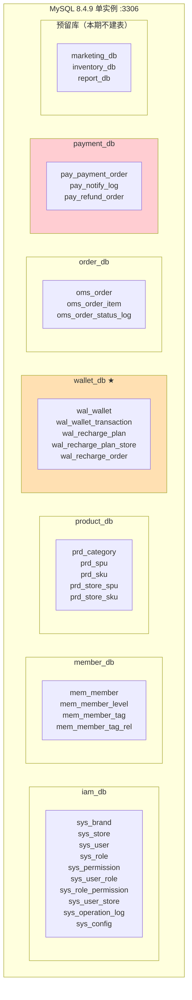

# TeaClub 数据库归属与隔离设计

| 项目 | 内容 |
| --- | --- |
| 文档编号 | TC-MSA-04 |
| 版本 | v1.0 |
| 编制日期 | 2026-11-19 |
| 当前数据库 | `teaclub`（33 张表，Flyway V8） |
| 目标 | 9 个逻辑库，账号权限隔离 |
| 单实例 | 开发环境共用 MySQL 8.4.9 实例 |

---

## 1. 归属总览



---

## 2. 表归属明细

### 2.1 iam_db（auth-service）— 10 张

| 表 | 行数 | 迁移注意 |
| --- | --- | --- |
| `sys_brand` | 1 | 品牌级配置（扣款顺序）需保持可读给 wallet |
| `sys_store` | 4 | 多服务需要门店名称（只读） |
| `sys_user` | 6 | 密码 BCrypt |
| `sys_role` | 5 | |
| `sys_permission` | 68 | 权限点 |
| `sys_user_role` | 6 | |
| `sys_role_permission` | 179 | |
| `sys_user_store` | 4 | **数据权限核心** |
| `sys_operation_log` | 770 | 最大表，迁移耗时最长 |
| `sys_config` | 0 | 空表 |

### 2.2 member_db（member-service）— 4 张

| 表 | 行数 | 迁移注意 |
| --- | --- | --- |
| `mem_member` | 3 | `register_store_id` 指向 iam_db，**跨库逻辑引用** |
| `mem_member_level` | 5 | 等级折扣率 order 需要 |
| `mem_member_tag` | 0 | 空表 |
| `mem_member_tag_rel` | 0 | 空表 |

### 2.3 product_db（product-service）— 5 张

| 表 | 行数 | 迁移注意 |
| --- | --- | --- |
| `prd_category` | 5 | |
| `prd_spu` | 7 | `min_price` 最低保护价 |
| `prd_sku` | 14 | |
| `prd_store_spu` | 20 | `store_id` 跨库引用 |
| `prd_store_sku` | 17 | **门店差异化定价，订单算价依赖** |

### 2.4 wallet_db（wallet-service）★ 5 张

| 表 | 行数 | 迁移注意 |
| --- | --- | --- |
| `wal_wallet` | 3 | **余额必须与流水累计相等** |
| `wal_wallet_transaction` | 5 | **不可篡改，迁移只读不改** |
| `wal_recharge_plan` | 6 | |
| `wal_recharge_plan_store` | 2 | |
| `wal_recharge_order` | 2 | 充值单号必须保持不变 |

### 2.5 order_db（order-service）— 3 张

| 表 | 行数 | 迁移注意 |
| --- | --- | --- |
| `oms_order` | 1 | 订单号必须保持不变 |
| `oms_order_item` | 1 | **商品快照必须原样保留** |
| `oms_order_status_log` | 3 | |

### 2.6 payment_db（payment-service）— 3 张

| 表 | 行数 | 迁移注意 |
| --- | --- | --- |
| `pay_payment_order` | 1 | **支付单号必须保持不变**（对外契约） |
| `pay_notify_log` | 1 | **保留全部通知记录，防止历史通知重放** |
| `pay_refund_order` | 2 | 退款单号保持不变 |

### 2.7 不迁移的表

| 表 | 处置理由 |
| --- | --- |
| `sys_idempotency_record` | 0 行，代码未使用；各服务按需自建 |
| `prd_inventory` | 0 行，划给 inventory_db |
| `flyway_schema_history` | 每库独立维护版本 |

---

## 3. 数据库账号权限隔离

### 3.1 设计目标

即使共用同一个 MySQL 实例，也要保证：
**auth 账号无法读 wallet_db，wallet 账号无法读 order_db**。

### 3.2 账号规划

| 账号 | 可访问库 | 权限 |
| --- | --- | --- |
| `tc_gateway` | 无（网关不连库） | — |
| `tc_auth` | `iam_db` | SELECT, INSERT, UPDATE, DELETE, CREATE, ALTER, INDEX |
| `tc_member` | `member_db` | 同上 |
| `tc_product` | `product_db` | 同上 |
| `tc_wallet` | `wallet_db` | 同上 |
| `tc_order` | `order_db` | 同上 |
| `tc_payment` | `payment_db` | 同上 |
| `tc_report` | `report_db` | 同上（未来） |

### 3.3 权限授予 SQL

```sql
-- 示例：wallet 账号只能访问 wallet_db
CREATE DATABASE IF NOT EXISTS wallet_db
  DEFAULT CHARACTER SET utf8mb4 COLLATE utf8mb4_unicode_ci;

CREATE USER IF NOT EXISTS 'tc_wallet'@'localhost' IDENTIFIED BY '<随机强密码>';
GRANT ALL PRIVILEGES ON wallet_db.* TO 'tc_wallet'@'localhost';

-- 关键：不授予任何其他库权限
-- REVOKE 默认就不存在，无需显式撤销

FLUSH PRIVILEGES;
```

### 3.4 隔离验证方法

```sql
-- 以 tc_wallet 登录后执行，应报 "Access denied"
SELECT COUNT(*) FROM order_db.oms_order;
-- 预期：ERROR 1142 (42000): SELECT command denied
```

> 该验证将纳入迁移验收脚本，**必须实际执行并确认被拒绝**，而非假设。

---

## 4. 跨库逻辑引用处理

拆分后仍存在逻辑外键，但**不允许物理外键跨库**：

| 引用 | 所在库 | 指向 | 处理方式 |
| --- | --- | --- | --- |
| `mem_member.register_store_id` | member_db | iam_db.sys_store | 保留字段，展示时 Feign 取名称 |
| `prd_store_spu.store_id` | product_db | iam_db.sys_store | 保留字段，写入前 Feign 校验门店存在 |
| `wal_wallet.member_id` | wallet_db | member_db.mem_member | 保留字段，操作前 Feign 校验会员 |
| `wal_recharge_order.store_id` | wallet_db | iam_db.sys_store | 保留字段 |
| `oms_order.store_id` | order_db | iam_db.sys_store | 保留字段 |
| `oms_order.member_id` | order_db | member_db.mem_member | 保留字段 |
| `pay_payment_order.biz_no` | payment_db | order_db / wallet_db | 仅存单号，不存业务数据 |
| `pay_refund_order.payment_no` | payment_db | payment_db | 同库 |

**原则**：跨库只存 ID，不存业务快照；需要快照的（如订单商品明细）在写入时固化到本库。

---

## 5. Flyway 版本管理策略

### 5.1 现状

```text
teaclub 库: V1 ~ V8（8 个迁移，全局单一版本链）
```

### 5.2 拆分后

每个库**独立** Flyway 版本链，从 V1 重新开始：

| 库 | 迁移脚本 | 说明 |
| --- | --- | --- |
| iam_db | `V1__init_iam.sql` | 含 10 张表结构 |
| member_db | `V1__init_member.sql` | 含 4 张表 |
| product_db | `V1__init_product.sql` | 含 5 张表 |
| wallet_db | `V1__init_wallet.sql` | 含 5 张表 |
| order_db | `V1__init_order.sql` | 含 3 张表 |
| payment_db | `V1__init_payment.sql` | 含 3 张表 |

**种子数据**：

| 库 | 脚本 |
| --- | --- |
| iam_db | `V2__seed_iam.sql`（品牌/门店/权限/角色/账号） |
| member_db | `V2__seed_member.sql`（等级/会员） |
| product_db | `V2__seed_product.sql`（分类/SPU/SKU/门店商品） |
| wallet_db | `V2__seed_wallet.sql`（充值方案 + 期初流水） |

> ⚠️ wallet 种子数据必须**同时**插入钱包和对应的期初流水，
> 否则会重现 V8 修复过的"余额无流水"问题。

### 5.3 为什么不用原 V1~V8

原脚本是单库设计，表间无库前缀。拆库后：
- 每库只保留属于自己的建表语句
- 跨库外键（原本就没有物理外键）自然消失
- 版本链解耦，各服务独立演进

**但数据迁移必须基于原库**，见 `DATA-MIGRATION.md`。

---

## 6. 存储容量评估

| 库 | 当前行数 | 当前大小 | 增长预估 |
| --- | --- | --- | --- |
| iam_db | ~1044（含 770 日志） | ~1.0 MB | 日志增长最快 |
| member_db | 8 | ~0.2 MB | 随会员增长 |
| product_db | 63 | ~0.2 MB | 缓慢 |
| wallet_db | 18 | ~0.3 MB | **随交易线性增长** |
| order_db | 5 | ~0.2 MB | **随交易线性增长** |
| payment_db | 4 | ~0.2 MB | **随交易线性增长** |

> 当前数据量很小（全库 < 2MB），迁移风险低，**正适合做架构迁移验证**。

---

## 7. 备份策略

| 时机 | 动作 | 保留 |
| --- | --- | --- |
| 迁移前 | 全库 `mysqldump` 到 `deploy/backup/teaclub_pre_migration_<timestamp>.sql` | 至少 3 份 |
| 每库迁移前 | 该库单独 dump | 保留到验收通过 |
| 迁移后 | 新库 dump 与旧库对比 | 长期 |

**备份校验**：dump 后必须实际尝试恢复到临时库并核对行数，不能只看文件大小。
