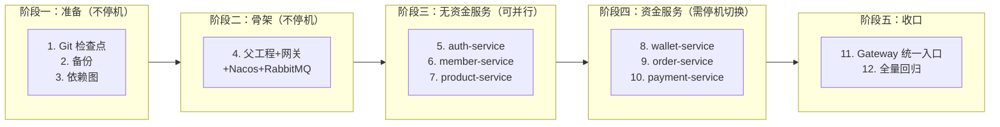
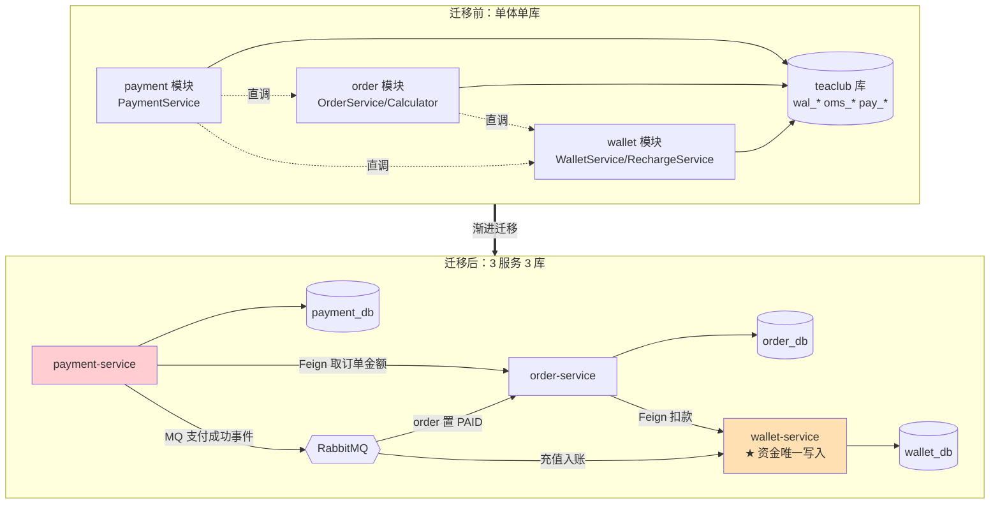

# TeaClub 微服务迁移路线图

| 项目 | 内容 |
| --- | --- |
| 文档编号 | TC-MSA-06 |
| 版本 | v1.0 |
| 编制日期 | 2026-11-19 |
| 迁移策略 | **渐进式**，分 9 步，每步可独立验证与回滚 |
| 核心原则 | 同一时刻只有一个服务能写同一份数据 |

---

## 1. 迁移全景图



> **注意**：用户要求的"第九步"在本文档中展开为更细粒度的任务，
> 但整体仍是 9 个里程碑阶段。

---

## 2. 九个阶段详解

### 第一步：备份与 Git 检查点 ✅ 可立即执行

| 任务 | 产出 | 验收 |
| --- | --- | --- |
| 1.1 Git 打 tag | `pre-microservices` | `git tag` 可见 |
| 1.2 全库备份 | `deploy/backup/teaclub_<ts>.sql` | **实际恢复到临时库**并核对行数 |
| 1.3 记录基线 | 行数 + 金额（见 DATA-MIGRATION §1） | 写入文档 |
| 1.4 环境准备清单 | Nacos/RabbitMQ 待装 | 列出 |

> ⚠️ 当前项目**尚未初始化 Git 仓库**（审计发现无 `.git`）。
> 这一步需要先 `git init`。

### 第二步：绘制业务依赖图 ✅ 已完成

| 任务 | 产出 | 状态 |
| --- | --- | --- |
| 2.1 跨模块 import 矩阵 | 9×7 矩阵 | ✅ `CURRENT-PROJECT-AUDIT.md` §5.1 |
| 2.2 类级耦合点清单 | 9 组耦合 | ✅ §5.2 |
| 2.3 数据库关系图 | 27 表归属 | ✅ `DATABASE-OWNERSHIP.md` |
| 2.4 API 清单 | 66 端点 | ✅ §6 |

### 第三步：设计边界与归属 ✅ 已完成

| 任务 | 产出 | 状态 |
| --- | --- | --- |
| 3.1 服务边界 | 7 个服务职责 | ✅ `SERVICE-BOUNDARIES.md` |
| 3.2 数据归属 | 每表唯一归属 | ✅ `DATABASE-OWNERSHIP.md` |
| 3.3 版本矩阵 | 已实证的版本组合 | ✅ `MICROSERVICES.md` §1 |
| 3.4 迁移方案 | 4 个重点分析 | ✅ `DATA-MIGRATION.md` |

### 第四步：搭建微服务基础工程 ⏳ 下一阶段

| 任务 | 说明 | 依赖 |
| --- | --- | --- |
| 4.1 创建 Maven 父工程 | `teaclub-cloud`，统一依赖管理 | — |
| 4.2 安装 Nacos Server | 2.5.x，端口 8848 | **需要下载** |
| 4.3 安装 RabbitMQ | 3.13.x，端口 5672 | **需要安装** |
| 4.4 创建 teaclub-common-starter | 统一响应/异常/JWT/Feign 拦截 | — |
| 4.5 创建 gateway-service 骨架 | 路由配置 + JWT 过滤器 | 4.1 |
| 4.6 建 6 个空服务骨架 | 仅 pom + Application + 健康检查 | 4.1 |
| 4.7 Docker Compose 编排 | 基础设施容器化 | **需 WSL** |

**验收**：6 个服务能启动并注册到 Nacos；Gateway 能转发到任一服务的健康检查。

### 第五步：迁移基础组织与会员 ⏳

| 任务 | 说明 | 风险 |
| --- | --- | --- |
| 5.1 建 iam_db + member_db | Flyway V1/V2 | 低 |
| 5.2 搬 iam 10 表 + member 4 表 | 显式列名 | 低 |
| 5.3 迁移 auth-service 全部代码 | 2 个 Controller 类族 + 6 Service | 低 |
| 5.4 迁移 member-service 全部代码 | 2 Controller + 2 Service | 低 |
| 5.5 **新增** 内部接口 | `/internal/stores` `/internal/members` | — |
| 5.6 验证 20 项 auth/member 接口 | 用 api-test 子集 | 低 |

**关键产出**：auth 与 member 成为其他服务的基础依赖。

### 第六步：迁移商品服务 ⏳

| 任务 | 说明 | 风险 |
| --- | --- | --- |
| 6.1 建 product_db | Flyway V1/V2 | 低 |
| 6.2 搬 product 5 表 | | 低 |
| 6.3 迁移 product-service 代码 | 3 Controller + 3 Service | 低 |
| 6.4 **新增** `POST /internal/products/quote` | 批量算价 | 中 |
| 6.5 验证 17 项商品接口 | | 低 |

**关键产出**：`quote` 接口是 order 拆分的**前置依赖**。

### 第七步：迁移钱包、订单、支付 ⏳（最高风险）

这一步必须**按 wallet → order → payment 顺序**，不能并行。

#### 7.1 迁移 wallet-service

| 任务 | 说明 | 风险 |
| --- | --- | --- |
| 7.1.1 建 wallet_db，搬 5 表 | **必须校验 255000/38000** | 🔴 高 |
| 7.1.2 迁移 WalletService（**资金核心**） | 行锁/幂等/双余额**一字不改** | 🔴 高 |
| 7.1.3 迁移 RechargeService / RechargePlanService | | 🟡 中 |
| 7.1.4 会员/品牌信息改 Feign | 原直读 MemMember/SysBrand | 🟡 中 |
| 7.1.5 **新增** `/internal/wallet/consume` 与 `/refund` | 供 order/payment 调用 | 🔴 高 |
| 7.1.6 验证 16 项钱包接口 + 59 项资金测试 | | 🔴 高 |

**验收硬指标**：`funds-test.mjs` 59 项 + `funds-concurrency-test.mjs` 21 项全绿。

#### 7.2 迁移 order-service

| 任务 | 说明 | 风险 |
| --- | --- | --- |
| 7.2.1 建 order_db，搬 3 表 | **商品快照逐字段比对** | 🔴 高 |
| 7.2.2 迁移 OrderService / OrderAmountCalculator | | 🔴 高 |
| 7.2.3 **算价改为 Feign 调 product quote** | 原直读 4 张 product 表 | 🟡 中 |
| 7.2.4 **扣款改为 Feign 调 wallet consume** | 原直调 WalletService | 🔴 高 |
| 7.2.5 **新增** `/internal/orders/{no}/payable` | 供 payment 调用 | 🟡 中 |
| 7.2.6 实现支付成功事件消费 | 订阅 `payment.order.success` | 🔴 高 |
| 7.2.7 验证 7 项订单接口 | | 🔴 高 |

#### 7.3 迁移 payment-service

| 任务 | 说明 | 风险 |
| --- | --- | --- |
| 7.3.1 建 payment_db，搬 3 表 | **支付单号不变 + notify_log 全量** | 🔴 高 |
| 7.3.2 迁移 PaymentProvider 抽象与 Mock 实现 | | 🟡 中 |
| 7.3.3 **去掉直读 order/wallet 表** | 改 Feign 取金额 | 🔴 高 |
| 7.3.4 **通知后处理改为发 MQ 事件** | 原直调 Service | 🔴 高 |
| 7.3.5 实现本地消息表 + 定时补偿 | 保证事件不丢 | 🔴 高 |
| 7.3.6 验证 6 项支付接口 + 21 项篡改测试 | | 🔴 高 |

**这一步完成后，原单体必须停止进程**（不是只读，是关闭）。

### 第八步：前端统一走 Gateway ⏳

| 任务 | 说明 |
| --- | --- |
| 8.1 修改测试脚本 BASE_URL | `:8080` → `:9000` |
| 8.2 全量回归 5 个套件 | 199 + 44 项 |
| 8.3 验证 Gateway 限流 | 登录接口压测 |
| 8.4 验证 CORS | 跨域配置 |
| 8.5 前端（若届时已开发）改对接 Gateway | — |

### 第九步：完整交易业务验证 ⏳

| 任务 | 说明 |
| --- | --- |
| 9.1 端到端：注册 → 充值 → 下单 → 支付 → 退款 | 全链路 |
| 9.2 资金对账 | `/api/admin/wallet/reconcile` |
| 9.3 跨服务资金一致性 | 钱包 = 流水累计 |
| 9.4 并发场景复测 | 21 项 |
| 9.5 性能基线 | 记录 P95 |
| 9.6 文档与 CHANGELOG | 更新 |

---

## 3. 任务清单（可勾选）

### 阶段一：准备

```text
[ ] T1.1  git init + 首次提交
[ ] T1.2  git tag pre-microservices
[ ] T1.3  全库备份 + 恢复验证
[ ] T1.4  记录行数基线（30 表）
[ ] T1.5  记录金额基线（9 项）
[ ] T1.6  确认 Nacos / RabbitMQ 安装方案
```

### 阶段二：骨架

```text
[ ] T2.1  创建 Maven 父工程 teaclub-cloud
[ ] T2.2  安装 Nacos Server 2.5.x
[ ] T2.3  安装 RabbitMQ 3.13.x
[ ] T2.4  创建 teaclub-common-starter
[ ] T2.5  创建 gateway-service
[ ] T2.6  创建 6 个服务空骨架
[ ] T2.7  验证全部注册到 Nacos
[ ] T2.8  Docker Compose（若 WSL 就绪）
```

### 阶段三：无资金服务

```text
[ ] T3.1  建 iam_db，Flyway V1/V2
[ ] T3.2  搬 iam 10 表 + 基线校验
[ ] T3.3  迁移 auth-service 代码（17 文件族）
[ ] T3.4  建 member_db，Flyway V1/V2
[ ] T3.5  搬 member 4 表 + 基线校验
[ ] T3.6  迁移 member-service 代码（15 文件族）
[ ] T3.7  新增 /internal/stores 与 /internal/members
[ ] T3.8  建 product_db，Flyway V1/V2
[ ] T3.9  搬 product 5 表 + 基线校验
[ ] T3.10 迁移 product-service 代码（30 文件族）
[ ] T3.11 新增 /internal/products/quote
[ ] T3.12 验证 48 项接口（auth20+member11+product17）
```

### 阶段四：资金服务

```text
[ ] T4.1  建 wallet_db，Flyway V1/V2
[ ] T4.2  搬 wallet 5 表
[ ] T4.3  ★ 校验 255000 / 38000
[ ] T4.4  ★ 校验钱包=流水累计（0 行不一致）
[ ] T4.5  迁移 WalletService（资金核心，逻辑不变）
[ ] T4.6  迁移 Recharge 相关
[ ] T4.7  会员/品牌改 Feign
[ ] T4.8  新增 /internal/wallet/consume 与 /refund
[ ] T4.9  ★ 跑 funds-test 59 项 + 并发 21 项
[ ] T4.10 建 order_db，Flyway V1/V2
[ ] T4.11 搬 order 3 表
[ ] T4.12 ★ 商品快照逐字段比对
[ ] T4.13 迁移 OrderService / Calculator
[ ] T4.14 算价改 Feign
[ ] T4.15 扣款改 Feign
[ ] T4.16 新增 /internal/orders/{no}/payable
[ ] T4.17 实现支付成功事件消费
[ ] T4.18 建 payment_db，Flyway V1/V2
[ ] T4.19 搬 payment 3 表
[ ] T4.20 ★ 支付单号一致 + notify_log 全量
[ ] T4.21 迁移 PaymentProvider
[ ] T4.22 去掉直读 order/wallet
[ ] T4.23 通知改发 MQ
[ ] T4.24 实现本地消息表 + 补偿任务
[ ] T4.25 ★ 停止原单体进程
```

### 阶段五：收口

```text
[ ] T5.1  测试脚本 BASE_URL 改 :9000
[ ] T5.2  全量回归 5 套件（199 项）
[ ] T5.3  单元测试 44 项
[ ] T5.4  Gateway 限流验证
[ ] T5.5  CORS 验证
[ ] T5.6  端到端交易链路
[ ] T5.7  资金对账一致
[ ] T5.8  并发复测
[ ] T5.9  更新全部文档
[ ] T5.10 更新 CHANGELOG
```

---

## 4. 第四阶段业务迁移图



### 关键变化对照

| 项 | 迁移前 | 迁移后 |
| --- | --- | --- |
| 订单扣款 | `order` 直调 `WalletService.consumeOut()` | `order` Feign 调 `wallet` `/internal/wallet/consume` |
| 支付取金额 | `payment` 直读 `oms_order` / `wal_recharge_order` | `payment` Feign 调 order/wallet 内部接口 |
| 支付成功后处理 | `payment` 直调 `orderService.processPaySuccess()` | `payment` 发 MQ → order/wallet 各自消费 |
| 退款回冲 | `payment` 直调 `walletService.refundIn()` | `payment` Feign 调 `/internal/wallet/refund` |
| 事务边界 | 单库 ACID | 本地事务 + 事件最终一致 + 补偿 |
| 资金规则 | — | **完全不变**（行锁、幂等、双余额、扣款顺序、退款构成） |

---

## 5. 风险登记

| # | 风险 | 等级 | 缓解 |
| --- | --- | --- | --- |
| R1 | payment 拆分时资金链路断裂 | 🔴 极高 | 先在单体内把 payment 改为"只依赖内部接口 + 发事件"，再拆库 |
| R2 | 跨服务事务导致资金不一致 | 🔴 极高 | 本地消息表 + 幂等键 + 对账任务兜底；不做分布式事务 |
| R3 | 迁移中金额对不平 | 🔴 极高 | 硬基线 255000/38000；不一致立即回滚 |
| R4 | 历史通知重放导致重复入账 | 🔴 高 | pay_notify_log 全量迁移 + 双重幂等 |
| R5 | 商品快照被刷新 | 🟡 中 | 逐字段比对脚本 |
| R6 | Nacos/RabbitMQ 未装阻塞 | 🟡 中 | 优先解决环境（需管理员装 WSL 或直接下载） |
| R7 | 无 Git 仓库无法回滚代码 | 🟡 中 | **第一步就 git init** |
| R8 | 前端为 0 文件，无 UI 验证 | 🟢 低 | 用现有 199 项接口测试替代 |

---

## 6. 环境前置条件（阻塞项）

| 项 | 状态 | 阻塞阶段 | 解决方式 |
| --- | --- | --- | --- |
| **Git 仓库** | ❌ 未初始化 | 第一步 | `git init` + 首次提交（我可直接做） |
| **Nacos Server** | ❌ 未安装 | 第四步 | 下载 zip 或用 Docker |
| **RabbitMQ** | ❌ 未安装 | 第四步 | 用 Docker（需 WSL）或 Windows 安装包 |
| **Docker 可用** | ⚠️ 已装未启动 | 第四步 | **需管理员执行 `wsl --install` 并重启** |
| MySQL | ✅ 运行中 | — | — |
| Redis | ✅ 运行中 | — | — |

> **当前最大阻塞**：Docker 不可用 → Nacos/RabbitMQ 无法容器化。
> 备选：Nacos 可下载 Windows zip 直接跑；RabbitMQ 需 Erlang，较麻烦。

---

## 7. 建议的下一步

按投入产出排序：

1. **立即可做**：`git init` + 打 tag + 全库备份（第一步）
2. **立即可做**：创建 Maven 父工程与 6 个空服务骨架（第四步的 4.1/4.4/4.6）
3. **需要你操作**：管理员启用 WSL → Docker 可用 → Nacos/RabbitMQ 容器化
4. **备选方案**：Nacos 下载 Windows 版直接跑（无需 Docker），RabbitMQ 暂用内存/直连替代

> 若你希望我**先不等 Docker**，我可以：
> - 先做 git 检查点 + 备份
> - 先搭 Maven 父工程与空服务骨架（能编译、能单测）
> - Nacos 用 Windows zip 版先跑起来
> - RabbitMQ 延后（payment 拆分本就排在最后）
