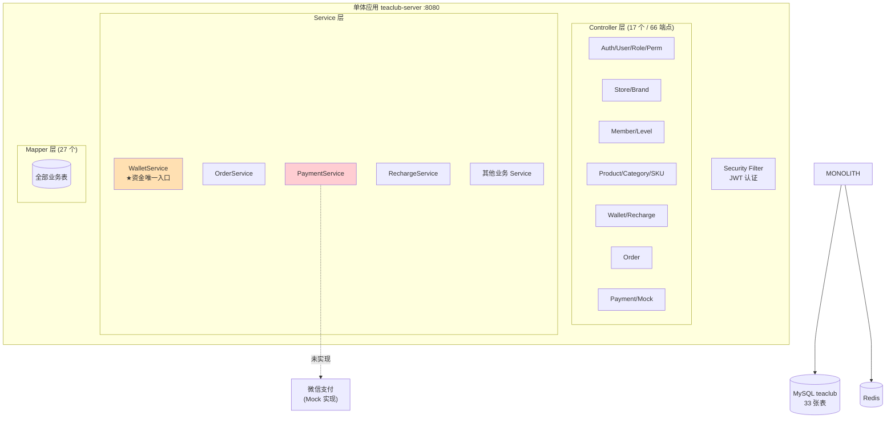
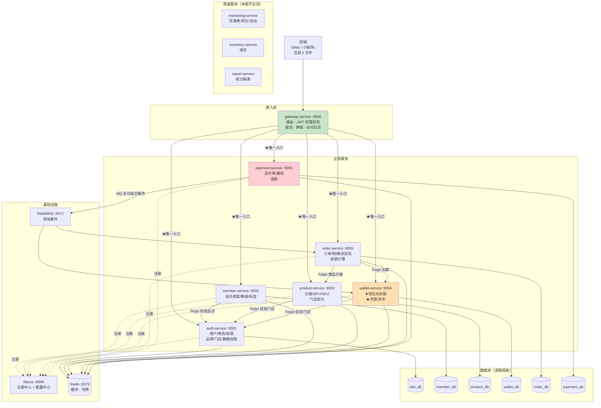
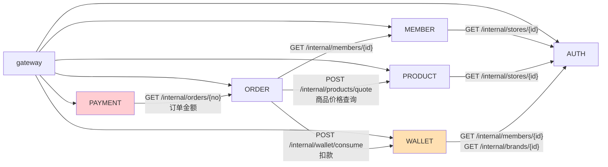
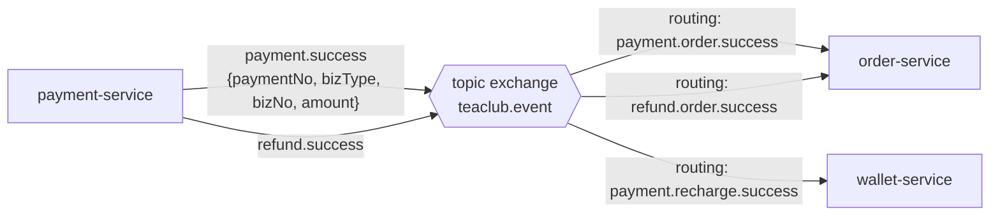

# TeaClub 微服务架构设计

| 项目 | 内容 |
| --- | --- |
| 文档编号 | TC-MSA-02 |
| 版本 | v1.0 |
| 编制日期 | 2026-11-19 |
| 架构风格 | Spring Cloud Alibaba 微服务 |
| 服务数量 | 10 个（本期落地 6 个，4 个预留） |
| 认证模式 | JWT + Gateway 前置校验 |
| 通信 | 同步 OpenFeign / 异步 RabbitMQ |

---

## 1. 技术栈版本矩阵（已实证验证）

### 1.1 版本选择过程

**不是凭记忆**，而是通过 Maven 元数据逐层解析验证：

```text
步骤 1: 查询 spring-cloud-alibaba-dependencies 可用版本
        → 2022.0.x / 2023.0.x / 2025.0.x / 2025.1.x

步骤 2: 检查各版本的 parent POM
        SCA 2025.1.0.0 → spring-cloud-dependencies-parent 5.0.0 → Spring Boot 4.0.x
        SCA 2023.0.3.4 → spring-cloud-dependencies-parent 4.1.0 → Spring Boot 3.x  ← 选它

步骤 3: 确认 Spring Cloud 2023.0.x 存在，最新 2023.0.6
        2023.0.5 的组件版本：gateway 4.1.6 / openfeign 4.1.4 / commons 4.1.5

步骤 4: 实测依赖解析（建临时工程跑 mvn dependency:tree）
        → BUILD SUCCESS，无冲突（见 §1.3）
```

### 1.2 最终版本矩阵

| 组件 | 版本 | 选择依据 |
| --- | --- | --- |
| JDK | **17** | 需求指定；本机 Temurin 17.0.19 |
| Spring Boot | **3.5.16** | 沿用现有工程，不升级到 4.x（避免破坏已通过 263 项测试的代码） |
| Spring Cloud | **2023.0.5** | 2023.0.x 是与 Boot 3.x 配套的 release train |
| Spring Cloud Alibaba | **2023.0.3.4** | 2023.x 线最新；parent 为 SC-dependencies-parent 4.1.0 |
| Spring Cloud Gateway | 4.1.6 | 由 SC 2023.0.5 BOM 管理 |
| OpenFeign | 4.1.4 | 由 SC 2023.0.5 BOM 管理 |
| Nacos Client | 2.5.x | 由 SCA 2023.0.3.4 管理 |
| RabbitMQ (spring-rabbit) | 3.2.12 | 由 Boot 3.5.16 BOM 管理 |
| Spring Data Redis | 3.5.13 | 由 Boot 3.5.16 BOM 管理 |
| MySQL | **8.4** | 沿用现有实例（8.4.9） |
| MyBatis-Plus | **3.5.18** | 沿用现有版本（已验证可用） |
| JJWT | **0.13.0** | 沿用现有版本 |
| Flyway | **11.20.3** | 沿用现有版本 |
| SpringDoc | **2.10.0** | 沿用现有版本（2.x 适配 Boot 3） |
| Maven | 3.9.6 | 本机 `C:\Users\Admin\apache-maven-3.9.6` |
| Docker | Desktop 4.99.0 | 已装，**WSL 未启用，守护进程不可用** |
| Redis | 3.0.504 | 已装并运行（Windows 移植版） |

### 1.3 依赖解析实证

实测 `mvn dependency:tree` 输出（关键行）：

```text
spring-cloud-starter-alibaba-nacos-discovery ... BUILD SUCCESS
spring-cloud-starter-alibaba-nacos-config:2023.0.3.4
spring-cloud-starter-gateway (4.1.6)
spring-cloud-starter-openfeign (4.1.4)
spring-cloud-context:4.1.5
spring-boot-starter-amqp:3.5.16
  └─ spring-rabbit:3.2.12
     └─ amqp-client:5.25.0
spring-boot-starter-data-redis:3.5.16
  └─ spring-data-redis:3.5.13
     └─ lettuce-core:6.6.0.RELEASE
```

**结论：该组合可正常解析与编译。**

### 1.4 版本风险提示（如实说明）

| 风险 | 说明 | 应对 |
| --- | --- | --- |
| SCA 2023.0.3.4 非最新 | 最新 2025.1.0.0 需要 Boot 4.x | 若后续升级 Boot 4，需同步升级 SCA，届时须重跑全部回归 |
| Nacos 服务端未安装 | 本机无 Nacos | 需下载 nacos-server 2.5.x（见 §7） |
| RabbitMQ 服务端未安装 | 本机无 RabbitMQ | 需安装（Docker 可用后最省事） |
| Redis 3.0.504 偏旧 | Windows 移植版 | 功能够用；生产建议换 7.x |

---

## 2. 原有架构图（迁移前）



**架构特征**：
- 单进程、单数据库、单事务域
- `WalletService` 是资金唯一写入入口（设计良好，利于拆分）
- `PaymentService` 跨域直读 order/wallet 表（**拆分难点**）

---

## 3. 新微服务架构图（迁移后）



---

## 4. 服务依赖图

### 4.1 同步依赖（OpenFeign）



### 4.2 异步依赖（RabbitMQ 领域事件）



### 4.3 依赖强度分级

| 服务 | 依赖方 | 被依赖 | 拆分难度 | 迁移顺序 |
| --- | --- | --- | --- | --- |
| **auth-service** | 无 | member/product/wallet/order | 🟢 低 | **第 1** |
| **member-service** | auth | order/wallet | 🟢 低 | **第 2** |
| **product-service** | auth | order | 🟢 低 | **第 3** |
| **wallet-service** | auth/member | order/payment | 🟡 中 | **第 4** |
| **order-service** | auth/member/product/wallet | payment | 🔴 高 | **第 5** |
| **payment-service** | order/wallet | — | 🔴 最高 | **第 6** |
| **gateway** | 全部 | — | 🟢 低 | 随第 1 步建立 |

---

## 5. 服务职责定义

### 5.1 gateway-service（:9000）

| 项 | 内容 |
| --- | --- |
| 端口 | 9000 |
| 职责 | 路由转发、JWT 前置校验、限流、跨域、访问日志、traceId 注入 |
| 不做 | **不承载任何业务逻辑**，不做数据库访问 |
| 路由策略 | 按路径前缀转发（见 §6） |
| 认证 | 校验 JWT 签名与有效期；解析 userId/roles 放入 Header 透传 |
| 限流 | 基于 Redis 的令牌桶；登录接口单独更严格 |
| 关键约束 | **下游服务仍必须自行鉴权**（网关校验只是第一道，不是唯一一道） |

### 5.2 auth-service（:9001）→ iam_db

| 项 | 内容 |
| --- | --- |
| 负责 | 用户、管理员、员工、角色、权限、品牌、门店、员工门店关联、数据权限 |
| 表 | `sys_brand` `sys_store` `sys_user` `sys_role` `sys_permission` `sys_user_role` `sys_role_permission` `sys_user_store` `sys_operation_log` `sys_config` |
| 对外（同步） | `GET /internal/stores/{id}`、`GET /internal/brands/{id}`、`POST /internal/auth/verify-token`、`GET /internal/users/{id}/store-scope` |
| 对外（异步） | `store.status.changed` |

### 5.3 member-service（:9002）→ member_db

| 项 | 内容 |
| --- | --- |
| 负责 | 会员档案、注册、微信身份关联、资料、标签、状态、会员等级 |
| 表 | `mem_member` `mem_member_level` `mem_member_tag` `mem_member_tag_rel` |
| 对外（同步） | `GET /internal/members/{id}`、`GET /internal/members/levels/{id}`、`GET /internal/members/{id}/level-info` |
| 对外（异步） | `member.registered`、`member.level.changed` |

### 5.4 product-service（:9003）→ product_db

| 项 | 内容 |
| --- | --- |
| 负责 | 商品分类、SPU、SKU、规格、门店商品、门店差异化价格、上下架 |
| 表 | `prd_category` `prd_spu` `prd_sku` `prd_store_spu` `prd_store_sku` |
| 对外（同步） | `POST /internal/products/quote`（批量取门店现价）、`GET /internal/products/spu/{id}` |
| 对外（异步） | `product.price.changed` |
| 注意 | **订单算价已经改为 Feign 调用本服务的 quote 接口**（原为直读 4 张表） |

### 5.5 wallet-service（:9004）→ wallet_db ★

| 项 | 内容 |
| --- | --- |
| 负责 | 会员钱包、实付余额、赠送余额、充值方案、充值订单、充值入账、钱包消费、钱包退款、资金流水、余额冻结 |
| 表 | `wal_wallet` `wal_wallet_transaction` `wal_recharge_plan` `wal_recharge_plan_store` `wal_recharge_order` |
| **必须保留** | 悲观行锁、幂等三层、实付/赠送分列、流水前后余额、GIFT_FIRST 扣款、退款按原构成 |
| 对外（同步） | `POST /internal/wallet/consume`、`POST /internal/wallet/refund`、`GET /internal/wallet/balance/{memberId}` |
| 对外（异步） | 订阅 `payment.recharge.success` → 充值入账 |

### 5.6 order-service（:9005）→ order_db

| 项 | 内容 |
| --- | --- |
| 负责 | 消费订单、订单明细、商品快照、金额计算、订单状态、取消、退款申请 |
| 表 | `oms_order` `oms_order_item` `oms_order_status_log` |
| 对外（同步） | `GET /internal/orders/{orderNo}`、`POST /internal/orders/{no}/paid` |
| 对外（异步） | 订阅 `payment.order.success` → 订单置 PAID；`refund.order.success` → 累加已退额 |

### 5.7 payment-service（:9006）→ payment_db

| 项 | 内容 |
| --- | --- |
| 负责 | 微信支付、支付订单、预支付、异步通知、结果查询、微信退款、退款通知、支付流水 |
| 表 | `pay_payment_order` `pay_notify_log` `pay_refund_order` |
| **必须保留** | 通知验签、幂等、金额逐分校验、provider 隔离、退款按原构成请求 |
| **核心变化** | **不再直读 order/wallet 表**。改为：调 order/wallet 的内部接口取金额；处理完发 MQ 事件 |
| 对外（异步） | `payment.order.success`、`payment.recharge.success`、`refund.order.success` |

### 5.8 预留服务（本期只定义边界，不实现）

| 服务 | 职责 | 归属库 |
| --- | --- | --- |
| marketing-service | 优惠券、积分、会员等级权益、充值活动配置、营销活动 | marketing_db |
| inventory-service | 原料、库存、盘点 | inventory_db |
| report-service | 经营统计、报表 | report_db（只读订阅事件） |

---

## 6. Gateway 路由设计

| 路由 ID | 路径谓词 | 目标服务 | 认证 |
| --- | --- | --- | --- |
| auth | `/api/admin/auth/**` | auth-service | 登录接口放行，其余校验 |
| system | `/api/admin/system/**` | auth-service | 校验 |
| store | `/api/admin/store/**` | auth-service | 校验 |
| member | `/api/admin/member/**` | member-service | 校验 |
| product | `/api/admin/product/**` | product-service | 校验 |
| wallet | `/api/admin/wallet/**` | wallet-service | 校验 |
| order | `/api/admin/order/**` | order-service | 校验 |
| payment | `/api/admin/payment/**` | payment-service | 校验 |
| payment-notify | `/api/payment/notify/**` | payment-service | **放行**（靠微信验签） |
| mock-payment | `/api/payment/mock/**` | payment-service | 放行（仅 mock profile 注册） |

> **路径保持不变**：66 个 API 路径全部沿用，前端与测试脚本无需改动。
> 这是"旧接口兼容"的核心手段，详见 `DATA-MIGRATION.md` §6。

---

## 7. 基础设施部署清单

| 组件 | 版本 | 端口 | 当前状态 | 需要动作 |
| --- | --- | --- | --- | --- |
| MySQL | 8.4.9 | 3306 | ✅ 运行中 | 建 9 个库与 9 个账号 |
| Redis | 3.0.504 | 6379 | ✅ 运行中 | 直接复用 |
| Nacos Server | 2.5.x | 8848 | ❌ 未安装 | **需下载或容器化** |
| RabbitMQ | 3.13.x | 5672 | ❌ 未安装 | **需安装或容器化** |
| Docker | 4.99.0 | — | ⚠️ 已装未启动 | **需启用 WSL（管理员）** |

> Nacos 与 RabbitMQ 若走容器，必须先用管理员权限执行 `wsl --install` 并重启。

---

## 8. 关键架构决策（ADR）

| 编号 | 决策 | 理由 | 影响 |
| --- | --- | --- | --- |
| ADR-M01 | 保留 Boot 3.5.16 不升 4.x | 263 项测试已通过，升级风险大 | SCA 只能用 2023.0.x 线 |
| ADR-M02 | 路径完全沿用 | 前端与测试脚本零改动 | Gateway 只做前缀转发 |
| ADR-M03 | Gateway 校验后下游仍鉴权 | 网关不是唯一防线 | 每服务保留 Security + StoreScope |
| ADR-M04 | 资金跨服务用 MQ + 本地消息表 | 不引入分布式事务框架 | 需实现补偿任务 |
| ADR-M05 | payment 不直连 order/wallet 库 | 违反数据所有权 | payment 需改调 Feign 取金额 |
| ADR-M06 | 开发环境单 MySQL 多 Schema | 资源受限 | 用账号权限实现逻辑隔离 |
| ADR-M07 | 先拆 auth/member/product | 无资金依赖，风险低 | 建立可复用的拆服务范式 |
| ADR-M08 | wallet/order/payment 最后拆 | 资金强相关 | 需最充分的测试保障 |
