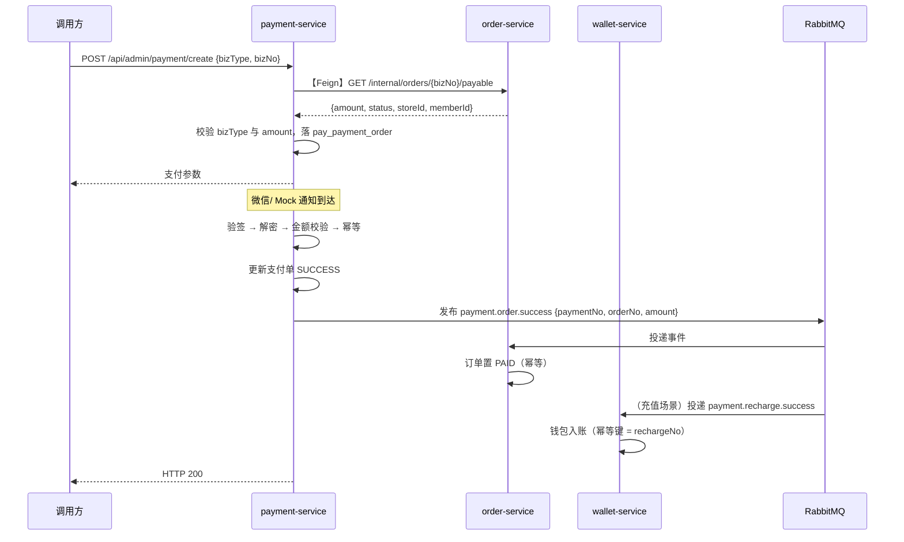
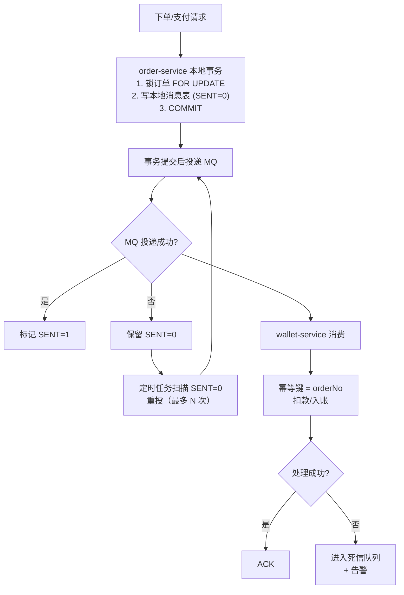

# TeaClub 服务边界定义

| 项目 | 内容 |
| --- | --- |
| 文档编号 | TC-MSA-03 |
| 版本 | v1.0 |
| 编制日期 | 2026-11-19 |
| 核心原则 | 每个服务拥有清晰独立职责；**每个数据只允许一个写入方** |
| 依据 | `CURRENT-PROJECT-AUDIT.md` 的实测依赖矩阵 |

---

## 1. 边界划分原则

| # | 原则 | 说明 |
| --- | --- | --- |
| P1 | 单一写入者 | 每张表只有一个服务可写 |
| P2 | 数据私有 | 服务不得直接访问其他服务的库 |
| P3 | 同步查询、异步变更 | 读用 Feign，写状态变更用事件 |
| P4 | 不为拆而拆 | 无独立业务语义的不拆 |
| P5 | 资金逻辑不变 | 拆分不得改变任何资金规则 |

---

## 2. 服务职责矩阵

| 能力 | gateway | auth | member | product | wallet | order | payment |
| --- | --- | --- | --- | --- | --- | --- | --- |
| 路由转发 | **W** | — | — | — | — | — | — |
| JWT 校验（第一道） | **W** | R | — | — | — | — | — |
| JWT 签发 | — | **W** | — | — | — | — | — |
| 用户/角色/权限 | — | **W** | — | — | — | — | — |
| 品牌/门店 | — | **W** | R | R | R | R | — |
| 门店数据权限 | — | **W** | R | R | R | R | — |
| 会员档案 | — | — | **W** | — | R | R | — |
| 会员等级 | — | — | **W** | — | R | R | — |
| 商品/价格 | — | — | — | **W** | — | R | — |
| 门店定价 | — | — | — | **W** | — | R | — |
| **钱包余额** | — | — | — | — | **W** | — | — |
| **资金流水** | — | — | — | — | **W** | — | — |
| **充值订单** | — | — | — | — | **W** | — | R |
| 订单与明细 | — | — | — | — | — | **W** | R |
| 订单金额计算 | — | — | — | R | — | **W** | — |
| **支付单** | — | — | — | — | — | — | **W** |
| **支付通知** | — | — | — | — | — | — | **W** |
| **退款单** | — | — | — | — | — | — | **W** |
| 订单状态更新 | — | — | — | — | — | **W** | I |
| 充值状态更新 | — | — | — | — | **W** | — | I |

**W = 拥有写权限 / R = 通过接口读取 / I = 通过事件间接影响**

---

## 3. 数据所有权（每张表唯一归属）

### 3.1 iam_db（auth-service）

| 表 | 说明 |
| --- | --- |
| `sys_brand` | 品牌 |
| `sys_store` | 门店 |
| `sys_user` | 后台账号 |
| `sys_role` | 角色 |
| `sys_permission` | 权限点 |
| `sys_user_role` | 用户角色关联 |
| `sys_role_permission` | 角色权限关联 |
| `sys_user_store` | 门店授权（数据权限核心） |
| `sys_operation_log` | 操作日志 |
| `sys_config` | 品牌配置 |

### 3.2 member_db（member-service）

| 表 | 说明 |
| --- | --- |
| `mem_member` | 会员档案 |
| `mem_member_level` | 会员等级 |
| `mem_member_tag` | 会员标签（空表） |
| `mem_member_tag_rel` | 标签关联（空表） |

### 3.3 product_db（product-service）

| 表 | 说明 |
| --- | --- |
| `prd_category` | 商品分类 |
| `prd_spu` | 商品 SPU |
| `prd_sku` | 商品 SKU |
| `prd_store_spu` | 门店上下架 |
| `prd_store_sku` | 门店差异化定价 |

### 3.4 wallet_db（wallet-service）★

| 表 | 说明 |
| --- | --- |
| `wal_wallet` | 会员钱包（双余额） |
| `wal_wallet_transaction` | 资金流水（不可篡改） |
| `wal_recharge_plan` | 充值方案 |
| `wal_recharge_plan_store` | 方案参与门店 |
| `wal_recharge_order` | 充值订单 |

### 3.5 order_db（order-service）

| 表 | 说明 |
| --- | --- |
| `oms_order` | 消费订单 |
| `oms_order_item` | 订单明细（商品快照） |
| `oms_order_status_log` | 状态流转日志 |

### 3.6 payment_db（payment-service）

| 表 | 说明 |
| --- | --- |
| `pay_payment_order` | 支付单 |
| `pay_notify_log` | 支付通知记录 |
| `pay_refund_order` | 退款单 |

### 3.7 本期不迁移的表

| 表 | 现状 | 处置 |
| --- | --- | --- |
| `sys_idempotency_record` | 空表、未被代码使用 | 不迁移，后续按需在各库新建 |
| `prd_inventory` | 空表、无 Entity | 划给 inventory_db（本期不建） |
| `flyway_schema_history` | 元表 | 每个库各自维护 |

---

## 4. 关键协作方案（解决现有耦合）

### 4.1 问题一：payment 直读 order / wallet 表

**现状代码**：

```java
// PaymentServiceImpl（违反数据所有权）
OmsOrder order = orderMapper.selectByNoForUpdate(orderNo);        // ❌ 直读 order_db
WalRechargeOrder rc = rechargeMapper.selectByNo(bizNo);           // ❌ 直读 wallet_db
orderService.processPaySuccess(...);                              // ❌ 跨域 Service 调用
```

**重构方案**：



**核心变化**：

| 项 | 迁移前 | 迁移后 |
| --- | --- | --- |
| 取金额 | 直读 order/wallet 表 | Feign 调内部接口 |
| 通知后业务处理 | 同步调用 OrderService / RechargeService | 发 MQ 事件 |
| 事务边界 | 单库大事务 | payment 本地事务 + 事件最终一致 |
| 金额校验 | 对本地字段比对 | 对 Feign 取回值比对（仍需逐分相等） |

### 4.2 问题二：订单支付要同时改订单与钱包（跨服务事务）

**方案：本地消息表 + 定时补偿（不用 Seata）**



**为什么不用 Seata**：本期只有 3 个服务参与资金链路，本地消息表 + 幂等已足够，
引入分布式事务框架会显著提高复杂度与运维成本。

**幂等保证**（保持现有设计）：

| 场景 | 幂等键 | 落库位置 |
| --- | --- | --- |
| 充值入账 | `rechargeNo` | `wal_wallet_transaction.uk_txn_biz` |
| 订单扣款 | `orderNo` | 同上 |
| 退款回冲 | `refundNo` | 同上 |
| 支付通知 | `notify_id` | `pay_notify_log.uk_notify_id` |

### 4.3 问题三：order 需要商品价格（原直读 4 张 product 表）

**方案**：product-service 提供批量算价接口

```java
// 新增内部接口（product-service）
POST /internal/products/quote
{
  "storeId": 1,
  "items": [ { "skuId": 1, "quantity": 2 }, { "skuId": 5, "quantity": 1 } ]
}
→ {
  "items": [
    { "skuId": 1, "spuId": 1, "spuName": "...", "skuName": "...",
      "unitPrice": 1750, "quantity": 2, "lineTotal": 3500 }
  ],
  "totalAmount": 3500
}
```

**约束**：价格必须由 product-service 返回，**order-service 不得自行推算或缓存过期价格**。
若需要缓存，必须带版本号或短 TTL（≤60s），下单时以实时查询为准。

### 4.4 问题四：member 服务需要门店信息

**方案**：member-service 调 auth-service 的 `GET /internal/stores/{id}`
仅用于展示"注册门店名称"，属**只读弱依赖**，auth 不可用时降级显示 null，不阻断业务。

### 4.5 问题五：wallet 需要会员与品牌信息

| 需求 | 方案 | 降级策略 |
| --- | --- | --- |
| 会员是否存在/是否冻结 | Feign `GET /internal/members/{id}` | **不可降级**，必须失败 |
| 品牌扣款顺序配置 | Feign `GET /internal/brands/{id}`，本地 Redis 缓存 5min | 缓存过期且服务不可用 → 默认 GIFT_FIRST 并告警 |
| 门店名称（展示） | Feign `GET /internal/stores/{id}` | 可降级为 null |

---

## 5. 内部接口规范

### 5.1 定义

| 项 | 规范 |
| --- | --- |
| 路径前缀 | `/internal/**` |
| 认证 | 服务间共享密钥 Header `X-Internal-Token`（Nacos 配置下发） |
| 网关暴露 | **不暴露**（Gateway 不配置 `/internal/**` 路由） |
| 返回格式 | 与现有 `Result<T>` 一致 |
| 幂等 | 写类内部接口必须支持幂等键 |
| 超时 | 读 2s / 写 5s |
| 重试 | 只对幂等读重试；写操作禁止自动重试 |

### 5.2 内部接口清单

| 提供方 | 接口 | 调用方 | 幂等 |
| --- | --- | --- | --- |
| auth | `GET /internal/stores/{id}` | member/product/wallet/order | 是 |
| auth | `GET /internal/brands/{id}` | wallet | 是 |
| auth | `GET /internal/users/{id}/store-scope` | gateway | 是 |
| member | `GET /internal/members/{id}` | order/wallet | 是 |
| member | `GET /internal/members/levels/{id}` | order/wallet | 是 |
| product | `POST /internal/products/quote` | order | 是（只读） |
| wallet | `POST /internal/wallet/consume` | order | **是（bizNo）** |
| wallet | `POST /internal/wallet/refund` | payment | **是（refundNo）** |
| wallet | `GET /internal/wallet/balance/{memberId}` | order | 是 |
| order | `GET /internal/orders/{orderNo}/payable` | payment | 是 |
| order | `GET /internal/orders/{orderNo}` | payment | 是 |

---

## 6. 事件规范

### 6.1 事件清单

| 事件 | 发布方 | 订阅方 | 载荷 |
| --- | --- | --- | --- |
| `payment.order.success` | payment | order | paymentNo, orderNo, amount, transactionId |
| `payment.recharge.success` | payment | wallet | paymentNo, rechargeNo, amount |
| `refund.order.success` | payment | order | refundNo, orderNo, refundAmount |
| `member.registered` | member | marketing（预留） | memberId, phone, registerStoreId |
| `store.status.changed` | auth | product/order | storeId, status |

### 6.2 事件契约

```json
{
  "eventId": "uuid",
  "eventType": "payment.order.success",
  "occurredAt": "2026-01-01T10:00:00+08:00",
  "version": 1,
  "traceId": "abc123",
  "payload": { }
}
```

**要求**：
- `eventId` 全局唯一，消费方以此为幂等键
- 消费失败进入死信队列并告警，**不静默丢弃**
- 事件只承载"已发生的事实"，不承载指令

---

## 7. 禁止事项（红线）

| # | 禁止 | 原因 |
| --- | --- | --- |
| X1 | 任何服务直连其他服务数据库 | 违反数据所有权 |
| X2 | Gateway 承载业务逻辑 | 网关不应有状态 |
| X3 | 绕过 WalletService 直接改钱包余额 | 破坏资金不变量 |
| X4 | 支付成功仅凭前端回调认定 | 必须服务端通知/查单确认 |
| X5 | 新旧系统同时写同一份资金数据 | 双写必然不一致 |
| X6 | 用 MQ 事件替代强一致校验金额 | 金额必须同步校验 |
| X7 | 为拆分而改变资金规则（扣款顺序、退款构成） | 业务逻辑必须保持 |
| X8 | 内部接口暴露到 Gateway | 安全边界 |
