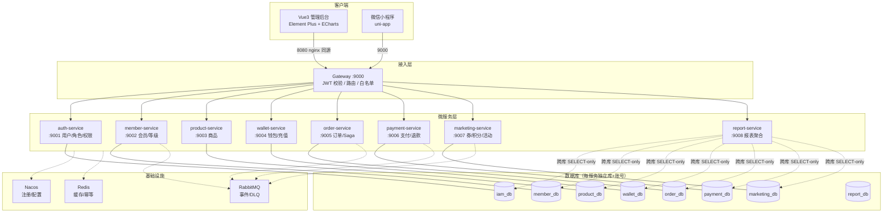
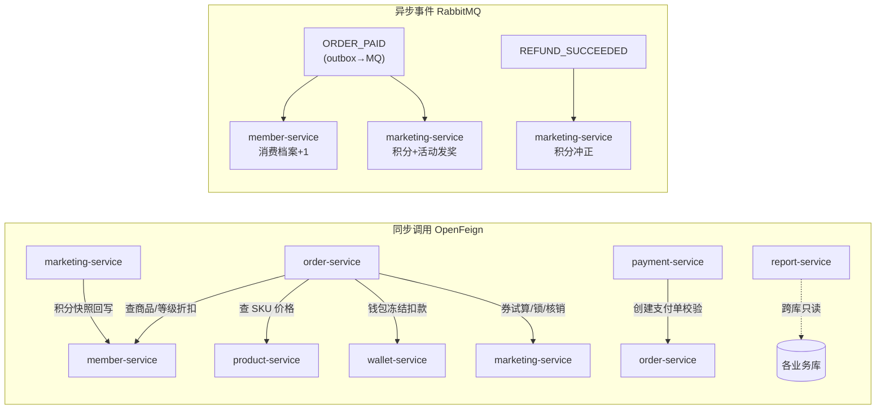
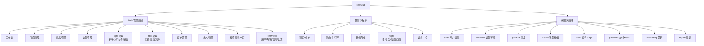
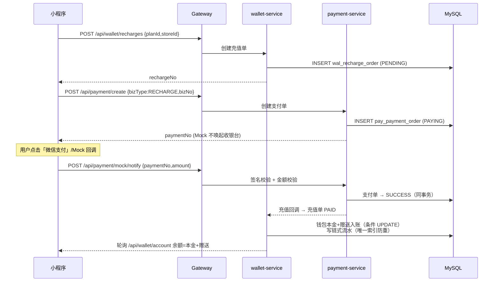
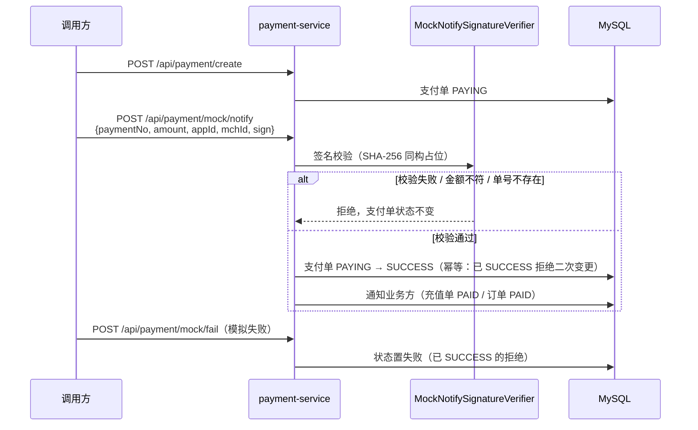
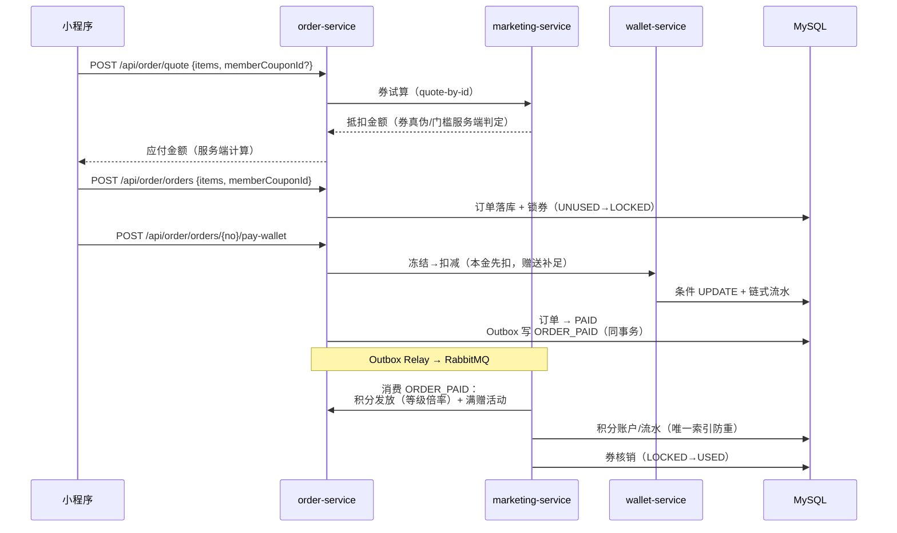
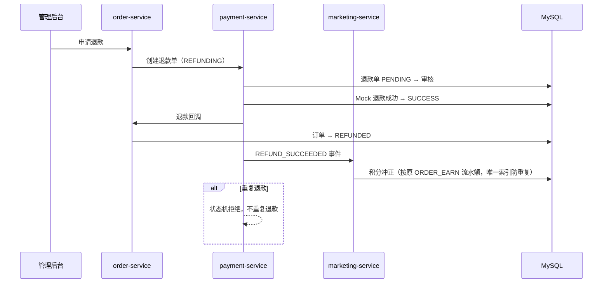
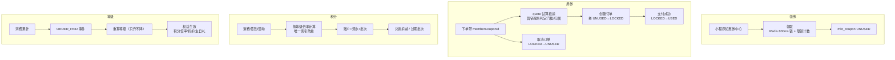
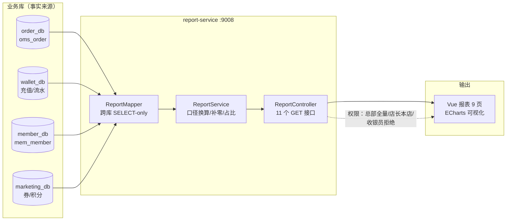

# TeaClub 系统设计图（Mermaid）

> 所有图均为 Mermaid 格式，可在 GitHub / Typora / VS Code 插件中直接渲染。

---

## 1. 系统总体架构图

---

## 2. 微服务架构图（服务间调用关系）

---

## 3. 功能模块结构图

---

## 4. 数据库 E-R 图（核心业务）

```mermaid
erDiagram
    sys_user ||--o{ sys_user_role : "拥有"
    sys_role ||--o{ sys_role_permission : "授权"
    sys_permission ||--o{ sys_permission : "父子"
    sys_user ||--o{ sys_user_store : "绑定门店"
    sys_store ||--o{ sys_user_store : "包含"

    mem_member }o--|| mem_member_level : "属于等级"
    mem_member ||--o{ mem_member_wx : "微信绑定"
    mem_member ||--o{ wal_wallet : "拥有钱包"
    wal_wallet ||--o{ wal_wallet_transaction : "产生流水"
    wal_wallet ||--o{ wal_wallet_freeze : "冻结记录"
    wal_recharge_plan ||--o{ wal_recharge_order : "套餐"
    wal_wallet ||--o{ wal_recharge_order : "充值"

    mem_member ||--o{ oms_order : "下单"
    sys_store ||--o{ oms_order : "门店"
    oms_order ||--|{ oms_order_item : "明细"
    oms_order ||--o{ oms_order_status_log : "状态日志"
    oms_order ||--o| oms_payment_saga : "Saga"
    oms_order }o--|| pay_payment_order : "支付单"

    pay_payment_order ||--o{ pay_refund_order : "退款"
    pay_payment_order ||--o{ pay_notify_log : "回调日志"

    mem_member ||--o{ mkt_coupon : "持有券"
    mkt_coupon_template ||--o{ mkt_coupon : "发行"
    mkt_coupon_template ||--o{ mkt_coupon_template_store : "适用门店"
    mem_member ||--o{ mkt_points_account : "积分账户"
    mkt_points_account ||--o{ mkt_points_transaction : "积分流水"
    mem_member ||--o{ mkt_sign_in : "签到"
    mkt_activity ||--o{ mkt_activity_record : "参与记录"
    mkt_level_benefit }o--|| mem_member_level : "等级权益"
```

---

## 5. 会员充值流程图

---

## 6. Mock 支付流程图

---

## 7. 钱包消费流程图

---

## 8. 订单退款流程图

---

## 9. 会员营销流程图

---

## 10. 经营报表数据流程图

---

## 使用说明

- 在 VS Code 安装「Markdown Preview Mermaid Support」插件即可预览渲染；
- GitHub / Gitee 网页端原生支持 Mermaid 渲染；
- 导出图片：Typora → 文件 → 导出 → 图片，或用 mermaid-cli（`mmdc -i 输入.md -o 输出.png`）。
